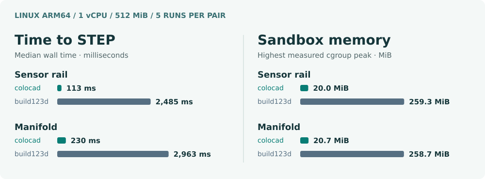

# colocad

[中文说明](README.zh-CN.md) · [npm package](https://www.npmjs.com/package/@coloopx/colocad) · [Download the offline comparison](https://github.com/Coloopx/colocad/raw/refs/heads/main/docs/benchmarks/comparison.html)

Generate a mechanical part from a JSON feature tree, export an exact STEP solid, and give an agent a PNG or 3D preview to inspect. **The npm package ships the compiled Rust CAD kernel.** The agent and harness call it locally in the same sandbox through the Node CLI or TypeScript API. No Python, Rust toolchain, network or separate service is required to build a part after installation.

On the two parts below, the published CLI delivered STEP in **113–230 ms** on **1 vCPU / 512 MiB**, compared with **2.49–2.96 s** for a fresh build123d process. Both backends produced valid solids. The advantage is largest when an agent starts a fresh tool call; the manifold’s geometry phase alone was faster in build123d.


Each backend modeled the part from the same parameters. The images use the exported STEPs, the same mesher and camera. OCCT reopened each file as **one valid solid**. Both rail exports had 22 faces and 56 edges; both manifold exports had 27 faces and 54 edges. The two directional boolean differences measured **0 mm³** in both cases (boolean tolerance: 0.000001 mm). [Geometry checks](docs/benchmarks/step-checks.json)

## Performance in a small sandbox



| Part | Time to STEP: colocad / build123d | Speedup | Peak sandbox memory: colocad / build123d | Geometry only: colocad / build123d |
| :--- | ---: | ---: | ---: | ---: |
| [Sensor rail](examples/sensor-rail.json) | 113 / 2,485 ms | **22.0×** | 20.0 / 259.3 MiB | 26.9 / 41.1 ms |
| [Port manifold](examples/manifold.json) | 230 / 2,963 ms | **12.9×** | 20.7 / 258.7 MiB | 53.7 / 43.8 ms |

**What was timed:** published colocad 0.1.0-alpha.2 (Node + its Rust executable) versus build123d 0.11.1 / OCCT. Each arm got the same offline Linux arm64 container limits and input. One excluded warm-up, then five alternating fresh runs per part and backend; all 20 measured calls succeeded. Time is the median from process launch to exit after STEP export. Memory is the largest measured whole-container cgroup peak, including charged file pages and output. Package installation, container launch, agent inference and rendering are excluded.

Python import alone took a median **2.01 s** for the rail and **2.45 s** for the manifold. A long-lived Python interpreter can amortize that cost. These results apply to this tool-call pattern and these fixtures; they do not establish a universal geometry-kernel speedup. [Every run](docs/benchmarks/runs.json) · [Method and reproduction](benchmarks/readme/README.md)

### When the agent only changes the camera

The first preview saves a display mesh. For a second view of unchanged geometry, the kernel SDK can load that mesh instead of rebuilding the solid or triangulating it again. Here are five-run medians for the same **top view**, comparing two paths inside colocad:

| Part | Rebuild part + render | Render from saved mesh | Speedup |
| :--- | ---: | ---: | ---: |
| Sensor rail | 108.8 ms | 19.4 ms | **5.6×** |
| Port manifold | 223.8 ms | 13.3 ms | **16.8×** |

The PNG, GLB and STL from both paths matched byte for byte on every pair. This test starts with the SDK already loaded and includes native process startup and display output. A geometry edit needs a new revision. [Preview measurements and hashes](docs/benchmarks/preview-runs.json)

## What ships

| In the [npm tarball](https://www.npmjs.com/package/@coloopx/colocad) | In the [source repository](https://github.com/Coloopx/colocad) |
| :--- | :--- |
| CLI, JavaScript API, TypeScript declarations and precompiled Rust executables for **Linux x64, Linux arm64 and macOS arm64**. Node.js 22+. | [Rust CAD source](crates/agent-cad/src), [TypeScript kernel SDK](kernel/src), [feature compiler](src/tree.mjs), tests and [pinned SolidCore dependency](third_party/solidcore.lock.json). |

For example, on Linux arm64 the CLI launches `node_modules/@coloopx/colocad/kernel/native/linux-arm64/agent-cad`. The tarball contains the executable; the Rust `.rs` files are in the repository.

**Alpha status.** Linux supports parametric edits, STEP and PNG/GLB/STL export. Direct generation of a complex, editable SOLIDWORKS part on Linux is still experimental. The optional Windows author compiles against the SOLIDWORKS 2024 interop API; a licensed native rebuild has not been verified. See the [native author](#native-solidworks-author-experimental) and [validation notes](docs/validation.md).

## Run the examples

```sh
npm install @coloopx/colocad@alpha
npx colocad build node_modules/@coloopx/colocad/examples/manifold.json ./manifold --preview
npx colocad build node_modules/@coloopx/colocad/examples/sensor-rail.json ./rail
```

The manifold contains a six-sided extrusion, a blind circular cut, an upper-rim fillet, a four-instance pattern referencing the earlier cut, and a rectangular pocket. The sensor rail uses a different sketch, feature order and pattern direction. Both run through the same compiler. The pattern count includes the seed.

Each call requires a new output directory. The `part/` subdirectory holds `model.step`, `feature-tree.json`, a kernel report, and `native-job.json`. With `--preview` it also contains PNG, STL and GLB files. The native job stores the ordered feature definitions, resolved inputs and reference geometry measurements.

```js
import { readFile } from 'node:fs/promises';
import { build } from '@coloopx/colocad';

const tree = JSON.parse(await readFile('./node_modules/@coloopx/colocad/examples/manifold.json', 'utf8'));
await build(tree, './original');
tree.parameters.instances = 3;
const edited = await build(tree, './edited');
console.log(edited.geometry.volume_mm3);
```

All coordinates and lengths are in mm. The first extrusion creates a solid. Further extrusions add material and cuts remove material along +Z from a sketch at `startZ` (default 0). Profiles can be rectangles, circles or polygons. Fillets select edges on a specified Z plane and require the declared match count. A linear pattern refers to an earlier extrusion or cut by ID, with X/Y direction, positive pitch and instance count. IDs are unique, case-insensitively. A scalar is a finite number or a reference such as `{"param":"thickness"}`. The public TypeScript declaration defines the full input.

The kernel API at `@coloopx/colocad/kernel` also exposes the lower-level geometry operations, STEP import, incremental revisions and preview cache. The npm tarball includes Linux arm64/x64 and macOS arm64 executables and dependency licenses. The checked-in sources build the kernel on supported toolchains.

## Native SOLIDWORKS author (experimental)

The Windows entry point consumes the same job. It starts a blank part using the application's configured default, builds sketches with native lines and circles, calls extrusion/cut/fillet/pattern APIs and names the resulting features. The fillet uses body edges and the native pattern selects the original seed feature. There are no part-specific model files. Running it requires local Windows, .NET 8 and a licensed SOLIDWORKS installation with a valid default blank part configuration.

```powershell
colocad solidworks .\manifold\part\native-job.json .\manifold.SLDPRT
```

Use `COLOCAD_SW_INTEROP` for an alternate directory containing the local SOLIDWORKS interop DLLs. The completion check is designed to save a temporary part, reopen it, verify native types, radius, pattern seed, count, pitch and reference volume, then edit a driving extrusion dimension, rebuild, restore and check it. Only a successful check publishes the output. The current release has **no native runtime pass** for either complex part. The package includes no four-hole template and does not route jobs to another machine.

## Build and verify from source

```sh
npm run build:kernel
npm test
node bin/colocad.mjs build examples/manifold.json ./out/manifold --preview
```

The first command fetches the pinned SolidCore archive, checks its SHA-256 and builds the local Rust executable. The plain Node tests use the local executable or `AGENT_CAD_BINARY`. The repository includes the TypeScript kernel SDK source and its compiled distribution. To rebuild the .NET author, build `solidworks/Colocad.SolidWorks.csproj` with a .NET 8 SDK and `-p:SWInteropDir=<directory containing the two SOLIDWORKS interop DLLs>`. Copy only Colocad.SolidWorks.dll, its deps.json and runtimeconfig.json to solidworks/managed.

Independent OCCT validation is in `test/validation/geometry.py`. It reopens the STEP and checks both volume and whether selected points lie inside the plate, the holes, the recess or the fillet. The measured results and the limits of the native experiment are in [the validation notes](docs/validation.md).
