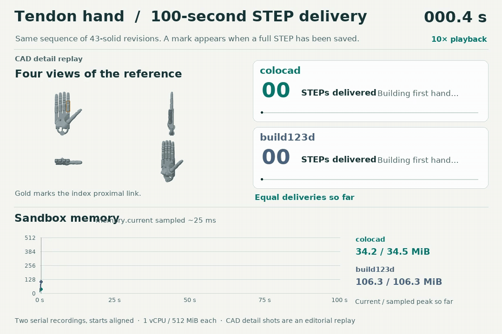
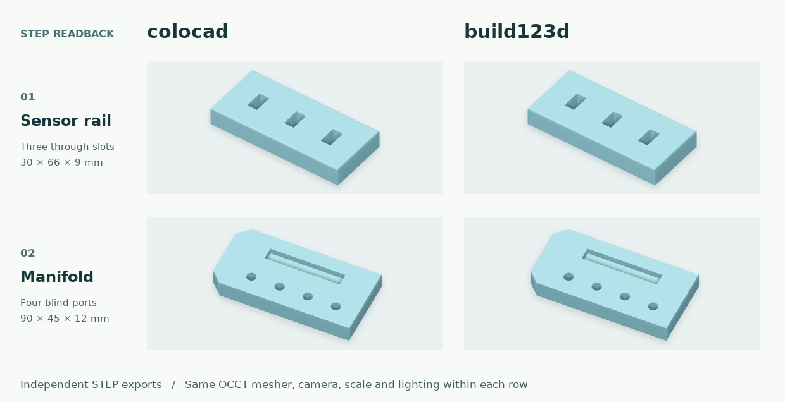

# colocad

[中文说明](README.zh-CN.md) · [npm package](https://www.npmjs.com/package/@coloopx/colocad) · [Download the offline comparison](https://github.com/Coloopx/colocad/raw/refs/heads/main/docs/benchmarks/comparison.html)

Generate a mechanical part from a JSON feature tree, export an exact STEP solid, and give an agent a PNG or 3D preview to inspect. **The npm package ships the compiled Rust CAD kernel.** The agent and harness call it locally in the same sandbox through the Node CLI or TypeScript API. No Python, Rust toolchain, network or separate service is required to build a part after installation.

## How many tendon hands can an agent deliver in 100 seconds?

**colocad delivered 44 complete revisions to build123d’s 33, an increase of 11 hands (33.3%).** Both arms rebuilt and assembled the same 43-solid hand at each revision and handed off a STEP file. Each mark is a measured handoff. The synchronized traces show whole-sandbox memory.



| Same revision queue, 1 vCPU / 512 MiB | Optimized colocad | build123d |
|---|---:|---:|
| Complete hands delivered in 100 s | **44** | 33 |
| First STEP | **2.223 s** | 3.010 s |
| Median job time on the same first 33 inputs | **2.234 s** | 2.855 s |
| Highest sampled cgroup memory over the 100 s window | **130.9 MiB** | 304.9 MiB |

One measured window per backend, with a new CAD process for each revision. The colocad arm uses the alpha.2 SDK with the optimized source kernel. Memory samples taken about every 25 ms include subprocesses, tmpfs and charged file cache. Every counted STEP reopened successfully. The 10-second replay includes the four views, booleans, bore edit, tessellation and assembly. [MP4](https://github.com/Coloopx/colocad/raw/refs/heads/main/showcase/tendon-hand/window/hand-window-en.mp4) · [Method and raw data](showcase/tendon-hand/window/README.md) · [Detailed build and single-call replay](showcase/tendon-hand/assembly-performance.md)

The static scorecard below uses the **published alpha.2 binary**. With fresh tool processes the sensor rail and manifold reached STEP 22.0× and 12.9× faster than build123d, using 7.7% and 8.0% of its peak memory.

<details>
<summary>See the static comparison across four workloads</summary>


</details>

| Deliverable | Time to STEP: colocad / build123d | Speedup¹ | Peak memory: colocad / build123d | Share of build123d peak |
| :--- | ---: | ---: | ---: | ---: |
| Sensor rail | 113 / 2,485 ms | **22.0×** | 20.0 / 259.3 MiB | **7.7%** |
| Port manifold | 230 / 2,963 ms | **12.9×** | 20.7 / 258.7 MiB | **8.0%** |
| Tendon-hand proximal link | 259 / 2,244 ms | **8.6×** | 21.4 / 260.1 MiB | **8.2%** |
| Complete 43-solid hand | 3,952 / 3,293 ms | **0.83×** | 52.7 / 271.3 MiB | **19.4%** |

¹ build123d time divided by colocad time from unrounded observations. Same Linux arm64 image, 1 vCPU, 512 MiB. Five fresh processes and cgroups per part and backend after warm-up. Time is the median wall clock including startup, imports, modeling, backend checks and STEP export. Memory is the maximum measured cgroup peak; charged pages, temporary outputs and tool descendants count. Installation, container startup, previews, inference and a resident agent are excluded.

[Rail/manifold samples](docs/benchmarks/runs.json) · [Finger/hand samples](showcase/tendon-hand/evidence/scope.json) · [Four-view hand study and CAD downloads](showcase/tendon-hand/README.md) · [Offline scorecard](https://github.com/Coloopx/colocad/raw/refs/heads/main/docs/benchmarks/time-to-step.html)

**Historical alpha.2 result.** in a separate 100-second sweep of complete hand revisions, colocad delivered 24 STEPs to build123d’s 30. Every counted file reopened as a valid 43-solid assembly. [Timestamped outputs and paired geometry checks](showcase/tendon-hand/evidence/window.json)

## SDK, CLI or skill?

- **In an application or harness:** call `build(tree, newDir, { preview: true })` in the SDK. Use `CadClient.build(model)` for named multi-solid assemblies.
- **In a shell or agent tool call:** install `npm install @coloopx/colocad@0.1.0-alpha.2`. Run `./node_modules/.bin/colocad plan tree.json`, then `./node_modules/.bin/colocad build tree.json ./new-part --preview`. Open `new-part/part/model.step`.
- **From drawings with an agent:** install the [colocad skill](skills/colocad/SKILL.md). Start the next turn with “Use `$colocad` to reconstruct these four views, export STEP, and flag any internal details you inferred.” [Installation and assembly replay](showcase/tendon-hand/README.md#try-it-with-your-agent).

## What the two STEP writers produced



Each backend modeled the part from the same parameters. The images use the exported STEPs, the same mesher and camera. OCCT reopened each file as **one valid solid**. Both rail exports had 22 faces and 56 edges; both manifold exports had 27 faces and 54 edges. The two directional boolean differences measured **0 mm³** in both cases (boolean tolerance: 0.000001 mm). [Geometry checks](docs/benchmarks/step-checks.json)

On the manifold, build123d’s modeling phase alone was **43.8 ms** to colocad’s **53.7 ms**, while build123d import alone took **2.45 s**. The table measures a fresh tool call, not the speed of an isolated boolean operation. [Stage timings and reproduction](benchmarks/readme/README.md)

### When the agent only changes the camera

The first preview saves a display mesh. For a second view of unchanged geometry, the kernel SDK can load that mesh instead of rebuilding the solid or triangulating it again. Here are five-run medians for the same **top view**, comparing two paths inside colocad:

| Part | Rebuild part + render | Render from saved mesh | Speedup |
| :--- | ---: | ---: | ---: |
| Sensor rail | 108.8 ms | 19.4 ms | **5.6×** |
| Port manifold | 223.8 ms | 13.3 ms | **16.8×** |

The PNG, GLB and STL from both paths matched byte for byte on every pair. This test starts with the SDK already loaded and includes native process startup and display output. A geometry edit needs a new revision. [Preview measurements and hashes](docs/benchmarks/preview-runs.json)

## What ships

| In the [npm tarball](https://www.npmjs.com/package/@coloopx/colocad) | In the [source repository](https://github.com/Coloopx/colocad) |
| :--- | :--- |
| CLI, JavaScript API, TypeScript declarations and precompiled Rust executables for **Linux x64, Linux arm64 and macOS arm64**. Node.js 22+. | [Rust CAD source](crates/agent-cad/src), [TypeScript kernel SDK](kernel/src), [feature compiler](src/tree.mjs), tests and [pinned SolidCore dependency](third_party/solidcore.lock.json). |

For example, on Linux arm64 the CLI launches `node_modules/@coloopx/colocad/kernel/native/linux-arm64/agent-cad`. The tarball contains the executable; the Rust `.rs` files are in the repository.

**Alpha status.** Linux supports parametric edits, STEP and PNG/GLB/STL export. Direct generation of a complex, editable SOLIDWORKS part on Linux is still experimental. The optional Windows author compiles against the SOLIDWORKS 2024 interop API; a licensed native rebuild has not been verified. See the [native author](#native-solidworks-author-experimental) and [validation notes](docs/validation.md).

## Run the examples

```sh
npm install @coloopx/colocad@alpha
npx colocad build node_modules/@coloopx/colocad/examples/manifold.json ./manifold --preview
npx colocad build node_modules/@coloopx/colocad/examples/sensor-rail.json ./rail
```

The manifold contains a six-sided extrusion, a blind circular cut, an upper-rim fillet, a four-instance pattern referencing the earlier cut, and a rectangular pocket. The sensor rail uses a different sketch, feature order and pattern direction. Both run through the same compiler. The pattern count includes the seed.

Each call requires a new output directory. The `part/` subdirectory holds `model.step`, `feature-tree.json`, a kernel report, and `native-job.json`. With `--preview` it also contains PNG, STL and GLB files. The native job stores the ordered feature definitions, resolved inputs and reference geometry measurements.

```js
import { readFile } from 'node:fs/promises';
import { build } from '@coloopx/colocad';

const tree = JSON.parse(await readFile('./node_modules/@coloopx/colocad/examples/manifold.json', 'utf8'));
await build(tree, './original');
tree.parameters.instances = 3;
const edited = await build(tree, './edited');
console.log(edited.geometry.volume_mm3);
```

All coordinates and lengths are in mm. The first extrusion creates a solid. Further extrusions add material and cuts remove material along +Z from a sketch at `startZ` (default 0). Profiles can be rectangles, circles or polygons. Fillets select edges on a specified Z plane and require the declared match count. A linear pattern refers to an earlier extrusion or cut by ID, with X/Y direction, positive pitch and instance count. IDs are unique, case-insensitively. A scalar is a finite number or a reference such as `{"param":"thickness"}`. The public TypeScript declaration defines the full input.

The kernel API at `@coloopx/colocad/kernel` also exposes the lower-level geometry operations, STEP import, incremental revisions and preview cache. The npm tarball includes Linux arm64/x64 and macOS arm64 executables and dependency licenses. The checked-in sources build the kernel on supported toolchains.

## Native SOLIDWORKS author (experimental)

The Windows entry point consumes the same job. It starts a blank part using the application's configured default, builds sketches with native lines and circles, calls extrusion/cut/fillet/pattern APIs and names the resulting features. The fillet uses body edges and the native pattern selects the original seed feature. There are no part-specific model files. Running it requires local Windows, .NET 8 and a licensed SOLIDWORKS installation with a valid default blank part configuration.

```powershell
colocad solidworks .\manifold\part\native-job.json .\manifold.SLDPRT
```

Use `COLOCAD_SW_INTEROP` for an alternate directory containing the local SOLIDWORKS interop DLLs. The completion check is designed to save a temporary part, reopen it, verify native types, radius, pattern seed, count, pitch and reference volume, then edit a driving extrusion dimension, rebuild, restore and check it. Only a successful check publishes the output. The current release has **no native runtime pass** for either complex part. The package includes no four-hole template and does not route jobs to another machine.

## Build and verify from source

```sh
npm run build:kernel
npm test
node bin/colocad.mjs build examples/manifold.json ./out/manifold --preview
```

The first command fetches the pinned SolidCore archive, checks its SHA-256 and builds the local Rust executable. The plain Node tests use the local executable or `AGENT_CAD_BINARY`. The repository includes the TypeScript kernel SDK source and its compiled distribution. To rebuild the .NET author, build `solidworks/Colocad.SolidWorks.csproj` with a .NET 8 SDK and `-p:SWInteropDir=<directory containing the two SOLIDWORKS interop DLLs>`. Copy only Colocad.SolidWorks.dll, its deps.json and runtimeconfig.json to solidworks/managed.

Independent OCCT validation is in `test/validation/geometry.py`. It reopens the STEP and checks both volume and whether selected points lie inside the plate, the holes, the recess or the fillet. The measured results and the limits of the native experiment are in [the validation notes](docs/validation.md).
