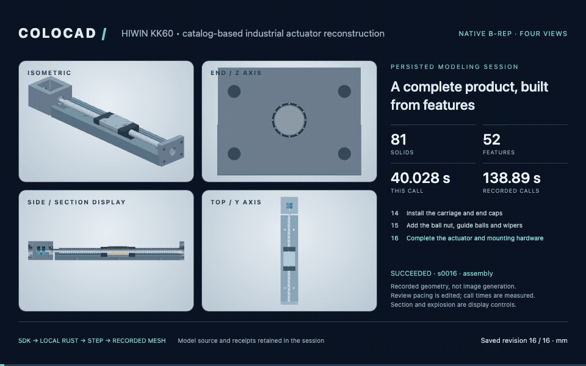
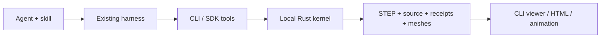
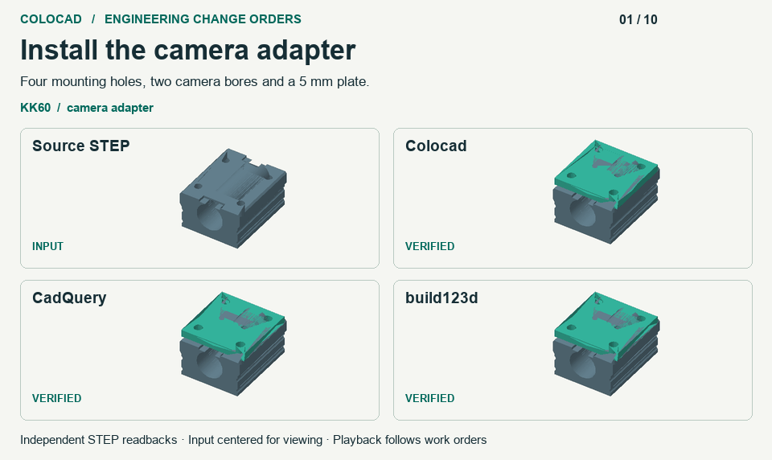
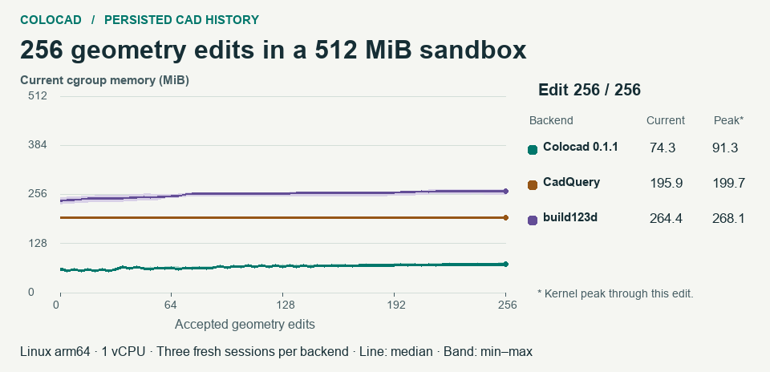
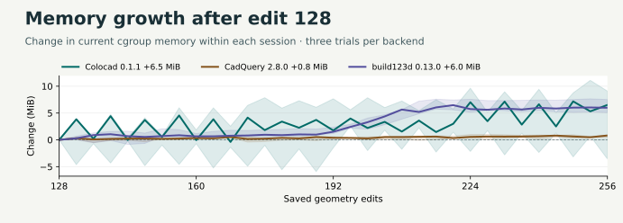
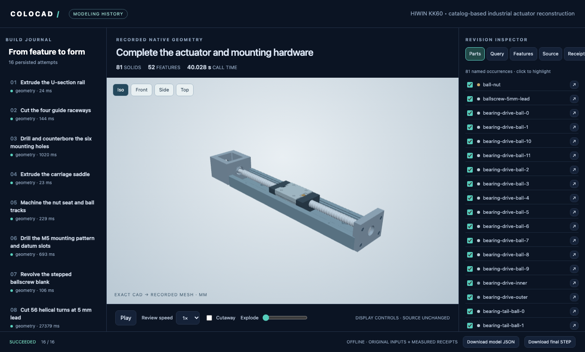
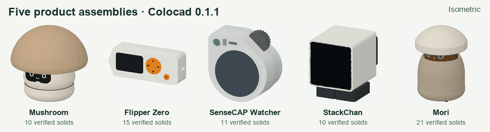
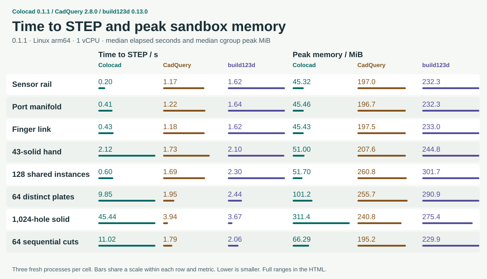
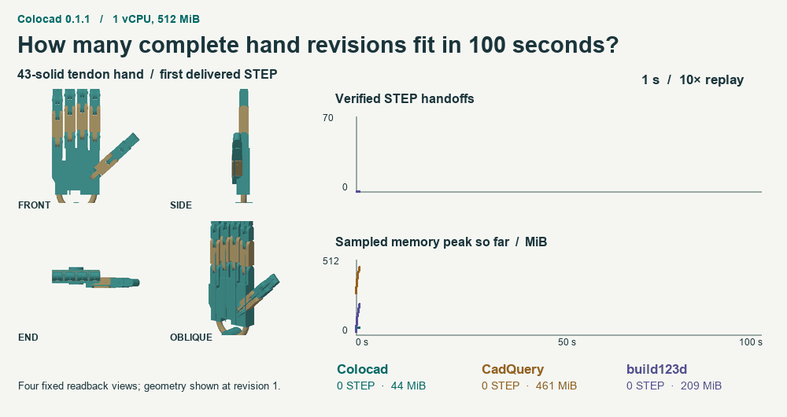

# Colocad



**Parametric CAD for agents. Local Rust geometry, a TypeScript SDK, a CLI, and an inspectable modeling history.**

[中文](README.zh-CN.md) · [Documentation](docs/README.md) · [npm](https://www.npmjs.com/package/@coloopx/colocad) · [Changelog](CHANGELOG.md) · [Releases](https://github.com/Coloopx/colocad/releases) · [Model behind the cover](examples/hiwin-kk60/README.md)

Colocad turns explicit modeling instructions into editable source, exact STEP geometry and visual review artifacts. It runs alongside the agent and its harness **inside the same sandbox**. The npm package includes the compiled Rust kernel; installed modeling needs no Python, Rust toolchain, network or separate CAD service.

**[Colocad 0.1.1](https://github.com/Coloopx/colocad/releases/tag/v0.1.1)** had the lowest sandbox peak in 22/23 mechanical cases. Saving 256 geometry edits to a KK60 assembly used a median peak of **91.3 MiB** across three independent sessions. [Memory by revision](#memory-over-256-saved-revisions) · [Three-backend mechanical cases](#mechanical-workloads-on-linux) · [Five product models](#five-product-appearance-models).

## What you can build

- **Parts and assemblies:** parametric features, repeated part definitions, exact STEP and PNG/GLB/STL previews.
- **Engineering queries:** exact topology, composable selection, datums, holes/groups, mounting interfaces and measured assembly relationships. [Supported domains](docs/engineering-queries.md).
- **Agent workflows:** SDK tools and a bundled skill for interpreting dimensions, planning features, editing and checking results.
- **Human review:** persistent build attempts, source/receipt inspection, offline single-file HTML and four-view MP4/GIF replay.

The SDK is the foundation; the CLI and tool adapters expose it to your harness; the skill guides modeling decisions. Images and drawings are evidence the agent interprets. Colocad executes explicit geometry instructions.



## Install

Requires **Node.js 22+** on **Linux x64, Linux arm64 or macOS arm64**.

```sh
npm install @coloopx/colocad
```

The npm `latest` tag points to `0.1.1`. To pin it, run `npm install --save-exact @coloopx/colocad@0.1.1`. The release check installed from the public registry and exported the manifold with the CLI. OCCT reopened one valid 90 × 45 × 12 mm solid. [Installation and STEP readback](https://github.com/Coloopx/colocad/releases/download/v0.1.1/registry-proof.json).

The package ships JS/TS APIs, the CLI, native executables, viewer and complete skill. Rust source is in [crates/agent-cad](crates/agent-cad); the npm tarball contains compiled binaries. [Package and model formats](docs/concepts.md).

## Quick start

Run these commands from your Node project:

```sh
# Build the packaged manifold and save its source, receipt and geometry.
npx colocad record node_modules/@coloopx/colocad/examples/manifold.json ./history \
  --label "Build the manifold"

# Launch the interactive viewer.
npx colocad view ./history

# Export one offline HTML file, including a final STEP download.
npx colocad replay ./history ./review.html
```

The manifold includes an extrusion, blind cut, fillet, linear pattern and pocket. Record an edited JSON into the same history directory to append a revision; failed attempts remain visible. `view` serves a snapshot, so reopen it after adding revisions. [First part and parameter edit](docs/getting-started.md).

Prefer an API? Use the same kernel through a persistent session:

```js
import { ModelingSession } from '@coloopx/colocad/session';

const session = await ModelingSession.create('./sdk-history');
const result = await session.build({
  version: 1, units: 'mm', parameters: { length: 60 },
  features: [{ id: 'stock', op: 'box', origin: [0, 0, 0],
    size: [{ param: 'length' }, 30, 8] }],
  output: 'stock',
});
if (!result.ok) throw new Error(JSON.stringify(result.error));
await session.edit({ length: 80 });
```

Use `CadClient` for direct builds without session recording. [SDK, CLI and tool API](docs/api.md).

## Engineering change orders

Give each backend the same source STEP. Resize the KK60 camera plate, cut a cable window and remount it after the saddle moves. Then install a keyed motor flange from rotated coordinates and reject parts with a missing hole or the wrong pitch.



**Colocad, CadQuery and build123d each delivered seven valid assemblies and rejected all three incompatible inputs.** Colocad exposes parameter edits, revision history and exact snapshot queries through the same SDK and CLI. In the history test, six earlier camera pitches were measured from saved native snapshots with zero geometry rebuilds. The Python adapters reopened six saved STEPs for the same measurements. Colocad used an exact circular-edge query where high-level blind-hole recognition on the imported saddle was partial. [Work orders, checks and limits](docs/benchmark-stable.md).

## Memory over 256 saved revisions

Each edit changes the KK60 camera plate thickness or pitch and saves editable source, an exact STEP and a mesh preview. Each backend ran three sessions in rotated order on fresh Linux volumes with one CPU, 512 MiB and zero swap. **All 2,304 edited STEPs passed independent readback.**



| Workflow | Peak MiB (median, range) | Current at edit 128 (MiB) | Current at edit 256 (MiB) | Last 128 edits (Δ MiB) |
|---|---:|---:|---:|---:|
| Colocad 0.1.1 | **91.3** (91.0–91.4) | 68.3 | 74.3 | +6.5 |
| CadQuery 2.8.0 | **199.7** (199.6–200.3) | 195.5 | 195.9 | +0.8 |
| build123d 0.13.0 | **268.1** (261.2–272.1) | 258.4 | 264.4 | +6.0 |

Lines show post-commit cgroup memory. Shading spans the three trials. The kernel peak also captures allocations between saves. Late growth is the median paired change within a session. The Python adapters sync files and SQLite history. Colocad also retains native checkpoints and query snapshots. [Per-revision evidence and cache conditions](docs/benchmark-stable.md).

The Colocad session peak was 54% below CadQuery and 66% below build123d. CadQuery 2.8.0 had the smallest paired change from edit 128 to 256 (+0.8 MiB). These 256 edits measure growth over this interval. They do not establish an asymptotic memory bound.



The development CLI archives displaced geometry in segments. The same KK60 session retains 42 files across seven directories. [Matched 0.1.1 comparison, commit latency and historical readback](docs/benchmark-segmented-sessions.md).

## Sculpted housings and external meshes

Build a smooth landmark loft, offset the shell, import a scanned exterior and place exact STEP hardware in the same local job. Instance colours appear in the GLB and offline viewer. Each interference check records the method and measured overlap volume. [Hybrid operations and exchange formats](docs/hybrid.md)

```sh
npx colocad build node_modules/@coloopx/colocad/examples/hybrid-enclosure/model.json ./housing-build
```

## Visualize and export from the CLI



Inspect the timeline, source, features, receipts and selected parts. Switch cameras, show display sections or explosion, and download artifacts. The offline HTML embeds its rendering code and geometry. Hosts can also embed `@coloopx/colocad/viewer`.

| Command | Input | Result |
| --- | --- | --- |
| `colocad plan TREE.json` | `colocad/1` feature tree | Compile and inspect a native job |
| `colocad build TREE.json NEW_DIR --preview` | Feature tree | STEP, editable source and previews |
| `colocad record MODEL.json SESSION` | Feature tree or kernel JSON | Build and persist a milestone |
| `colocad view SESSION` | Saved session | Interactive local viewer |
| `colocad replay SESSION review.html` | Saved session | Self-contained offline HTML |
| `colocad render SESSION modeling.mp4` | Saved session | Four-view animation; `.gif` also supported |

Use `colocad head SESSION` to get the accepted query revision, `colocad inspect SESSION REQUEST.json` to record exact measurements, and `colocad edit SESSION PARAMETERS.json` to rebuild after a parameter change. The four-hole plate example exercises all three. [Plate workflow](skills/colocad/references/modeling-loop.md#inspect-and-edit-from-a-shell).

In a headless sandbox, use `colocad view ./history --no-open --port 8787` with the harness's port forwarding; the listener binds to `127.0.0.1`.

```sh
# Optional movie dependencies; install FFmpeg on the host as well.
npm install -D playwright
npx playwright install chromium
npx colocad render ./history ./modeling.mp4 --width 1280 --height 800 --fps 15
```

Movies replay **actual saved revisions**. Recorded call times and edited playback duration are separate. Building geometry and exporting HTML do not need Chromium or FFmpeg. [History, viewer and rendering guide](docs/modeling-history.md).

## Use with your agent

Copy the whole skill, including its references, scripts and editable shape assets:

```sh
# Codex project skill; use .claude/skills for Claude Code.
mkdir -p .agents/skills
cp -R node_modules/@coloopx/colocad/skills/colocad .agents/skills/colocad
```

If that skill already exists, preserve local customizations before updating it. Then ask:

> Use the colocad skill to build a 100 × 50 × 6 mm plate with a centered 3 × 2 grid of Ø6 through-holes on 32 × 30 mm pitches. Keep editable source and modeling history, verify the dimensions, and export STEP and an offline HTML review through the CLI.

| Harness | Integration |
| --- | --- |
| Codex | [Project skill and CLI](docs/integrations/codex.md) |
| Claude Code | [Project skill and local tools](docs/integrations/claude-code.md) |
| Pi core / coding agent | [Typed tool adapter and extension](docs/integrations/pi.md) |
| Your own harness | [SDK schemas, state and artifact lifecycle](docs/integrations/overview.md) |

The [end-to-end handbook](docs/agent-modeling-handbook.md) covers source preparation, dimension uncertainty, tool abstraction, prompts, modeling loops, validation and tuning. A [runnable guided workflow](examples/integrations/README.md) demonstrates real builds, quantitative edits and recovery; its decisions are scripted, not a live-LLM benchmark.

## Example: a complete linear actuator

The cover reconstructs a **HIWIN KK60, 300 mm rail, 5 mm lead, 210 mm travel** from manufacturer drawings: **52 final features, 81 named solid occurrences and 16 modeling milestones**. It includes a physically cut helical screw groove, rail tracks, mounting holes, carriage, bearings and coupling.

```sh
node node_modules/@coloopx/colocad/examples/hiwin-kk60/run.mjs ./actuator
npx colocad view ./actuator/session
npx colocad render ./actuator/session ./modeling.mp4
```

Independent OCCT checks cover all 16 STEP revisions, 64 material probes and selected rail/carriage clearances. Proprietary internals are explicitly approximated or omitted; this is a catalog reconstruction, not a production drawing package. The animation is not a speed benchmark.

[MP4](docs/benchmarks/stable-0.1.1/kk60-modeling.mp4) · [Editable model](showcase/hiwin-kk60/model.json) · [Checks](docs/benchmarks/stable-0.1.1/kk60-readback.json) · [Dimensions and assumptions](examples/hiwin-kk60/sources.json) · [Offline actuator viewer and STEP download](https://github.com/Coloopx/colocad/releases/download/v0.1.1/kk60-actuator.html)

## Performance

### Five product appearance models

On macOS arm64, median fresh process-tree peak RSS ranged from **71–84 MiB** for Colocad 0.1.1 to **479–492 MiB** for CadQuery 2.8.0. Colocad completed **5/5** fresh builds sooner. With each host already loaded, CadQuery rebuilt **5/5** sooner.



Each cell lists **Colocad / CadQuery**. Both execute the same plan per product. Each median uses three timed runs following one warm-up. Independent OCCT readback checked all 80 exports.

| Product | Fresh process to STEP (s) | Fresh peak RSS (MiB) | Loaded host to STEP (s) |
|---|---:|---:|---:|
| Mushroom | 0.96 / 2.26 | 72.1 / 483.1 | 0.87 / 0.11 |
| Flipper Zero | 0.60 / 2.24 | 79.8 / 480.8 | 0.52 / 0.12 |
| SenseCAP Watcher | 0.57 / 2.21 | 74.7 / 481.8 | 0.48 / 0.11 |
| StackChan | 0.43 / 2.21 | 70.9 / 479.0 | 0.34 / 0.07 |
| Mori | 2.33 / 2.71 | 84.3 / 492.2 | 2.24 / 0.47 |

The specified SenseCAP ellipse still fails release validation. Both timed implementations use the same circular substitution, changing the minor dimension by 0.0228 mm. Of 139 specified dimensions, 109 passed the 0.25 mm comparison threshold. [Timings and geometry checks](docs/benchmark-appearance.md).

### Mechanical workloads on Linux

The November 17 public-package rerun gave Colocad the lowest median peak in **22/23** cases and the shortest median time to STEP in **16/23**. Three fresh processes per backend and case produced 207 independently verified STEPs.



Values are **Colocad / CadQuery / build123d** in that order.

| Workload | Time to STEP (s) | Peak sandbox memory (MiB) |
|---|---|---|
| 128 placements of one plate | 0.60 / 1.69 / 2.30 | 51.7 / 260.8 / 301.7 |
| 64 independently sized plates | 9.85 / 1.95 / 2.44 | 101.2 / 255.7 / 290.9 |
| One 1,024-hole solid | 45.44 / 3.94 / 3.67 | 311.4 / 240.8 / 275.4 |
| 43-solid tendon hand | 2.12 / 1.73 / 2.10 | 51.0 / 207.6 / 244.8 |

For 128 placements of one shared plate, CadQuery took 2.8× as long as Colocad. With 64 independently sized plates, Colocad took 5.1× as long as CadQuery. On the 1,024-hole solid it took 11.5× as long, and both Python backends used less memory.

In one 100-second hand queue per backend, **52 / 63 / 52** completed revisions passed readback. Sampled memory peaks were **200.4 / 512.0 / 291.3 MiB**. The replay runs at 10× the measured clock.



[Offline single-file scorecard](docs/benchmarks/stable-0.1.1/scorecard.html) · [All memory scaling curves](docs/benchmarks/stable-0.1.1/memory-scaling.svg) · [Experiment and acceptance](docs/benchmark-stable.md) · [Reproduction](benchmarks/readme/stable/README.md).

## Support and limits

- Native packages: Linux x64/arm64 and macOS arm64, Node.js 22+. [Three-platform package verification](https://github.com/Coloopx/colocad/releases/download/v0.1.1/release-validation.json).
- Editable JSON/programs and exact STEP are supported; STEP does not preserve a commercial CAD application's native feature tree.
- General editable SOLIDWORKS output on Linux remains incomplete. The experimental Windows author requires licensed SOLIDWORKS, and a native rebuild pass is still unverified. [Native author status](docs/native-solidworks.md).
- CAD checks, drawing interpretation, edit preservation, fit and manufacturing readiness are separate claims. [Validation scope](docs/validation.md).
- A 512 MiB CAD test is not a memory guarantee for an entire resident agent, browser or video encoder.

## Coverage and roadmap

[CadQuery design and API coverage](docs/cadquery-comparison.md) maps all 150 entries in its API index, with explicit gaps and evidence. [ROADMAP](ROADMAP.md) records the current architecture, scoped G1-G3 acceptance and planned benchmark/RSI cycle. The G4 runner is not yet implemented.

## Documentation and help

Use [exact queries and geometry-backed assembly](docs/engineering-queries.md), with a [runnable external STEP example](examples/engineering-queries/README.md). The [four ordered goals](specs/0005-capability-reliability-and-optimization.md) track functional coverage, geometry reliability, engineering usability, then benchmark-driven optimization. The SDK, CLI, tool schema and all three native targets ship together; this is a Colocad API, not CadQuery Python/API compatibility.

The release passed 166 Rust tests, 88 Node tests and six integration tests. Under sandbox limits the 24-case corpus passed and 1/2 live Pi tasks passed on the first attempt. The actuator failed on its same-prompt repeat. [Sandbox results](docs/benchmark-stable.md#resident-pi-agent-and-harness) · [Release checks](https://github.com/Coloopx/colocad/releases/download/v0.1.1/release-validation.json).


[Getting started](docs/getting-started.md) · [API](docs/api.md) · [Agent handbook](docs/agent-modeling-handbook.md) · [Skill](skills/colocad/SKILL.md) · [Troubleshooting](docs/troubleshooting.md) · [All documentation](docs/README.md)

For a bug or feature request, [open an issue](https://github.com/Coloopx/colocad/issues) with the package version, platform, minimal model and relevant receipt. Remove credentials and private source material.

## Develop and contribute

```sh
git clone https://github.com/Coloopx/colocad.git
cd colocad
npm ci
npm run build:kernel
npm test
```

Building from source requires the Rust toolchain and fetches the pinned SolidCore dependency. Viewer/render and Pi integration checks have additional dependencies; see [CONTRIBUTING.md](CONTRIBUTING.md) for setup, tests and release instructions. Contributions are welcome as issues and pull requests.

## License and acknowledgments

Colocad application code is [MIT licensed](LICENSE). The kernel builds on [SolidCore](https://github.com/tangency-labs/solidcore), including work derived from NVIDIA USD BRep / SMLib; the viewer uses Three.js. Dependency licenses and attribution are in [NOTICE.md](NOTICE.md) and [kernel/licenses](kernel/licenses). The industrial example is not affiliated with or endorsed by HIWIN.
