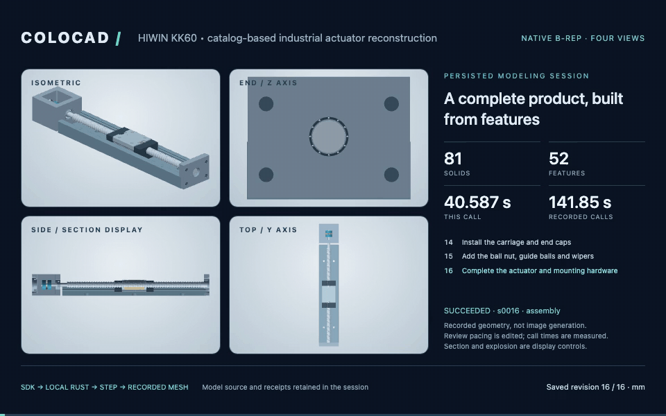
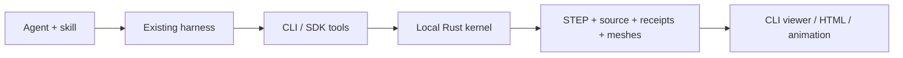
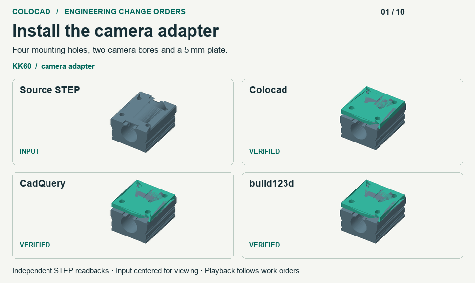
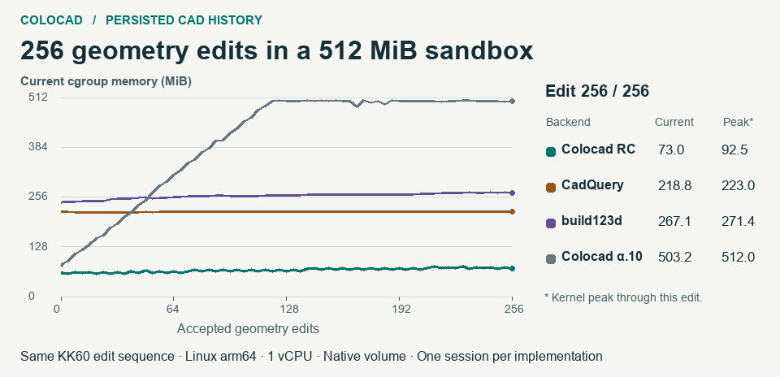
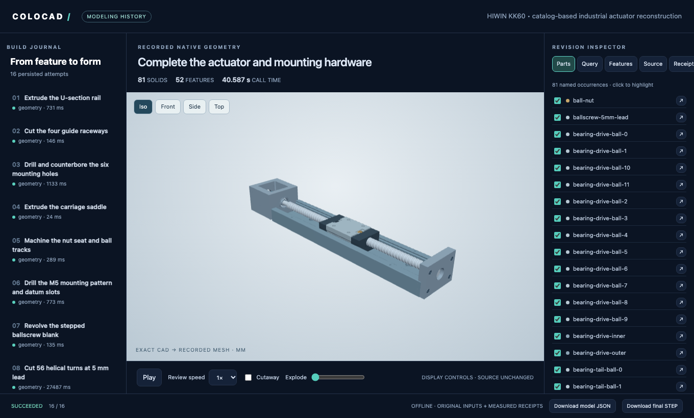
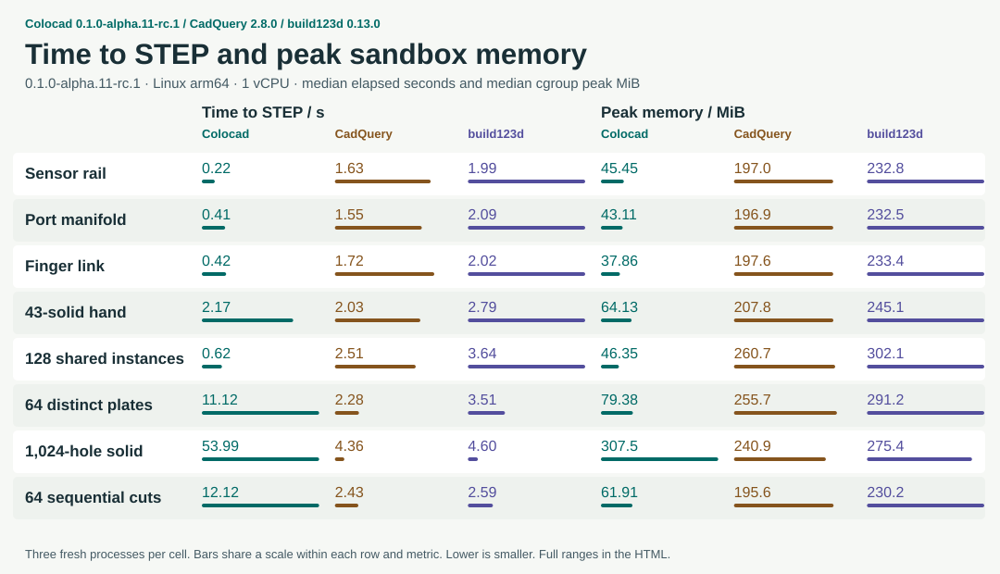
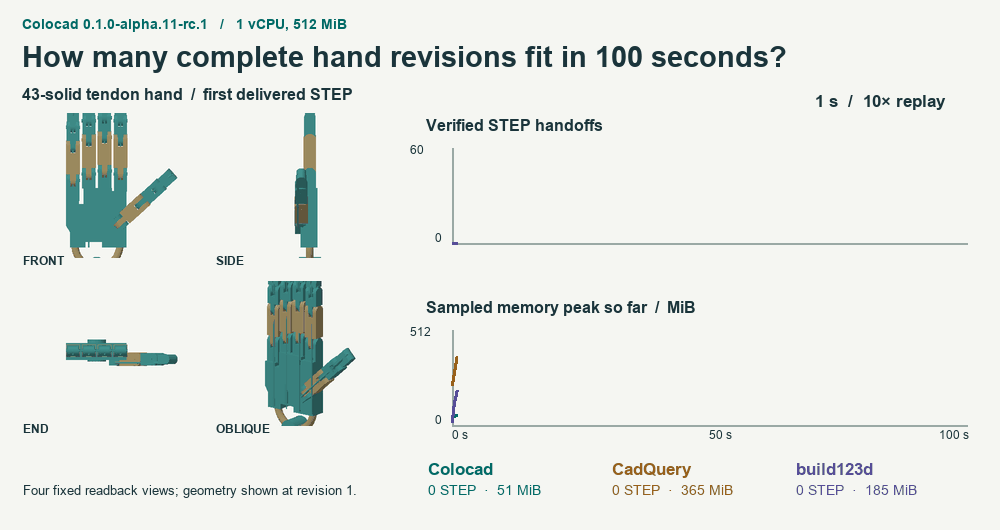

# Colocad



**Parametric CAD for agents. Local Rust geometry, a TypeScript SDK, a CLI, and an inspectable modeling history.**

[中文](README.zh-CN.md) · [Documentation](docs/README.md) · [npm](https://www.npmjs.com/package/@coloopx/colocad) · [Changelog](CHANGELOG.md) · [Releases](https://github.com/Coloopx/colocad/releases) · [Model behind the cover](examples/hiwin-kk60/README.md)

Colocad turns explicit modeling instructions into editable source, exact STEP geometry and visual review artifacts. It runs alongside the agent and its harness **inside the same sandbox**. The npm package includes the compiled Rust kernel; installed modeling needs no Python, Rust toolchain, network or separate CAD service.

**Release 0.1.0** supports the mechanical modeling and assembly workflows described below. See [support and limits](#support-and-limits).

**256 saved KK60 edits used 92.5 MiB peak on the development candidate**, compared with 223.0 MiB for CadQuery and 271.4 MiB for build123d with durable history adapters. See the [change-order replay](#engineering-change-orders), [memory curves](#memory-over-256-saved-revisions) and [23-case benchmark](#performance).

## What you can build

- **Parts and assemblies:** parametric features, repeated part definitions, exact STEP and PNG/GLB/STL previews.
- **Engineering queries (alpha.7):** exact topology, composable selection, datums, holes/groups, mounting interfaces and measured assembly relationships. [Supported domains](docs/engineering-queries.md).
- **Agent workflows:** SDK tools and a bundled skill for interpreting dimensions, planning features, editing and checking results.
- **Human review:** persistent build attempts, source/receipt inspection, offline single-file HTML and four-view MP4/GIF replay.

The SDK is the foundation; the CLI and tool adapters expose it to your harness; the skill guides modeling decisions. Images and drawings are evidence the agent interprets. Colocad executes explicit geometry instructions.



## Install

Requires **Node.js 22+** on **Linux x64, Linux arm64 or macOS arm64**.

```sh
npm install @coloopx/colocad@0.1.0
```

The 0.1.0 release ships the same native binaries as the November 13 benchmarks. Those measurements used [the candidate source](https://github.com/Coloopx/colocad/tree/01079a9898480dd22d8c75277a526bf9da30a8a4).

The package ships JS/TS APIs, the CLI, native executables, viewer and complete skill. Rust source is in [crates/agent-cad](crates/agent-cad); the npm tarball contains compiled binaries. [Package and model formats](docs/concepts.md).

## Engineering change orders

Give each backend the same source STEP. Resize the KK60 camera plate, cut a cable window and remount it after the saddle moves. Then install a keyed motor flange from rotated coordinates and reject parts with a missing hole or the wrong pitch.



**Colocad, CadQuery and build123d each delivered seven valid assemblies and rejected all three incompatible inputs.** Colocad exposes parameter edits, revision history and exact snapshot queries through the same SDK and CLI. In the history test, six earlier camera pitches were measured from saved native snapshots with zero geometry rebuilds. The Python adapters reopened six saved STEPs for the same measurements. Colocad used an exact circular-edge query where high-level blind-hole recognition on the imported saddle was partial. [Work orders, checks and limits](docs/benchmark-alpha11-rc1.md).

## Memory over 256 saved revisions

Every edit changed real geometry and retained editable source, exact STEP and a mesh preview. All 1,024 edited assemblies across the four runs passed independent readback. Each session had one CPU, 512 MiB and zero swap.



| Workflow | Peak MiB | Current MiB at edit 256 | Increase from edit 128 |
|---|---:|---:|---:|
| Colocad 0.1.0-alpha.11-rc.1 | **92.5** | **73.0** | 6.8 MiB |
| CadQuery 2.8.0 + durable adapter | 223.0 | 218.8 | **0.9 MiB** |
| build123d 0.13.0 + durable adapter | 271.4 | 267.1 | 6.9 MiB |
| Colocad 0.1.0-alpha.10 | 512.0 | 503.2 | Reached the cap |

The RC had the lowest peak. The CadQuery adapter had the smallest late increase. Each Python adapter persisted its history in SQLite, synced its outputs and released clean file pages. Colocad also retained native checkpoints and query snapshots. [Session methods and per-revision evidence](docs/benchmark-alpha11-rc1.md#256-saved-geometry-edits).

## Sculpted housings and external meshes

Build a smooth landmark loft, offset the shell, import a scanned exterior and place exact STEP hardware in the same local job. Instance colours appear in the GLB and offline viewer. Each interference check records the method and measured overlap volume. [Hybrid operations and exchange formats](docs/hybrid.md)

```sh
npx colocad build node_modules/@coloopx/colocad/examples/hybrid-enclosure/model.json ./housing-build
```

## Quick start

Run these commands from your Node project:

```sh
# Build the packaged manifold and save its source, receipt and geometry.
npx colocad record node_modules/@coloopx/colocad/examples/manifold.json ./history \
  --label "Build the manifold"

# Launch the interactive viewer.
npx colocad view ./history

# Export one offline HTML file, including a final STEP download.
npx colocad replay ./history ./review.html
```

The manifold includes an extrusion, blind cut, fillet, linear pattern and pocket. Record an edited JSON into the same history directory to append a revision; failed attempts remain visible. `view` serves a snapshot, so reopen it after adding revisions. [First part and parameter edit](docs/getting-started.md).

Prefer an API? Use the same kernel through a persistent session:

```js
import { ModelingSession } from '@coloopx/colocad/session';

const session = await ModelingSession.create('./sdk-history');
const result = await session.build({
  version: 1, units: 'mm', parameters: { length: 60 },
  features: [{ id: 'stock', op: 'box', origin: [0, 0, 0],
    size: [{ param: 'length' }, 30, 8] }],
  output: 'stock',
});
if (!result.ok) throw new Error(JSON.stringify(result.error));
await session.edit({ length: 80 });
```

Use `CadClient` for direct builds without session recording. [SDK, CLI and tool API](docs/api.md).

## Visualize and export from the CLI



Inspect the timeline, source, features, receipts and selected parts. Switch cameras, show display sections or explosion, and download artifacts. The offline HTML embeds its rendering code and geometry. Hosts can also embed `@coloopx/colocad/viewer`.

| Command | Input | Result |
| --- | --- | --- |
| `colocad plan TREE.json` | `colocad/1` feature tree | Compile and inspect a native job |
| `colocad build TREE.json NEW_DIR --preview` | Feature tree | STEP, editable source and previews |
| `colocad record MODEL.json SESSION` | Feature tree or kernel JSON | Build and persist a milestone |
| `colocad view SESSION` | Saved session | Interactive local viewer |
| `colocad replay SESSION review.html` | Saved session | Self-contained offline HTML |
| `colocad render SESSION modeling.mp4` | Saved session | Four-view animation; `.gif` also supported |

Alpha.9 adds three session commands for a shell-based agent. Use `colocad head SESSION` to get the accepted query revision, `colocad inspect SESSION REQUEST.json` to record exact measurements, and `colocad edit SESSION PARAMETERS.json` to rebuild after a parameter change. The four-hole plate example exercises all three. [Plate workflow](skills/colocad/references/modeling-loop.md#inspect-and-edit-from-a-shell).

In a headless sandbox, use `colocad view ./history --no-open --port 8787` with the harness's port forwarding; the listener binds to `127.0.0.1`.

```sh
# Optional movie dependencies; install FFmpeg on the host as well.
npm install -D playwright
npx playwright install chromium
npx colocad render ./history ./modeling.mp4 --width 1280 --height 800 --fps 15
```

Movies replay **actual saved revisions**. Recorded call times and edited playback duration are separate. Building geometry and exporting HTML do not need Chromium or FFmpeg. [History, viewer and rendering guide](docs/modeling-history.md).

## Use with your agent

Copy the whole skill, including its references, scripts and editable shape assets:

```sh
# Codex project skill; use .claude/skills for Claude Code.
mkdir -p .agents/skills
cp -R node_modules/@coloopx/colocad/skills/colocad .agents/skills/colocad
```

If that skill already exists, preserve local customizations before updating it. Then ask:

> Use the colocad skill to build a 100 × 50 × 6 mm plate with a centered 3 × 2 grid of Ø6 through-holes on 32 × 30 mm pitches. Keep editable source and modeling history, verify the dimensions, and export STEP and an offline HTML review through the CLI.

| Harness | Integration |
| --- | --- |
| Codex | [Project skill and CLI](docs/integrations/codex.md) |
| Claude Code | [Project skill and local tools](docs/integrations/claude-code.md) |
| Pi core / coding agent | [Typed tool adapter and extension](docs/integrations/pi.md) |
| Your own harness | [SDK schemas, state and artifact lifecycle](docs/integrations/overview.md) |

The [end-to-end handbook](docs/agent-modeling-handbook.md) covers source preparation, dimension uncertainty, tool abstraction, prompts, modeling loops, validation and tuning. A [runnable guided workflow](examples/integrations/README.md) demonstrates real builds, quantitative edits and recovery; its decisions are scripted, not a live-LLM benchmark.

## Example: a complete linear actuator

The cover reconstructs a **HIWIN KK60, 300 mm rail, 5 mm lead, 210 mm travel** from manufacturer drawings: **52 final features, 81 named solid occurrences and 16 modeling milestones**. It includes a physically cut helical screw groove, rail tracks, mounting holes, carriage, bearings and coupling.

```sh
node node_modules/@coloopx/colocad/examples/hiwin-kk60/run.mjs ./actuator
npx colocad view ./actuator/session
npx colocad render ./actuator/session ./modeling.mp4
```

Independent OCCT checks cover all 16 STEP revisions, 64 material probes and selected rail/carriage clearances. Proprietary internals are explicitly approximated or omitted; this is a catalog reconstruction, not a production drawing package. The animation is not a speed benchmark.

[MP4](showcase/hiwin-kk60/modeling-alpha11-rc1.mp4) · [Editable model](showcase/hiwin-kk60/model.json) · [Checks](docs/benchmarks/alpha11-rc1/kk60-readback.json) · [Dimensions and assumptions](examples/hiwin-kk60/sources.json) · [Full offline delivery](https://github.com/Coloopx/colocad/releases/download/v0.1.0-alpha.4/hiwin-kk60-delivery.zip)

## Performance

On the **November 13 candidate rerun**, Colocad had the lowest median peak memory in **22/23 cases** and the shortest median time to STEP in **16/23**. All 207 STEP exports passed independent checks. Times include fresh process startup and delivery. Each case ran three times per backend.



128 placements of one shared part took **0.62 / 2.51 / 3.64 s** in Colocad / CadQuery / build123d. For 64 independently sized plates the times were **11.12 / 2.28 / 3.51 s**. On the 1,024-hole solid both Python backends used less memory and finished sooner. [All memory scaling curves](docs/benchmarks/alpha11-rc1/memory-scaling.svg).

One 100-second queue per backend produced **45 / 51 / 41** independently verified revisions of the 43-solid hand. The sampled memory peaks were **167.1 / 481.0 / 280.9 MiB**. The GIF plays recorded completion times at 10×.



[Offline single-file scorecard with the replays](docs/benchmarks/alpha11-rc1/scorecard.html) · [Methods and results](docs/benchmark-alpha11-rc1.md) · [Reproduce](https://github.com/Coloopx/colocad/blob/main/benchmarks/readme/candidate/README.md).

## Support and limits

- Native packages: Linux x64/arm64 and macOS arm64, Node.js 22+. [Three-platform package verification](https://github.com/Coloopx/colocad/releases/download/v0.1.0/release-validation.json).
- Editable JSON/programs and exact STEP are supported; STEP does not preserve a commercial CAD application's native feature tree.
- General editable SOLIDWORKS output on Linux remains incomplete. The experimental Windows author requires licensed SOLIDWORKS, and a native rebuild pass is still unverified. [Native author status](docs/native-solidworks.md).
- CAD checks, drawing interpretation, edit preservation, fit and manufacturing readiness are separate claims. [Validation scope](docs/validation.md).
- A 512 MiB CAD test is not a memory guarantee for an entire resident agent, browser or video encoder.
- Alpha.8 fixes exact query snapshots for `face_hole_grid` and `hole_grid` seam curves. [Regression and installed-package evidence](docs/evidence/release-alpha.8.json).

## Coverage and roadmap

[CadQuery design and API coverage](docs/cadquery-comparison.md) maps all 150 entries in its API index, with explicit gaps and evidence. [ROADMAP](ROADMAP.md) records the current architecture, scoped G1-G3 acceptance and planned benchmark/RSI cycle. The G4 runner is not yet implemented.

## Documentation and help

Available in alpha.7: [exact queries and geometry-backed assembly](docs/engineering-queries.md), with a [runnable external STEP example](examples/engineering-queries/README.md). The [four ordered goals](specs/0005-capability-reliability-and-optimization.md) track functional coverage, geometry reliability, engineering usability, then benchmark-driven optimization. The SDK, CLI, tool schema and all three native targets ship together; this is a Colocad API, not CadQuery Python/API compatibility.

G1–G3 are accepted for the [declared workloads](specs/experiments/0005/README.md): 24/24 geometry cases independently verified, 127 Rust / 41 Node tests, and two live Pi tasks in Linux arm64 **1 vCPU / 512 MiB**. Peak cgroup memory was **256 MiB** for the corpus with a minimal supervisor and **371 MiB** for resident Pi/harness plus the 82-solid actuator edit and preview; zero OOM. This is resource/correctness acceptance, not a new build123d speed comparison or full industry-wide parity. G4 has not started.


[Getting started](docs/getting-started.md) · [API](docs/api.md) · [Agent handbook](docs/agent-modeling-handbook.md) · [Skill](skills/colocad/SKILL.md) · [Troubleshooting](docs/troubleshooting.md) · [All documentation](docs/README.md)

For a bug or feature request, [open an issue](https://github.com/Coloopx/colocad/issues) with the package version, platform, minimal model and relevant receipt. Remove credentials and private source material.

## Develop and contribute

```sh
git clone https://github.com/Coloopx/colocad.git
cd colocad
npm ci
npm run build:kernel
npm test
```

Building from source requires the Rust toolchain and fetches the pinned SolidCore dependency. Viewer/render and Pi integration checks have additional dependencies; see [CONTRIBUTING.md](CONTRIBUTING.md) for setup, tests and release instructions. Contributions are welcome as issues and pull requests.

## License and acknowledgments

Colocad application code is [MIT licensed](LICENSE). The kernel builds on [SolidCore](https://github.com/tangency-labs/solidcore), including work derived from NVIDIA USD BRep / SMLib; the viewer uses Three.js. Dependency licenses and attribution are in [NOTICE.md](NOTICE.md) and [kernel/licenses](kernel/licenses). The industrial example is not affiliated with or endorsed by HIWIN.
