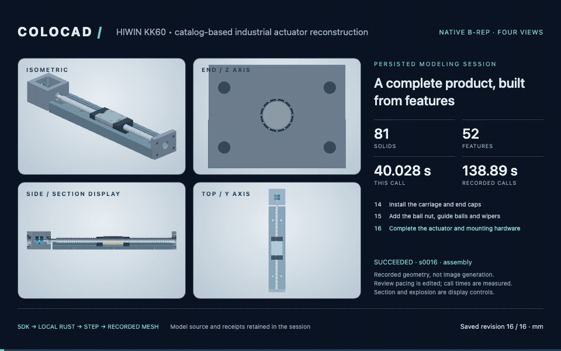
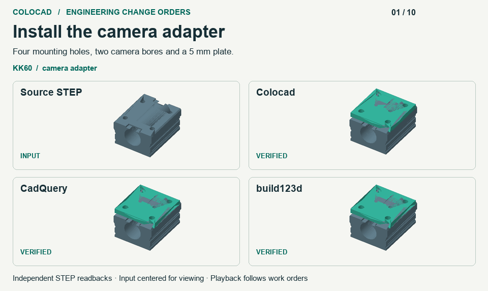
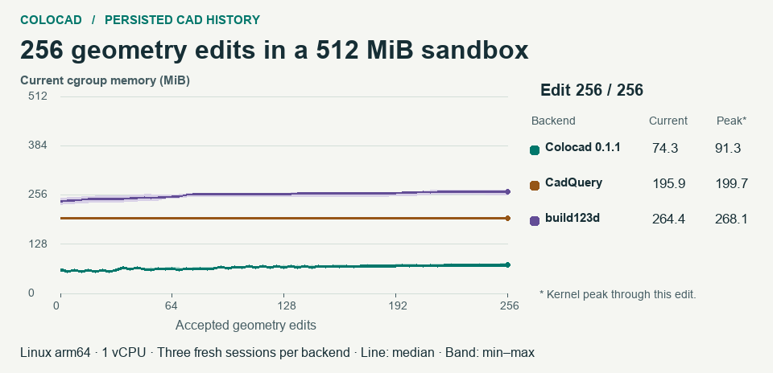
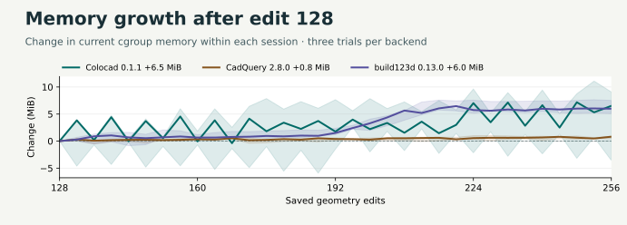
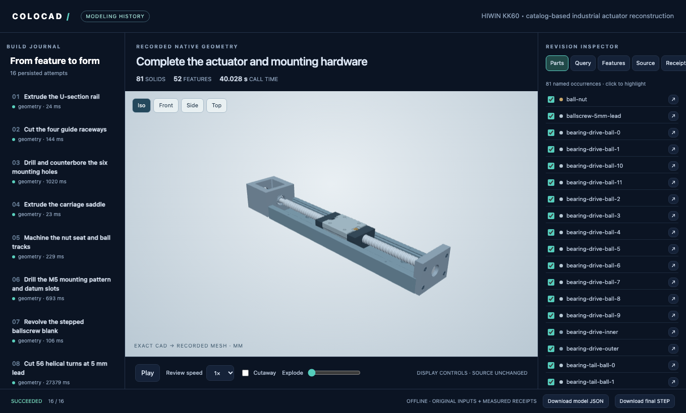
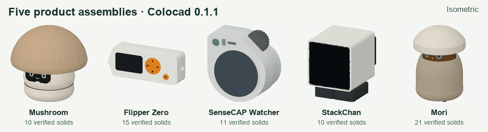
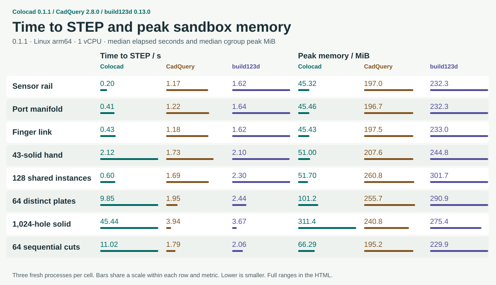
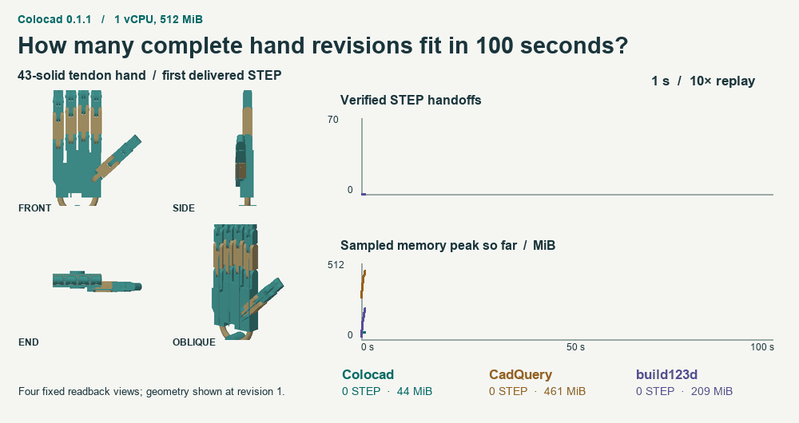

# Colocad



**面向 agent 的参数化 CAD：本地 Rust 几何内核、TypeScript SDK、CLI，以及可追溯的建模过程。**

[English](README.md) · [文档](docs/README.zh-CN.md) · [npm](https://www.npmjs.com/package/@coloopx/colocad) · [更新日志](CHANGELOG.md) · [Releases](https://github.com/Coloopx/colocad/releases) · [封面模型](examples/hiwin-kk60/README.md)

Colocad 把明确的建模指令转成可编辑源、精确 STEP 和可视化产物。Agent、harness 与 CAD 程序都在**同一个沙箱内部**。npm 包自带编译好的 Rust 内核，安装后建模无需 Python、Rust 工具链、网络或独立 CAD 服务。

**[Colocad 0.1.1 正式版](https://github.com/Coloopx/colocad/releases/tag/v0.1.1)** 在 22/23 个机械用例中沙箱峰值最低。连续保存 256 次 KK60 几何修改，三个独立会话的累计峰值中位数为 **91.3 MiB**。[逐版内存](#连续保存-256-版的内存) · [三后端机械用例](#linux-沙箱机械用例) · [五款产品外观](#五款产品的外观建模)。

## 可以用来做什么

- **零件和装配体：** 参数化特征、重复零件实例、精确 STEP，以及 PNG/GLB/STL 预览。
- **Agent 建模：** SDK 工具与随包 skill，支持尺寸解释、特征规划、改参和结果检查。
- **人类审阅：** 保存成功与失败的构建，检查源和回执，输出单文件离线 HTML、四视图 MP4/GIF。

SDK 是基础，CLI 和工具适配器负责接入 harness，skill 指导建模决策。图纸与图片由 agent 作为证据解释；colocad 执行明确的几何指令。


## 安装

需要 **Node.js 22+**，支持 **Linux x64、Linux arm64、macOS arm64**。

```sh
npm install @coloopx/colocad
```

npm 的 `latest` 指向 `0.1.1`。如需锁定版本，使用 `npm install --save-exact @coloopx/colocad@0.1.1`。发布验收从公共注册表安装，再用 CLI 导出歧管，OCCT 回读得到一个 90 × 45 × 12 mm 的有效实体。[安装与回读记录](https://github.com/Coloopx/colocad/releases/download/v0.1.1/registry-proof.json)。

安装包包含 JS/TS API、CLI、原生可执行文件、查看器和完整 skill。Rust 源码位于 [crates/agent-cad](crates/agent-cad)，npm 包携带编译产物。[模型与产物格式](docs/concepts.md)。

## 快速开始

在你的 Node 项目中运行：

```sh
# 构建随包歧管示例，保存源、回执和几何。
npx colocad record node_modules/@coloopx/colocad/examples/manifold.json ./history \
  --label "Build the manifold"

# 启动交互式查看器。
npx colocad view ./history

# 导出单文件 HTML，其中包含最终 STEP 下载。
npx colocad replay ./history ./review.html
```

示例包含拉伸、盲孔切除、圆角、线性阵列和口袋。修改 JSON 后再次 `record` 到同一个 history 目录，即可追加版本；失败尝试也会保留。`view` 展示启动时的快照，新增版本后需重新打开。[首个零件与改参教程](docs/getting-started.md)。

也可以通过 SDK 使用相同的本地内核：

```js
import { ModelingSession } from '@coloopx/colocad/session';

const session = await ModelingSession.create('./sdk-history');
const result = await session.build({
  version: 1, units: 'mm', parameters: { length: 60 },
  features: [{ id: 'stock', op: 'box', origin: [0, 0, 0],
    size: [{ param: 'length' }, 30, 8] }],
  output: 'stock',
});
if (!result.ok) throw new Error(JSON.stringify(result.error));
await session.edit({ length: 80 });
```

无需记录会话时，直接使用 `CadClient`。[SDK、CLI 与工具 API](docs/api.md)。

## 工程更改单

给三个后端相同的 STEP，要求改长、加厚 KK60 相机板，新增走线窗口，再用实际孔位适配坐标平移的替换件。另一组任务要求从旋转过的电机法兰重新求安装方向，遇到孔距不符或缺孔必须拒绝。



**Colocad、CadQuery 和 build123d 都交付了七个有效装配，并正确拒绝三个不兼容输入。** Colocad 的 SDK/CLI 自带改参、版本历史和快照查询；实测六个旧版本的孔距时，Colocad 直接查询原生快照，几何重建次数为 0；两个 Python 适配器重开六份 STEP 完成了相同测量。Colocad 的高层盲孔识别在重导入滑台上仍返回部分覆盖，实测用精确圆边找到了安装位置。[任务、几何验收和限制](docs/benchmark-stable.zh-CN.md)。

## 连续保存 256 版的内存

在 1 vCPU、512 MiB、零交换的 Linux 沙箱中，连续改变相机板厚度和孔距。每次保存可编辑源、精确 STEP 和网格预览。三个后端各跑三轮，轮换次序、使用新数据卷，**2,304 份改图 STEP 全部独立回读通过**。



| 工作流 | 累计峰值 MiB（中位数，范围） | 第 128 版 MiB | 第 256 版 MiB | 后 128 版净增 MiB |
|---|---:|---:|---:|---:|
| Colocad 0.1.1 | **91.3** (91.0–91.4) | 68.3 | 74.3 | +6.5 |
| CadQuery 2.8.0 | **199.7** (199.6–200.3) | 195.5 | 195.9 | +0.8 |
| build123d 0.13.0 | **268.1** (261.2–272.1) | 258.4 | 264.4 | +6.0 |

曲线取保存后的 cgroup 当前读数，阴影表示三轮范围。峰值包含两次保存间的瞬时分配。后 128 版的增量按同一会话配对后取中位数。两套 Python 适配器均持久化到 SQLite 并同步文件，Colocad 还保存原生检查点与查询快照。[逐版原始数据与缓存条件](docs/benchmark-stable.zh-CN.md)。

整段会话中，Colocad 的峰值比 CadQuery 低 54%，比 build123d 低 66%。从第 128 版到第 256 版，净增最小的是 CadQuery 2.8.0（+0.8 MiB）。这段曲线只能衡量已测试的 256 次修改，尚不能确定长期增长阶数。



开发版 CLI 将被替换的几何版本写入分段文件，同一 KK60 会话最终保留 42 个文件、7 个目录。[与 0.1.1 的配对复测、完整提交耗时和历史回读](docs/revision-memory-attribution.zh-CN.md#分段写入修复与最终复测)。

## 有机外壳与外部网格

从轮廓标志点做光顺放样与法向偏置，将外部扫描网格和精确 STEP 机构放入同一装配。GLB 和离线查看器显示实例材质，干涉收据给出实际零件的交叠体积与算法。[使用说明、导出格式与验收](docs/hybrid.zh-CN.md)

```sh
npx colocad build node_modules/@coloopx/colocad/examples/hybrid-enclosure/model.json ./housing-build
```

## 从 CLI 启动可视化与导出



查看时间线、源、特征、回执与选中的零件；切换镜头、显示剖切/爆炸视图、下载产物。离线 HTML 内嵌渲染代码和几何。需要集成到现有界面时，可使用 `@coloopx/colocad/viewer`。

| 命令 | 输入 | 结果 |
| --- | --- | --- |
| `colocad plan TREE.json` | `colocad/1` 特征树 | 编译并检查原生建模任务 |
| `colocad build TREE.json NEW_DIR --preview` | 特征树 | STEP、可编辑源和预览 |
| `colocad record MODEL.json SESSION` | 特征树或 kernel JSON | 构建并保存建模里程碑 |
| `colocad view SESSION` | 已保存会话 | 本地交互查看器 |
| `colocad replay SESSION review.html` | 已保存会话 | 单文件离线 HTML |
| `colocad render SESSION modeling.mp4` | 已保存会话 | 四视图动画，也支持 `.gif` |

用 `colocad head SESSION` 取当前有效的几何版本，`colocad inspect SESSION REQUEST.json` 查询并记录安装面和孔组，`colocad edit SESSION PARAMETERS.json` 从有效模型改参。四孔板示例演示了如何改成六孔，并重新测量孔径。[操作步骤](skills/colocad/references/modeling-loop.md#inspect-and-edit-from-a-shell)

无桌面的沙箱使用 `colocad view ./history --no-open --port 8787`，配合 harness 现有端口转发；监听地址为 `127.0.0.1`。

```sh
# 可选的视频依赖；还需在宿主安装 FFmpeg。
npm install -D playwright
npx playwright install chromium
npx colocad render ./history ./modeling.mp4 --width 1280 --height 800 --fps 15
```

动画读取**实际保存的 CAD 版本**，真实调用耗时与剪辑后的播放时长分别显示。构建几何、导出 HTML 无需 Chromium 或 FFmpeg。[完整历史与渲染指南](docs/modeling-history.md)。

## 接入你的 agent

复制完整 skill，包含 references、scripts 和可编辑形状资产：

```sh
# Codex 项目技能；Claude Code 改用 .claude/skills。
mkdir -p .agents/skills
cp -R node_modules/@coloopx/colocad/skills/colocad .agents/skills/colocad
```

已有同名 skill 时，更新前保留本地定制。然后给 agent 一个具体任务：

> 使用 colocad skill，构建 100 × 50 × 6 mm 安装板，中心对称布置 3 × 2 个 Ø6 通孔，两向孔距 32、30 mm。保存可编辑源与建模会话，检查尺寸，通过 CLI 导出 STEP 和离线 HTML。

| Harness | 接入方式 |
| --- | --- |
| Codex | [项目 skill 与 CLI](docs/integrations/codex.md) |
| Claude Code | [项目 skill 与本地工具](docs/integrations/claude-code.md) |
| Pi core / coding agent | [类型化工具适配与扩展](docs/integrations/pi.md) |
| 自建 harness | [SDK schema、状态和产物生命周期](docs/integrations/overview.md) |

[完整建模指南](docs/agent-modeling-handbook.zh-CN.md)涵盖材料预备、尺寸不确定性、工具抽象、提示词、建模闭环、验证和调优。[可运行工具示例](examples/integrations/README.md)执行真实建模、数值核对和失败恢复；决策序列是脚本化的，不是 LLM 自主建模成功率测试。

## 实例：完整线性执行器

封面依据厂家图纸重建 **HIWIN KK60，导轨 300 mm、导程 5 mm、行程 210 mm**，包含 **52 个最终特征、81 个命名实体实例、16 个建模里程碑**。丝杠螺旋槽是实际切出的几何，另有导轨沟槽、安装孔、滑台、轴承和联轴器。

```sh
node node_modules/@coloopx/colocad/examples/hiwin-kk60/run.mjs ./actuator
npx colocad view ./actuator/session
npx colocad render ./actuator/session ./modeling.mp4
```

独立 OCCT 检查覆盖 16 份 STEP、64 个材料探针和指定位置的导轨/滑台间隙。未公开内部结构明确标为近似或省略；这是产品目录重建，不是可直接生产的完整图纸。动画也不是速度基准。

[MP4](docs/benchmarks/stable-0.1.1/kk60-modeling.mp4) · [可编辑模型](showcase/hiwin-kk60/model.json) · [验证结果](docs/benchmarks/stable-0.1.1/kk60-readback.json) · [尺寸与假设](examples/hiwin-kk60/sources.json) · [离线执行器查看器与 STEP 下载](https://github.com/Coloopx/colocad/releases/download/v0.1.1/kk60-actuator.html)

## 性能

### 五款产品的外观建模

在 macOS arm64 上，新进程构建五款产品时，Colocad 0.1.1 的进程树峰值 RSS 中位数为 **71–84 MiB**，CadQuery 2.8.0 为 **479–492 MiB**。从进程启动计时，Colocad 有 **5/5** 例更快。从加载完毕的宿主开始，两端都重新建模，CadQuery 有 **5/5** 例更快。



每格依次为 **Colocad / CadQuery**。同一份建模规格，每个后端和产品各预热一次，再测三次取中位数。80 份 STEP 均经独立回读。

| 产品 | 新进程到 STEP（秒） | 新进程峰值 RSS（MiB） | 已加载后重建（秒） |
|---|---:|---:|---:|
| Mushroom | 0.96 / 2.26 | 72.1 / 483.1 | 0.87 / 0.11 |
| Flipper Zero | 0.60 / 2.24 | 79.8 / 480.8 | 0.52 / 0.12 |
| SenseCAP Watcher | 0.57 / 2.21 | 74.7 / 481.8 | 0.48 / 0.11 |
| StackChan | 0.43 / 2.21 | 70.9 / 479.0 | 0.34 / 0.07 |
| Mori | 2.33 / 2.71 | 84.3 / 492.2 | 2.24 / 0.47 |

SenseCAP 的指定椭圆在正式版仍未通过校验，计时的两个后端均使用同一个圆形替代，短轴增加 0.0228 mm。139 个指定尺寸中，109 个通过 0.25 mm 对照阈值。[逐次耗时与几何验收](docs/benchmark-appearance.zh-CN.md)。

### Linux 沙箱机械用例

11 月 17 日使用 npm 正式包复测。23 个用例中，Colocad 在 **22/23** 个用例的峰值最低，在 **16/23** 个用例交付 STEP 最快。每个用例、后端均跑三个新进程，207 份 STEP 全部通过独立检查。



以下顺序均为 **Colocad / CadQuery / build123d**。

| 用例 | 到 STEP（秒） | 沙箱峰值（MiB） |
|---|---|---|
| 同一板件放置 128 次 | 0.60 / 1.69 / 2.30 | 51.7 / 260.8 / 301.7 |
| 64 种独立尺寸的板件 | 9.85 / 1.95 / 2.44 | 101.2 / 255.7 / 290.9 |
| 单实体 1,024 孔 | 45.44 / 3.94 / 3.67 | 311.4 / 240.8 / 275.4 |
| 43 实体灵巧手 | 2.12 / 1.73 / 2.10 | 51.0 / 207.6 / 244.8 |

共享一种板件定义放置 128 次，CadQuery 的耗时是 Colocad 的 2.8 倍。换成 64 种独立尺寸，Colocad 的耗时是 CadQuery 的 5.1 倍；在 1,024 孔单实体上为 11.5 倍，且两套 Python 后端都更省内存。

灵巧手的 100 秒队列分别交付 **52 / 63 / 52** 份经回读的完整装配，采样内存峰值为 **200.4 / 512.0 / 291.3 MiB**。下图按实测时间 10 倍速播放。



[单文件离线报告](docs/benchmarks/stable-0.1.1/scorecard.html) · [完整内存规模曲线](docs/benchmarks/stable-0.1.1/memory-scaling.svg) · [实验和验收](docs/benchmark-stable.zh-CN.md) · [复现步骤](benchmarks/readme/stable/README.md)。

## 支持范围与限制

- 原生包支持 Linux x64/arm64、macOS arm64，要求 Node.js 22+。[三平台发包验收](https://github.com/Coloopx/colocad/releases/download/v0.1.1/release-validation.json)。
- 支持可编辑 JSON/程序和精确 STEP；STEP 不保存商业 CAD 软件的原生特征树。
- Linux 通用可编辑 SOLIDWORKS 输出尚未完成。实验性 Windows author 需要授权 SOLIDWORKS，软件内重建验收仍未通过验证。[原生导出状态](docs/native-solidworks.md)。
- 几何有效、读图正确、可编辑、能配合和可制造需要各自的证据。[验证范围](docs/validation.md)。
- CAD 的 512 MiB 测试不代表常驻 agent、浏览器和视频编码器的整体内存预算。

## 能力覆盖与路线图

[CadQuery 设计与 API 覆盖报告](docs/cadquery-comparison.zh-CN.md)逐项映射其 API 索引的 150 个入口，列出缺口和证据。[ROADMAP](ROADMAP.zh-CN.md)总结架构、G1–G3 验收范围以及后续 benchmark/RSI 路线；G4 自动执行器尚未实现。

## 文档与帮助

从[外部 STEP 示例](examples/engineering-queries/README.md)可以上手[精确查询与几何驱动装配](docs/engineering-queries.zh-CN.md)。[四阶段目标](specs/0005-capability-reliability-and-optimization.zh-CN.md)依次为功能覆盖、几何可靠性、工程可用性和基准测试驱动的优化。SDK、CLI、工具 schema 和三平台原生内核同步交付。查询接口采用 Colocad 自身的 API。

本次正式版通过 166 项 Rust、88 项 Node 和 6 项集成测试。受限沙箱内的 24 项几何回归全部通过，驻留 Pi 的四孔板任务首轮通过。82 实体执行器任务首轮和原提示词重试均未完成验收。[受限沙箱实测](docs/benchmark-stable.zh-CN.md#驻留-pi-agent-与-harness) · [发布验收](https://github.com/Coloopx/colocad/releases/download/v0.1.1/release-validation.json).


[入门](docs/getting-started.md) · [API](docs/api.md) · [完整建模指南](docs/agent-modeling-handbook.zh-CN.md) · [Skill](skills/colocad/SKILL.md) · [故障排查](docs/troubleshooting.md) · [全部文档](docs/README.zh-CN.md)

问题和功能建议请[提交 issue](https://github.com/Coloopx/colocad/issues)，附上版本、平台、最小模型和相关回执，并移除凭证及私密资料。

## 开发与贡献

```sh
git clone https://github.com/Coloopx/colocad.git
cd colocad
npm ci
npm run build:kernel
npm test
```

源码构建需要 Rust 工具链，并拉取固定版本的 SolidCore。查看器、视频和 Pi 接入测试另有依赖；安装、测试和发布方法见 [CONTRIBUTING.md](CONTRIBUTING.md)。欢迎提交 issue 和 pull request。

## 许可证与致谢

Colocad 应用代码使用 [MIT 许可证](LICENSE)。内核基于 [SolidCore](https://github.com/tangency-labs/solidcore)，其中包含源自 NVIDIA USD BRep / SMLib 的工作；查看器使用 Three.js。依赖许可证与归属见 [NOTICE.md](NOTICE.md) 和 [kernel/licenses](kernel/licenses)。工业实例与 HIWIN 无隶属或背书关系。
