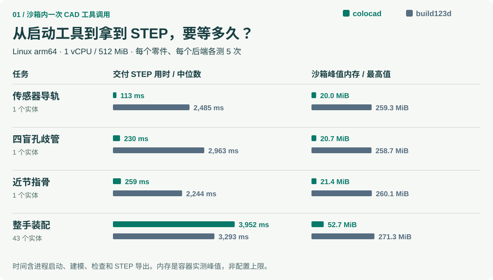

# colocad


**HIWIN KK60 线性执行器** · [建模案例](examples/hiwin-kk60/README.md) · [MP4 动画](showcase/hiwin-kk60/modeling.mp4) · [独立验证](showcase/hiwin-kk60/verification.json)

[English](README.md) · [开发与接入指南](docs/README.zh-CN.md) · [npm 包](https://www.npmjs.com/package/@coloopx/colocad) · [下载单文件对比报告：含四份 STEP](https://github.com/Coloopx/colocad/raw/refs/heads/main/docs/benchmarks/comparison.html)

让沙箱内的 agent 用 JSON 描述可改参的机械零件，输出 STEP 实体、PNG 预览和 GLB/STL 网格。**npm 包自带编译好的 Rust CAD 内核**：Linux x64、Linux arm64 和 macOS arm64 各一份。agent 和 harness 在同一沙箱里调用 Node CLI 或 TypeScript API，CLI 直接启动本地 Rust 程序。安装后建模不需要网络、Python、Rust 工具链或额外服务。[Rust 源码](crates/agent-cad/src)和[内核依赖版本](third_party/solidcore.lock.json)在本仓库。

## 从这里开始：SDK + CLI + skill

[完整建模与 skill/提示词指南](docs/agent-modeling-handbook.zh-CN.md) · [研究依据](docs/agent-modeling-research.md)

**SDK 是建模基础，CLI 提供命令行入口，skill 指导 agent 选择几何操作和验收方法。** Agent、harness、SDK 与 Rust 可执行文件在同一个沙箱中运行。建模会话保存实际输入、结果与失败记录，供人类通过查看器检查。


### CLI：建模、查看、保存过程

```sh
npm install @coloopx/colocad@0.1.0-alpha.5

# 构建随包提供的模型，同时记录一个真实建模阶段。
npx colocad record node_modules/@coloopx/colocad/examples/manifold.json ./history \
  --label "Build the manifold"

# 启动交互式查看器并打开浏览器。
npx colocad view ./history

# 导出单文件 HTML，包含最终 STEP 的下载入口。
npx colocad replay ./history ./review.html
```

把修改后的 JSON 再 `record` 到同一个 `history` 目录，即可追加阶段。输入、回执和失败都保留。查看器展示会话快照；追加阶段后重新打开即可。在无桌面的沙箱中运行 `colocad view ./history --no-open --port 8787`，使用现有 harness 的端口转发。监听地址是 `127.0.0.1`。

| 命令 | 输入 | 结果 |
| --- | --- | --- |
| `colocad plan TREE.json` | `colocad/1` 特征树 | 编译原生建模任务，不生成几何 |
| `colocad build TREE.json NEW_DIR --preview` | `colocad/1` 特征树 | STEP、可编辑特征树、报告与预览 |
| `colocad record MODEL.json SESSION --label TEXT` | 特征树或内核模型 JSON | 构建并追加持久化建模阶段 |
| `colocad view SESSION` | 已保存会话 | 启动查看器，可加 `--export review.html` |
| `colocad replay SESSION review.html` | 已保存会话 | 导出离线单文件 HTML |
| `colocad render SESSION modeling.mp4` | 已保存会话 | 导出四视图动画、时间/哈希清单和封面，也支持 `.gif` |

### 可视化与动画由 CLI 启动


查看器提供阶段时间线、特征/源码/回执检查、零件选择与显隐、四种镜头、显示剖切与爆炸，以及模型和最终 STEP 下载。HTML 内嵌代码和几何，可离线打开。宿主界面也可使用 `@coloopx/colocad/viewer` 嵌入同一组件。

```sh
# 以下依赖仅视频编码需要：
npm install -D playwright
npx playwright install chromium
# 在宿主安装 FFmpeg 后，直接从会话导出：
npx colocad render ./history ./modeling.mp4 --width 1280 --height 800 --fps 15
npx colocad render ./history ./modeling.gif --width 960 --height 600 --fps 10
```

动画回放实际保存的 CAD 阶段，四个镜头同步显示，并保留每步实测耗时。播放节奏和显示爆炸是展示设置；视频时长不能当作建模耗时。几何构建和 HTML 导出不依赖 Chromium/FFmpeg。[完整使用文档](docs/modeling-history.md)。

### SDK 和 agent skill 如何接入

SDK 使用 `CadClient` 直接构建、改参和复用预览；需要持久化过程时使用 `ModelingSession.build / edit`。`createCadTools` 和 `createSessionTools` 给 harness 提供工具 schema 与执行器。[可运行集成示例](examples/integrations/README.md)覆盖 Pi core/extension 和 Codex/Claude 本地 skill 路径，并明确区分脚本化工具测试与真实模型推理。

```sh
# Codex 项目：复制完整目录，保留脚本、参考文档和可编辑基础形状。
mkdir -p .agents/skills
cp -R node_modules/@coloopx/colocad/skills/colocad .agents/skills/colocad

# Claude Code 使用 .claude/skills/colocad 路径。
```

要求 agent 使用 colocad skill，提供目标产品/尺寸，并交付建模会话、精确 STEP 与 CLI 导出的可视化结果。其他 harness 可直接加载 `skills/colocad/SKILL.md` 并注册 SDK 工具。图纸理解与几何规划由 agent 完成，colocad 执行明确的建模指令。[实际操作流程](docs/modeling-workflow.zh-CN.md) · [Codex](docs/integrations/codex.md) · [Claude Code](docs/integrations/claude-code.md) · [Pi](docs/integrations/pi.md)。

## 真实工业产品：从厂家图纸到整机及建模动画

[HIWIN KK60 执行器实例](examples/hiwin-kk60/README.md)对应真实目录配置：300 mm 导轨、5 mm 导程、210 mm 行程，包含 **52 个原生特征、81 个命名实例、16 个持久化建模阶段**。螺旋槽、安装孔、导轨滚道均为实际 B-rep 几何。


[MP4 动画](showcase/hiwin-kk60/modeling.mp4) · [可编辑模型](showcase/hiwin-kk60/model.json) · [独立验证](showcase/hiwin-kk60/verification.json) · [尺寸来源与假设](examples/hiwin-kk60/sources.json)

```sh
node node_modules/@coloopx/colocad/examples/hiwin-kk60/run.mjs ./actuator
npx colocad view ./actuator/session
npx colocad replay ./actuator/session ./actuator.html
# 视频导出另需 Playwright/Chromium 和 FFmpeg。
npx colocad render ./actuator/session ./modeling.mp4
```

这是依据厂家目录进行的整机复建，未公开的轴承、滚道与回珠细节有明确近似/缺失标注，不能作为制造认证模型。动画读取实际保存的建模结果，播放节奏与实测构建耗时分开显示，不构成 build123d 性能比较。参见[实际操作流程](docs/modeling-workflow.zh-CN.md)和 [CLI 可视化与导出](docs/modeling-history.md)。

## 100 秒能交付多少版绳驱灵巧手？

**colocad 交付 44 版，build123d 交付 33 版：交付量多 33.3%，采样峰值内存低 57.1%。** 两边按同一组参数逐版建模、装配。每条刻线代表一份含 43 个实体的整手 STEP 已写入持久存储。


动图底部显示两边**从开始到当前时刻采到的最高内存**，共用 0–512 MiB 刻度。要看每次建模之间内存如何回落，可打开[瞬时内存回放（MP4）](https://github.com/Coloopx/colocad/raw/refs/heads/main/showcase/tendon-hand/window/hand-window-zh-CN.mp4)或[原始采样](showcase/tendon-hand/evidence/window-optimized.json)。

| 同一改参队列，1 vCPU / 512 MiB | colocad 优化内核 | build123d |
|---|---:|---:|
| 100 秒内交付的完整整手 | **44 份** | 33 份 |
| 首份 STEP | **2.223 s** | 3.010 s |
| 共同前 33 份交付耗时中位数 | **2.234 s** | 2.855 s |
| 连续 100 秒内的最高采样内存 | **130.9 MiB** | 304.9 MiB |

各运行一个真实窗口，每版新起 CAD 进程。这次原始记录使用 alpha.2 SDK 和优化后的 Linux arm64 内核。alpha.3 已内置同一份二进制。内存约每 25 ms 采样，包含子进程、临时文件和计入本容器的文件缓存。两边计入的 STEP 都已独立回读。[单文件回放与 STEP 下载](https://github.com/Coloopx/colocad/raw/refs/heads/main/showcase/tendon-hand/window/hand-window.html) · [建模细节与单次原速回放](showcase/tendon-hand/assembly-performance.md)

以下静态表记录 npm **0.1.0-alpha.2 自带内核**的历史基线。新进程交付导轨和歧管分别快 22.0× 和 12.9×，峰值内存分别为 build123d 的 7.7% 和 8.0%。

<details>
<summary>查看四种任务的静态对照图</summary>



</details>

| 独立交付物 | 首份 STEP：colocad / build123d | 交付速度比¹ | 沙箱峰值：colocad / build123d | 内存占对方 |
|---|---:|---:|---:|---:|
| 三槽导轨 | 113 / 2,485 ms | **22.0×** | 20.0 / 259.3 MiB | **7.7%** |
| 四盲孔歧管 | 230 / 2,963 ms | **12.9×** | 20.7 / 258.7 MiB | **8.0%** |
| 绳驱手近节指骨 | 259 / 2,244 ms | **8.6×** | 21.4 / 260.1 MiB | **8.2%** |
| 43 实体整手 | 3,952 / 3,293 ms | **0.83×** | 52.7 / 271.3 MiB | **19.4%** |

¹ 速度比为 build123d 用时 ÷ colocad 用时，按未取整的读数计算。Linux arm64、1 vCPU、512 MiB。每组预热后交替运行五轮，**耗时取中位数，内存取五轮容器 cgroup 峰值最大值**。计入启动、导入、建模、后端自身的检查及 STEP 导出；不含安装、容器启动、预览、模型推理或常驻 agent。单件和整手使用各自对应的公开接口。

[原始读数：导轨与歧管](docs/benchmarks/runs.json) · [原始读数：指骨与整手](showcase/tendon-hand/evidence/scope.json) · [四视图、可编辑整手和 STEP](showcase/tendon-hand/README.md) · [离线数据卡](https://github.com/Coloopx/colocad/raw/refs/heads/main/docs/benchmarks/time-to-step.html)

**旧版整手基线。** 另一项 100 秒、按顺序改参的实测中，colocad 交付 24 份整手 STEP，build123d 交付 30 份；每份都是完整的 43 个实体，已逐件回读。[两端交付时间戳与几何核对](showcase/tendon-hand/evidence/window.json)

## SDK、CLI、skill 怎么选？

SDK 是基础，CLI / 工具负责执行，skill 提供建模步骤与常用结构。完整文档从[中文开发指南](docs/README.zh-CN.md)开始，包含模型格式、改参、预览复用、失败处理和产物保存。

| 使用环境 | 接入文档 |
| --- | --- |
| Pi agent core / Pi coding agent | [工具适配器、extension 与 skill](docs/integrations/pi.md) |
| Claude Code | [项目 skill + 本地 CLI](docs/integrations/claude-code.md) |
| Codex | [skill 安装、调用与产物检查](docs/integrations/codex.md) |
| 自建 harness | [同沙箱架构、会话状态与产物生命周期](docs/integrations/overview.md) |

[可运行示例与接入回归](examples/integrations/README.md) · [建模最佳实践](docs/best-practices.md) · [常见故障](docs/troubleshooting.md) · [贡献指南](CONTRIBUTING.md)

运行 `npm install @coloopx/colocad@0.1.0-alpha.5` 即可安装优化后的装配内核和完整 skill。沙箱内的 harness 可加载 `node_modules/@coloopx/colocad/skills/colocad/SKILL.md`，也可以把整个 `colocad` skill 目录复制到 agent 的技能目录。

常见机械件可以让 agent 直接按尺寸搭建。例如「做一块 100 × 50 × 6 mm 的安装板，钻 3 × 2 个 Ø6 通孔，两向孔距 32 和 30 mm」。skill 自带可改参的孔阵列、轴套、角码、开口壳和四种基础实体。参见[基础形状与结构的命令示例](skills/colocad/references/quick-build.md)。

- **应用或 harness 集成：** 进程里直接调用 SDK 的 `build(tree, newDir, { preview: true })`；多实体装配用 `CadClient.build(model)`。
- **终端或沙箱 agent：** 安装 `npm install @coloopx/colocad@0.1.0-alpha.5`；用 `./node_modules/.bin/colocad plan tree.json` 检查特征，再用 `./node_modules/.bin/colocad build tree.json ./new-part --preview`。成品在 `new-part/part/model.step`。全程在同一沙箱内。
- **从多视图交给 agent：** 从 [skills/colocad](skills/colocad/SKILL.md) 安装 skill；下个回合输入「用 `$colocad` 读这四张图，生成可编辑模型和 STEP，并标出推断的内部结构」。[完整安装命令、SDK 装配示例和重放步骤](showcase/tendon-hand/README.md#try-it-with-your-agent)。

以 Linux arm64 为例，安装后可执行文件就在 `node_modules/@coloopx/colocad/kernel/native/linux-arm64/agent-cad`。npm 分发编译产物；要读或修改 `.rs` 源文件，请用上面的 GitHub 源码链接。

## 两个建模后端做出来的东西一样吗？


左右两列分别从相同参数独立建模、导出 STEP，再用同一套 OCCT 三角化参数、相机和光照出图。四份 STEP 回读都是有效的单实体。导轨各有 22 个面、56 条边；歧管各有 27 个面、54 条边。两个零件分别做 A−B、B−A，测得差集体积均为 **0 mm³**（布尔容差 0.000001 mm）。[逐件几何核对](docs/benchmarks/step-checks.json)

只看歧管几何阶段，build123d 是 43.8 ms，colocad 是 53.7 ms；build123d 导入则用了 2.45 s。端到端提速不能当作纯几何运算提速。[分阶段数据与复现方法](benchmarks/readme/README.md)

## 如果 agent 只是转动视角呢？

首次预览会保存网格。同一个零件从等轴视图切到俯视图，SDK 可以用 `observeArtifact` 重新出图，跳过精确建模和三角化。同一版 colocad 在同样沙箱预算下得到以下五轮中位数：

| 切到俯视图 | 完整重建并出图 | 复用网格出图 | 加速比 |
| :--- | ---: | ---: | ---: |
| 导轨 | 108.8 ms | 19.4 ms | **5.6×** |
| 歧管 | 223.8 ms | 13.3 ms | **16.8×** |

每对输出的 PNG、GLB、STL 三个文件均逐字节相同。这一组只比较 colocad 的两条路径；SDK 已加载，计时包括启动本地 Rust 进程和写出显示文件。改几何参数需要生成新版本。[预览耗时和文件哈希](docs/benchmarks/preview-runs.json)

## 试跑并改参

需要 Node.js 22+。输出目录必须是新目录。

```sh
npm install @coloopx/colocad@0.1.0-alpha.5
npx colocad build node_modules/@coloopx/colocad/examples/manifold.json ./manifold --preview
```

打开 `manifold/part/model.step` 检查实体；`preview.png`、`model.glb` 和 `model.stl` 用于查看。歧管由六边形拉伸、盲孔切除、上缘圆角、引用种子孔的线性阵列和矩形浅槽构成。将 `instances` 从 4 改到 3，少切一个 Ø6 × 8 mm 的盲孔，实测恢复材料 **226.195 mm³**，与圆柱体积一致。[验证记录](docs/evidence/scoped-runner.json)

```js
import { readFile } from 'node:fs/promises';
import { build } from '@coloopx/colocad';

const tree = JSON.parse(await readFile('./node_modules/@coloopx/colocad/examples/manifold.json', 'utf8'));
tree.parameters.instances = 3;
const result = await build(tree, './three-port-manifold', { preview: true });
console.log(result.step);
```

公开特征接口支持矩形、圆和多边形草图拉伸、切除、按 Z 平面选边的定半径圆角，以及沿 X/Y 的拉伸或切除阵列。[类型定义](src/index.d.mts) · [更底层的内核 API](kernel/src/client.ts)

**交付边界：** Linux 已验证 STEP、网格和改参。Linux 直接生成复杂、可在 SOLIDWORKS 里编辑和重建的原生 `.SLDPRT` 尚未完成。仓库中的 Windows 作者程序已针对 SOLIDWORKS 2024 接口编译，尚未在有授权的 SOLIDWORKS 上完成回读重建。[验证说明](docs/validation.md) · [从源码构建](README.md#build-and-verify-from-source)
