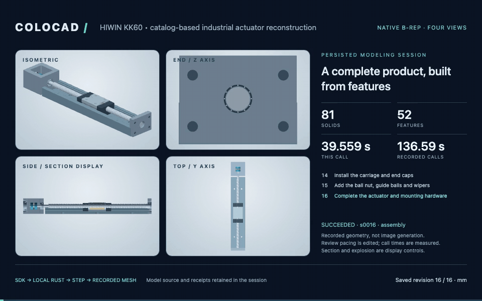
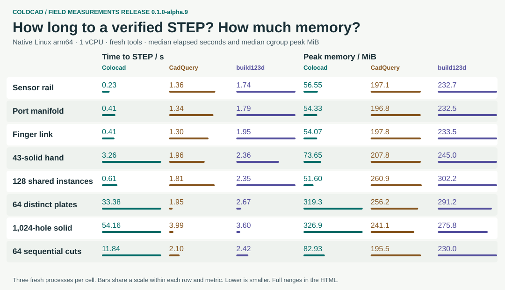

# Colocad



**面向 agent 的参数化 CAD：本地 Rust 几何内核、TypeScript SDK、CLI，以及可追溯的建模过程。**

[English](README.md) · [文档](docs/README.zh-CN.md) · [npm](https://www.npmjs.com/package/@coloopx/colocad) · [更新日志](CHANGELOG.md) · [Releases](https://github.com/Coloopx/colocad/releases) · [封面模型](examples/hiwin-kk60/README.md)

Colocad 把明确的建模指令转成可编辑源、精确 STEP 和可视化产物。Agent、harness 与 CAD 程序都在**同一个沙箱内部**。npm 包自带编译好的 Rust 内核，安装后建模无需 Python、Rust 工具链、网络或独立 CAD 服务。

**项目处于 alpha 阶段。** 已有机械零件、装配体、性能记录和可复现示例；尚不能完整替代 build123d，也不等于经过制造验收的 CAD 系统。[支持范围与限制](#支持范围与限制)。

## 可以用来做什么

- **零件和装配体：** 参数化特征、重复零件实例、精确 STEP，以及 PNG/GLB/STL 预览。
- **Agent 建模：** SDK 工具与随包 skill，支持尺寸解释、特征规划、改参和结果检查。
- **人类审阅：** 保存成功与失败的构建，检查源和回执，输出单文件离线 HTML、四视图 MP4/GIF。

SDK 是基础，CLI 和工具适配器负责接入 harness，skill 指导建模决策。图纸与图片由 agent 作为证据解释；colocad 执行明确的几何指令。


## 安装

需要 **Node.js 22+**，支持 **Linux x64、Linux arm64、macOS arm64**。

```sh
npm install @coloopx/colocad@0.1.0-alpha.9
```

安装包包含 JS/TS API、CLI、原生可执行文件、查看器和完整 skill。Rust 源码位于 [crates/agent-cad](crates/agent-cad)，npm 包携带编译产物。[模型与产物格式](docs/concepts.md)。

## 快速开始

在你的 Node 项目中运行：

```sh
# 构建随包歧管示例，保存源、回执和几何。
npx colocad record node_modules/@coloopx/colocad/examples/manifold.json ./history \
  --label "Build the manifold"

# 启动交互式查看器。
npx colocad view ./history

# 导出单文件 HTML，其中包含最终 STEP 下载。
npx colocad replay ./history ./review.html
```

示例包含拉伸、盲孔切除、圆角、线性阵列和口袋。修改 JSON 后再次 `record` 到同一个 history 目录，即可追加版本；失败尝试也会保留。`view` 展示启动时的快照，新增版本后需重新打开。[首个零件与改参教程](docs/getting-started.md)。

也可以通过 SDK 使用相同的本地内核：

```js
import { ModelingSession } from '@coloopx/colocad/session';

const session = await ModelingSession.create('./sdk-history');
const result = await session.build({
  version: 1, units: 'mm', parameters: { length: 60 },
  features: [{ id: 'stock', op: 'box', origin: [0, 0, 0],
    size: [{ param: 'length' }, 30, 8] }],
  output: 'stock',
});
if (!result.ok) throw new Error(JSON.stringify(result.error));
await session.edit({ length: 80 });
```

无需记录会话时，直接使用 `CadClient`。[SDK、CLI 与工具 API](docs/api.md)。

## 从 CLI 启动可视化与导出


查看时间线、源、特征、回执与选中的零件；切换镜头、显示剖切/爆炸视图、下载产物。离线 HTML 内嵌渲染代码和几何。需要集成到现有界面时，可使用 `@coloopx/colocad/viewer`。

| 命令 | 输入 | 结果 |
| --- | --- | --- |
| `colocad plan TREE.json` | `colocad/1` 特征树 | 编译并检查原生建模任务 |
| `colocad build TREE.json NEW_DIR --preview` | 特征树 | STEP、可编辑源和预览 |
| `colocad record MODEL.json SESSION` | 特征树或 kernel JSON | 构建并保存建模里程碑 |
| `colocad view SESSION` | 已保存会话 | 本地交互查看器 |
| `colocad replay SESSION review.html` | 已保存会话 | 单文件离线 HTML |
| `colocad render SESSION modeling.mp4` | 已保存会话 | 四视图动画，也支持 `.gif` |

alpha.9 增加了三个会话命令。用 `colocad head SESSION` 取当前有效的几何版本，`colocad inspect SESSION REQUEST.json` 查询并记录安装面和孔组，`colocad edit SESSION PARAMETERS.json` 从有效模型改参。四孔板示例演示了如何改成六孔，并重新测量孔径。[操作步骤](skills/colocad/references/modeling-loop.md#inspect-and-edit-from-a-shell)

无桌面的沙箱使用 `colocad view ./history --no-open --port 8787`，配合 harness 现有端口转发；监听地址为 `127.0.0.1`。

```sh
# 可选的视频依赖；还需在宿主安装 FFmpeg。
npm install -D playwright
npx playwright install chromium
npx colocad render ./history ./modeling.mp4 --width 1280 --height 800 --fps 15
```

动画读取**实际保存的 CAD 版本**，真实调用耗时与剪辑后的播放时长分别显示。构建几何、导出 HTML 无需 Chromium 或 FFmpeg。[完整历史与渲染指南](docs/modeling-history.md)。

## 接入你的 agent

复制完整 skill，包含 references、scripts 和可编辑形状资产：

```sh
# Codex 项目技能；Claude Code 改用 .claude/skills。
mkdir -p .agents/skills
cp -R node_modules/@coloopx/colocad/skills/colocad .agents/skills/colocad
```

已有同名 skill 时，更新前保留本地定制。然后给 agent 一个具体任务：

> 使用 colocad skill，构建 100 × 50 × 6 mm 安装板，中心对称布置 3 × 2 个 Ø6 通孔，两向孔距 32、30 mm。保存可编辑源与建模会话，检查尺寸，通过 CLI 导出 STEP 和离线 HTML。

| Harness | 接入方式 |
| --- | --- |
| Codex | [项目 skill 与 CLI](docs/integrations/codex.md) |
| Claude Code | [项目 skill 与本地工具](docs/integrations/claude-code.md) |
| Pi core / coding agent | [类型化工具适配与扩展](docs/integrations/pi.md) |
| 自建 harness | [SDK schema、状态和产物生命周期](docs/integrations/overview.md) |

[完整建模指南](docs/agent-modeling-handbook.zh-CN.md)涵盖材料预备、尺寸不确定性、工具抽象、提示词、建模闭环、验证和调优。[可运行工具示例](examples/integrations/README.md)执行真实建模、数值核对和失败恢复；决策序列是脚本化的，不是 LLM 自主建模成功率测试。

## 实例：完整线性执行器

封面依据厂家图纸重建 **HIWIN KK60，导轨 300 mm、导程 5 mm、行程 210 mm**，包含 **52 个最终特征、81 个命名实体实例、16 个建模里程碑**。丝杠螺旋槽是实际切出的几何，另有导轨沟槽、安装孔、滑台、轴承和联轴器。

```sh
node node_modules/@coloopx/colocad/examples/hiwin-kk60/run.mjs ./actuator
npx colocad view ./actuator/session
npx colocad render ./actuator/session ./modeling.mp4
```

独立 OCCT 检查覆盖 16 份 STEP、64 个材料探针和指定位置的导轨/滑台间隙。未公开内部结构明确标为近似或省略；这是产品目录重建，不是可直接生产的完整图纸。动画也不是速度基准。

[MP4](showcase/hiwin-kk60/modeling.mp4) · [可编辑模型](showcase/hiwin-kk60/model.json) · [验证结果](showcase/hiwin-kk60/verification.json) · [尺寸与假设](examples/hiwin-kk60/sources.json) · [完整离线交付包](https://github.com/Coloopx/colocad/releases/download/v0.1.0-alpha.4/hiwin-kk60-delivery.zip)

## 性能

**alpha.9 三方复测。** 针对相同几何，207 份 STEP 均通过独立回读。在主矩阵的 12 个规模点里，Colocad 有 **10 个峰值内存最低、6 个用时最短**。小零件、共享实例占优；大量独立件、密集孔和长布尔链的耗时由其他后端领先。



**同一只 43 实体灵巧手，100 秒连续改参：** 按 Colocad / CadQuery / build123d 顺序，交付 **32 / 58 / 48** 份有效 STEP，最高采样内存为 **146.4 / 259.1 / 287.6 MiB**。Colocad 内存最低，两套 Python 后端交付更多。


默认检查点换来了可检查的构建产物，也会增加写入量。[方法、构建 I/O 图与改参验收](docs/benchmark-alpha9.zh-CN.md) · [下载单文件 HTML](https://github.com/Coloopx/colocad/releases/download/v0.1.0-alpha.9/scorecard.html) · [历史实验](docs/performance.md)。

## 支持范围与限制

- 原生包支持 Linux x64/arm64、macOS arm64，要求 Node.js 22+。[发布验证](docs/evidence/release-alpha.7.json)。
- 支持可编辑 JSON/程序和精确 STEP；STEP 不保存商业 CAD 软件的原生特征树。
- Linux 通用可编辑 SOLIDWORKS 输出尚未完成。实验性 Windows author 需要授权 SOLIDWORKS，软件内重建验收仍未通过验证。[原生导出状态](docs/native-solidworks.md)。
- 几何有效、读图正确、可编辑、能配合和可制造需要各自的证据。[验证范围](docs/validation.md)。
- CAD 的 512 MiB 测试不代表常驻 agent、浏览器和视频编码器的整体内存预算。
- alpha.8 修复 `face_hole_grid` 与 `hole_grid` 接缝曲线的精确查询快照。[回归与安装包证据](docs/evidence/release-alpha.8.json)。

## 能力覆盖与路线图

[CadQuery 设计与 API 覆盖报告](docs/cadquery-comparison.zh-CN.md)逐项映射其 API 索引的 150 个入口，列出缺口和证据。[ROADMAP](ROADMAP.zh-CN.md)总结架构、G1–G3 验收范围以及后续 benchmark/RSI 路线；G4 自动执行器尚未实现。

## 文档与帮助

alpha.7 已提供：[精确查询与几何驱动装配](docs/engineering-queries.zh-CN.md)，以及[可运行的外部 STEP 例子](examples/engineering-queries/README.md)。[四阶段目标](specs/0005-capability-reliability-and-optimization.zh-CN.md)依次为功能覆盖、几何可靠性、工程可用性、benchmark 驱动优化。SDK、CLI、工具 schema 和三平台原生内核同步交付；这是 Colocad 自己的查询 API，不提供 CadQuery Python/API 兼容层。

G1–G3 已按[明确的验收范围](specs/experiments/0005/README.md)通过：24/24 几何案例独立验证、127 项 Rust / 41 项 Node 测试，以及 Linux arm64 **1 vCPU / 512 MiB** 内的两条真实 Pi 任务。语料执行加最小调度器的 cgroup 峰值约 **256 MiB**；驻留 Pi/harness 加 82 实体执行器改参和预览约 **371 MiB**，无 OOM。这是正确性与资源验收，不是新一轮 build123d 性能比较，也不代表全部工业场景对等；G4 尚未启动。


[入门](docs/getting-started.md) · [API](docs/api.md) · [完整建模指南](docs/agent-modeling-handbook.zh-CN.md) · [Skill](skills/colocad/SKILL.md) · [故障排查](docs/troubleshooting.md) · [全部文档](docs/README.zh-CN.md)

问题和功能建议请[提交 issue](https://github.com/Coloopx/colocad/issues)，附上版本、平台、最小模型和相关回执，并移除凭证及私密资料。

## 开发与贡献

```sh
git clone https://github.com/Coloopx/colocad.git
cd colocad
npm ci
npm run build:kernel
npm test
```

源码构建需要 Rust 工具链，并拉取固定版本的 SolidCore。查看器、视频和 Pi 接入测试另有依赖；安装、测试和发布方法见 [CONTRIBUTING.md](CONTRIBUTING.md)。欢迎提交 issue 和 pull request。

## 许可证与致谢

Colocad 应用代码使用 [MIT 许可证](LICENSE)。内核基于 [SolidCore](https://github.com/tangency-labs/solidcore)，其中包含源自 NVIDIA USD BRep / SMLib 的工作；查看器使用 Three.js。依赖许可证与归属见 [NOTICE.md](NOTICE.md) 和 [kernel/licenses](kernel/licenses)。工业实例与 HIWIN 无隶属或背书关系。
