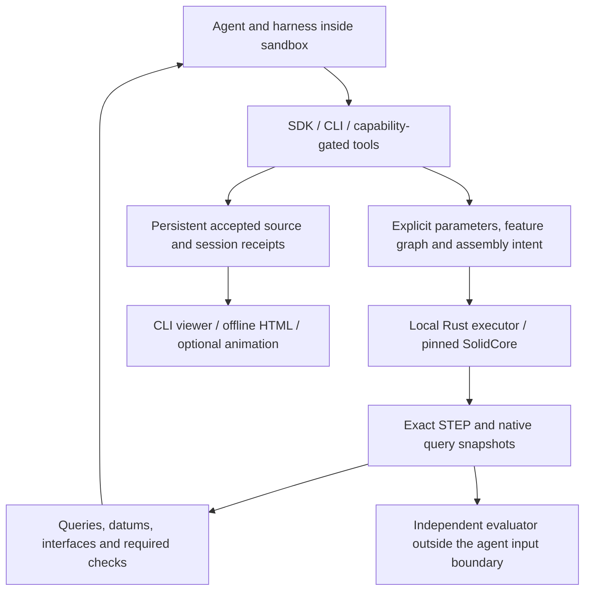
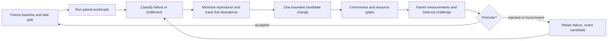

# Colocad roadmap

Updated **2026-11-12**. [中文](ROADMAP.zh-CN.md) · [CadQuery coverage](docs/cadquery-comparison.md) · [Ordered acceptance spec](specs/0005-capability-reliability-and-optimization.md).

[Alpha.10 performance and hybrid acceptance](docs/benchmark-alpha10.md) records 207 independent deliveries and the 100-second hand queue. The next performance baselines are dense-plate Level-1 checks, placed-volume integration on distinct parts, and persistent writes for full assemblies.

This roadmap separates shipped architecture, scoped acceptance and planned experiments. Colocad targets a practical independent modeling/assembly stack for agents; it does not claim full CadQuery/build123d equivalence. **G4's automated benchmark/optimization runner is planned, not shipped or accepted.**

## Current design

The alpha.9 memory work is tracked in [issue #1](https://github.com/Coloopx/colocad/issues/1) and its [milestone](https://github.com/Coloopx/colocad/milestone/1): M0 investigation complete. Alpha.9 ships a Rust session catalog, paged history and v1 migration. [M1 validation](benchmarks/session-catalog/README.md) · [500k migration memory gate](benchmarks/session-catalog/migration-memory.md). M2–M5 are pending.

Alpha.9 reduces the live STEP buffers during assembly encoding and shares query input files across recorded inspections. [Implementation and measurement](benchmarks/query-io/README.md).

**Next: bound active geometry and stream assembly output.** [SDD 0006](specs/0006-bounded-memory-persistence.md) defines the program for indexed history, a byte-budgeted active geometry set, streamed artifacts and large-project/viewer pagination. The [memory study](docs/memory-persistence-report.md) retains Colocad/CadQuery/build123d baselines, failures and experimental controls. Indexed migration has shipped. Chunked projects and single-STEP streaming have separate acceptance gates. [Release benchmark](docs/benchmark-alpha9.md). This directed experiment also supplies a concrete G4 development case.

Agent, harness, SDK and native executor share one sandbox. The independent evaluator can run in a separate test environment; reference geometry must not be exposed to a drawing-reconstruction agent. The modeling package does not require a separate CAD service.

- **Deterministic execution:** schema-validated parameters, features and named occurrences produce exact geometry; source edits are explicit. The model interprets materials through the harness's existing file/image tools, not a built-in image-to-CAD endpoint.
- **Read-only engineering observation:** exact revision-bound snapshots support selection, descriptors, supported hole/group recognition, semantic datums/interfaces and pair checks. Re-query after edits; persist recipes rather than incidental face numbers.
- **Usable persistence:** accepted source, failed attempts, receipts and mesh observations survive a session. CLI starts human review/export. Camera changes reuse saved geometry when possible.
- **Distribution:** npm contains the SDK, CLI, skill/docs and precompiled macOS arm64/Linux arm64/Linux x64 executables. Optional rendering and independent verification have additional dependencies.

## Implementation and acceptance state

| Area | State | Evidence / remaining boundary |
| --- | --- | --- |
| Modeling, parameters, local sketch solver, assembly and preview | Implemented in declared domains | [Capabilities](crates/agent-cad/src/capabilities.rs), [coverage report](docs/cadquery-comparison.md); not a general industrial success-rate claim |
| G1: selectors, datums, bores/groups, mounting interfaces | Accepted for the SDD 0004 contract | [G1 ledger](specs/experiments/0004/README.md); complex recognition/contact domains remain partial/unsupported |
| G2: geometric reliability | Frozen 24-case corpus accepted | [G2/G3 ledger](specs/experiments/0005/README.md); 18 positives and six required rejections are not a representative population estimate |
| G3: edit/reference/replacement/recovery and sandbox usability | Accepted on recorded tasks | Semantic lifecycle and two live Pi tasks; resource conclusions apply to those workloads |
| Alpha.8 grid snapshot repair | Release regression | [Evidence](docs/evidence/release-alpha.8.json); adds a combination missed by alpha.7's frozen corpus without rewriting that corpus's results |
| CadQuery coverage audit | Documented | 150 index entries mapped; no complete API compatibility or 150-case differential test |
| G4 benchmark and retrospective improvement | **Planned** | Protocol below and SDD 0005; existing benchmarks are inputs, not a completed autonomous loop |
| General native editable commercial CAD | Incomplete | [SOLIDWORKS status](docs/native-solidworks.md); STEP and source editability are different claims |

New failures re-open the affected gate for the changed candidate. A historical green record does not excuse a newly reproduced supported-path defect. Every release must retain earlier failing evidence and add new acceptance evidence.

## Prioritized capability work

1. **Query-to-feature bridge:** let more typed geometric recipes drive fillet, shell and other feature operands. Acceptance: cardinality/ambiguity, split/merge/delete, fresh re-resolution after edits and imported-part variants. Do not store old query refs as a shortcut.
2. **Missing query primitives:** spatial selection, radius ranking and explicit body/wire scope where justified by tasks. Specify whole-shape versus support-surface semantics and resource bounds before expanding the schema.
3. **Sketch/interchange breadth:** prioritize DXF profiles, general 2D offsets and spline/curve operations using a source-backed task corpus. Import/export representation, units, topology and edit preservation need separate checks.
4. **Difficult geometric families:** expand foreign STEP, intersecting bores, blends, thin walls and sweeps/surfaces. Include valid difficult cases and invalid controls; unsupported cases stay visible in denominators.
5. **Assembly verification:** extend curved-contact and region-specific checks only with independent reference cases. Continuous travel needs a distinct collision/motion contract; more discrete poses do not establish it.

These are planned scope expansions, not hidden requirements already satisfied by G1–G3. Dates and broad parity claims follow evidence, not an API-name count.

## Benchmark tracks

| Track | Inputs and experiment | Acceptance and metrics |
| --- | --- | --- |
| A — deterministic execution | Paired Colocad/CadQuery/build123d programs derived from the same geometry specification; primitive, grid, boolean, blend, shell, surface and assembly families | Independent exact readback first; cold time-to-STEP, resident edits, snapshot load/query, preview and export measured separately; peak cgroup, OOM, artifacts |
| B — engineering lifecycle | Imported parts, parameter/topology edits, compatible and incompatible replacements, interrupted/reopened sessions | Semantic intent, reference invalidation, required compatibility and pair checks, false acceptance, recovery success, latency/resource cost |
| C — live agent reconstruction | Licensed source packs for whole products and parts; drawings/views/BOM as available; identical task and budget per paired run | Geometry, interfaces, topology, edit challenges, tool repairs, tokens/cost and end-to-end duration; human-review artifacts retained |
| D — controlled skill/tool changes | Same agent/model, tools, source split and budget; change one prompt, skill reference or feedback abstraction | Held-out task success, invalid/unsupported claims, repair count, cost and context size; scripted tests alone do not prove prompt effectiveness |

CadQuery and build123d are distinct baselines even though both use OCCT. Use idiomatic implementations reviewed for unnecessary rebuilding and equivalent caching policies. Freeze their versions independently. For kernel effects hold geometry fixed; for agent outcomes hold the task fixed and report the resulting model/harness/tool configuration. Do not attribute a whole-system difference solely to the kernel.

### Drawing quality and editability

[CADArena's official methodology](https://normal.ai/research/cadarena/methodology) separates geometry and editability, keeps reference geometry/jigs out of agent inputs, and uses real manufacturer drawings. Its original report uses 18 licensed drawings and a FrontierCAD score combining geometry with editability. We borrow those evaluation principles; **we do not claim access to its licensed dataset/verifier, an official score, or a reproduction of its leaderboard**.

Our proposed evaluator will publish its own rubric and version:

- Reject missing/invalid geometry before scoring; compare at correct units. If alignment is permitted, allow translation/rotation, not rescaling or reflection.
- Check shape, reference material/clearance regions and topology separately. Bounding box or total volume alone cannot locate a wrong hole.
- Exercise predeclared edits and component replacements; measure intended downstream changes and preserved invariants. Inspect feature intent with a disclosed rubric where needed, and report judge disagreement rather than silently converting it to fact.
- Report geometry, editability and resource metrics separately. A combined score, if adopted, must retain its components and be labelled Colocad's evaluator, not FrontierCAD.
- Include no-output, crash, timeout, OOM and unsupported trials in the task denominator. Success-only timing distributions must be labelled; failed runs are never quietly dropped.

### Dataset and measurement controls

Before running a campaign, freeze a manifest containing provenance/license, hashes, units, given/derived/assumed dimensions, required outputs, editable variables, tolerances, evaluator and split. Start with the existing regressions, source-backed KK60 product and foreign-interface fixtures. Acquire additional whole-product materials with sufficient geometry and redistribution permission; the historical examples are development data, not unseen holdouts.

Use development reproducers, a frozen regression set and held-out **product families**, including unseen parameter/topology combinations. Keep holdout reference/jig assets outside the candidate agent's workspace. Repeatedly tuning against a public test case makes it development data; rotate a versioned holdout rather than continuing to call it unseen.

Use matched native hardware for platform comparisons. Linux x64 under arm64 emulation can validate correctness but cannot establish native x64 performance. Pin CPU/memory/network, OS/compiler/native/SDK hashes and cache policy. For the target 1 vCPU / 512 MiB budget distinguish CAD-only, installation and resident agent/harness measurements. Browser/video encoding has a separate budget.

Use at least five repetitions for a pilot, then preregister the promotion run size and objective. A proposed default is 20 paired runs with randomized order, median/spread and paired confidence intervals; use sufficient samples before reporting tail percentiles. Record raw timings and cgroup peak/events, including descendants and charged cache pages. Query/preview reuse cannot be compared to fresh modeling.

## RSI: auditable improvement of code, tools and skill

Here **RSI means an agent-operated iterative improvement loop** over this repository and its guidance. It does not mean model-weight training or autonomous unrestricted publication. The optimization agent may propose source/skill changes; an independent, frozen evaluator decides whether they work.

Each iteration records baseline/candidate commit, native/skill/tool hashes, hypothesis, affected family, source/split/evaluator hashes, command/environment, raw traces, smallest reproducer, original product regression, independent checks, resource/cost data and `accepted | rejected | inconclusive` with rationale.

Promotion rules:

1. A required correctness failure, incompatible-part false acceptance, swallowed ambiguity/degradation or stale reference rejects the candidate regardless of speed. The proposer cannot modify the frozen evaluator, expected geometry, tolerance or task denominator to pass.
2. A correctness repair needs the original red case, affected-family regressions, independent geometry checks and no new required regression. It need not claim a speed gain. The alpha.8 seam repair is this type of work, not evidence that the G4 runner exists.
3. A performance candidate needs a predeclared improvement objective beyond measured noise, with no correctness/resource regression outside its accepted budget. A suggested initial threshold is a ≥5% paired median improvement with a 95% paired interval supporting the direction; the campaign freezes the actual threshold before observing candidates. Report tradeoffs and rejected hypotheses.
4. A skill/tool candidate needs held-out live-agent evidence under the same model and budget. Better scripted behavior or prettier output does not establish a higher modeling success rate.
5. Bound iterations, inference spend and wall time. Stop on repeated inconclusive candidates or exhausted budget; preserve the best accepted baseline and unresolved findings. Merging/releasing remains a separately authorized maintainer action, never an automatic consequence of a score.

## G4 delivery milestones

| Milestone | Planned artifact | Exit criterion |
| --- | --- | --- |
| G4.0 — protocol and corpus | Versioned manifests, license checks, paired task specifications and holdout boundary | Independent review of metrics/tolerances/splits; valid and invalid controls; relevant G1–G3 gates current |
| G4.1 — runner and baseline | CLI runner, isolated execution, resource collection and immutable result bundles | Repeatable runs for all three backends; deliberate crash/OOM/timeout/no-output accounting; independent readback |
| G4.2 — agent tracks | Drawing/product and skill/tool ablation protocols | Fixed model/harness/budget, retained traces, predeclared edit challenges and unseen family evaluation |
| G4.3 — first improvement cycle | One complete candidate, plus rejected/inconclusive evidence when encountered | Original failure/bottleneck → red test → bounded patch → regression/holdout → justified accept/revert |
| G4.4 — recurring campaigns | Versioned reports and maintainer review of proposed changes | No benchmark contamination, preserved history and reproducible results; no unattended publish path |

G4 acceptance requires an executed end-to-end cycle and inspectable artifacts. Writing this roadmap, fixing one defect or reusing an old speed chart does not satisfy it.
