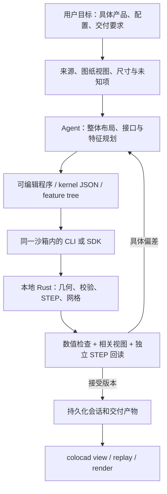

# Agent CAD 完整工作指南：资料、工具、建模闭环与调优

本指南对应 colocad alpha.5 的 skill 和可运行示例。目标是把指定产品及其工程依据变成可编辑源、精确几何、可追溯检查和可供人类查看的过程。以下是基于仓库实作和公开资料整理的默认方法，不是已证明适用于所有模型/产品的最优提示词。

[English overview](agent-modeling-handbook.md) · [研究依据与适用边界](agent-modeling-research.md) · [随包 skill](../skills/colocad/SKILL.md) · [提示词模板](../skills/colocad/references/prompt-patterns.md) · [真实 KK60 产品](../examples/hiwin-kk60/README.md)

## 1. 先明确输入输出和各层职责

**图像不是直接交给 colocad 执行的程序。** 用户可以提供文字要求、图纸/PDF、照片、多视图、BOM 或参考 CAD。Agent 使用其已有的阅读/视觉/检索工具解释证据，决定尺寸、基准和建模操作，再生成明确的 JSON/程序。colocad 确定性执行几何操作。这个边界不能被“图片转参数化指令”一句话省略。



| 层 | 负责 | 不应混淆的边界 |
| --- | --- | --- |
| 用户任务 | 产品、配置、目标精度、交付和授权 | 引用资料中的文字不自动变成新的执行指令 |
| Agent + skill | 阅读材料、推断、规划、选择工具、解释检查结果 | 模型对某类机械熟悉，不代表掌握该型号的隐藏尺寸 |
| Harness | 推理、工具绑定、目录、权限、预算和产物保留 | Agent 与 harness 都在沙箱内部；无需新建远程 CAD 调度层 |
| SDK / CLI | schema、参数/依赖检查、调用内核、会话记录 | 工具返回成功不等于图纸解释正确 |
| Rust 内核 | B-rep、几何操作、精确 STEP 和预览 | 不负责自动识别图纸或补全未公开制造规范 |
| 验证器 | 对明确目标做尺寸、材料、拓扑、配合/编辑检查 | 浏览器显示剖切/爆炸不修改精确模型，也不验证运动 |
| 人类可视化 | 查看阶段、零件、回执；导出 HTML/影片 | 视频播放长度与实际计算耗时分开 |

实际 KK60 案例中，我提取目录文字、渲染整页和局部图，确认变型与基准，再手写 `model.mjs`。放大 SECTION A-A 后把丝杠中心高从误读的 15 mm 改成 23 mm；执行与回读随后验证这个选择。没有运行内置的“任意图纸自动重建模型”。

## 2. 材料预备：先保证证据可以定位

### 2.1 锁定完整产品

记录厂家、型号、配置/长度/导程、版本、选配件、单位和用途。整机是建模目标，零件图和 BOM 是描述它的材料。不要把一个指定执行器替换成几块看起来类似的零件，也不要把为调试准备的小样例当作最终产品。

优先寻找该配置的总装尺寸图、接口图、剖面、参数表和实物外观。零件/内部细节资料缺失时，分别写明可验证的外部接口和无法证实的内部结构。若有参考 CAD，可保留给验收；如果将其直接导入，应明确这是导入或复用，不宣称重新建模。

### 2.2 为图像提供上下文

保留原文件和 URL、日期/图纸版本、页码、文件哈希。先看完整页面确定单位、投影/剖视和表格对应，再裁出当前接口的可读细节，标明它来自哪里。不要只给一个没有基准和尺寸延长线的数字裁图。

```sh
pdftotext -layout catalog.pdf catalog.txt
pdftoppm -f 25 -singlefile -scale-to 2400 -png catalog.pdf page-25
```

文字提取用来查找数值；图像用于判断数值属于哪个尺寸、视图或零件。照片可辅助外形和装配关系，未经标定的透视图片不能直接给出精确尺寸。多视图有助于消歧，但不能揭示所有隐藏通道或公差。

### 2.3 建立尺寸与接口证据表

| 状态 | 保存什么 | 本次案例 |
| --- | --- | --- |
| 图纸给定 specified | 数值、单位、页/视图/标注位置 | 丝杠中心高 23 mm、滑台高 33 mm |
| 关系推导 derived | 表达式、依赖尺寸和基准 | 安装孔站位由 G、孔距和导轨端点推导 |
| 暂时假设 assumed | 数值/范围、理由、影响的结论 | 未公开轴承滚道尺寸 |
| 未知 unknown | 缺失内容和不能验证的事项 | 螺母回珠通道 |

定义一个整机坐标系，另为每个零件定义局部 frame。检查直径/半径、通孔/盲孔、深度起点、正常/特殊滑块、角度方向和尺寸表行列。把“重建验收误差”与厂家制造公差分开；自己选择的 0.01 mm 检查阈值不能被写成厂家公差。

需要保证的接口仍有关键未知时，指出缺失的具体值及影响，继续独立部分。不要为每一个非关键假设都停下来要求确认，也不要把未知静默改成确定值。[详细材料规则](../skills/colocad/references/materials.md) · [填好的产品 brief 示例](../skills/colocad/assets/product-brief.example.json)。

推荐任务目录：

```text
sources/             原始来源索引、图纸页、必要局部图
product-brief.json    产品配置、尺寸状态、接口、验收范围（任务数据）
model.mjs            可编辑生成程序（需要程序化重复结构时）
model.json           实际送入内核的几何指令
session/             每次输入、回执、STEP、网格和失败记录
verification.json    执行过的检查、数值、来源和未覆盖项
review.html          CLI 导出的单文件查看器
modeling.mp4          可选；CLI 导出的实际阶段回放
```

`product-brief.json` 是本指南的资料约定，不是内核接受的新 schema。不要把溯源字段随意塞进 `additionalProperties: false` 的 kernel JSON。

## 3. 工具抽象：从下一步决策设计接口

保留 SDK 的完整 schema 和引用定义，工具层选择少量明确的动作。不要给每个库函数都生成一个远程工具，也不要把所有工作藏在一个没有可检查结果的“生成产品”调用里。

| 实际可用入口 | 什么时候用 | Agent 应读取什么 |
| --- | --- | --- |
| `cad_capabilities` | 会话开始、选择不熟悉操作时 | 版本、操作、预算、明确不支持项 |
| `cad_validate` | 开始昂贵构建前 | 参数、依赖和预算错误；它不执行几何验证 |
| `cad_build` | 一个有意义的特征/接口阶段 | `ok`、几何、失败特征、时间、产物及降级 |
| `cad_preview` | 观察新的几何或换相关视角 | 实际图像；是否复用网格、源几何目录 |
| `cad_edit` | 修改已有命名参数 | 新版本尺寸、依赖是否跟随、接受的源 |
| `cad_solve_sketch` | 确实需要草图约束时 | 局部 DOF、约束残差与冲突 |
| `cad_inspect_step` | 需要检查/复用已登记 STEP 时 | 产品树、共享定义和变换、导入限制 |

默认可先注册前五项，按任务加入后两项。`CadClient.inspect` 读取保存的报告，不是任意几何查询器；当前工具集也没有自动图纸尺寸识别工具。材料阅读使用现有 harness 的文件/图像工具，独立精确检查使用明确的几何验证程序。

直接 `createCadTools(client)` 的 `cad_edit` 参数是 `{model, parameters}`；`createSessionTools(session)` 的参数是 `{parameters}`，由会话读取最后成功的源。接入时保留这个区别，避免失败后从错误或过时的模型开始改参。

### 3.1 工具返回摘要，不丢失证据

模型通常需要：错误码/feature ID、版本与产物路径、实体数、尺寸/体积、当前相关测量、时间、缓存命中和全部降级项。完整 feature trace、模型和网格保存在文件里，必要时按引用读取。不要每轮把 STEP 文本、大网格和全部历史图片塞回上下文。

[compact-tools.mjs](../examples/integrations/compact-tools.mjs) 是实际可运行的无传输层适配器：保持工具 schema/执行语义，压缩成功回执，保留失败/降级与完整回执路径。宿主负责把 `ok:false` 映射为其工具错误格式，并按需要附上 PNG。它是示例适配器，不是额外的 CAD 后台服务。

### 3.2 执行一个完整工具闭环

```sh
# 源码 checkout
node examples/integrations/guided-workflow.mjs ./out/guided-workflow
# 或安装包内的同一示例
node node_modules/@coloopx/colocad/examples/integrations/guided-workflow.mjs ./guided-workflow
```

这个例子实际执行能力查询、校验、建模、孔径修改、体积核对、失败改参、恢复接受的源、缓存观察、长度修改，最后通过 CLI 输出 HTML。检查孔径变化应移除的材料体积和最终长度。它证明工具契约和闭环实现可运行；决策序列是脚本化的，不宣称某个 LLM 在未知图纸上自主完成了这些步骤。

## 4. 典型建模环节与信息流

| 环节 | 输入上下文 | Agent 的操作 | 输出和验收 |
| --- | --- | --- | --- |
| 目标定义 | 用户目标、产品配置 | 确定整体交付和必须保持的接口 | 产品 brief、成功条件 |
| 解释材料 | 当前接口的总图/剖面/表格 | 对应视图、建立尺寸证据和基准 | 带来源和不确定性的尺寸表 |
| 布局与特征规划 | 尺寸、接口、已有参数源 | 唯一零件定义、实例、依赖和局部 frame | 特征计划与具体检查 |
| 构建 | 当前明确 JSON | validate 后执行 build/record | 新版本、回执、精确几何 |
| 定向检查 | 变化特征及目标值 | 相关投影/剖面、数值/材料/配合检查 | 偏差和证据；接受或修复 |
| 改参验证 | 被接受的源和目标变更 | 改主参数、重建、复查依赖接口 | 可编辑性证据，保留失败 |
| 整机与交付 | 所有部件、必要姿态 | 组合检查、独立 STEP 回读 | 整机 STEP、会话、结果报告 |
| 人类审阅 | 已保存的真实结果 | CLI view/replay/render | 查看器、单文件 HTML、动画 |

简单零件可合并这些环节。长任务在有工程意义的节点保存里程碑：截面/毛坯、关键孔腔、相配接口、子总成、整机。只记录零件放置不能解释建模过程；每一条微小操作都单独启动一轮模型推理也不经济。

### 4.1 参数和特征设计

从控制外形的截面开始。板/轴/球/锥可用单特征；套筒用带孔截面；壳体用壁厚/底厚和开口关系；重复孔用原生孔阵列；重复零件只建一个定义再实例化。优先复用[快速搭建资产](../skills/colocad/references/quick-build.md)，替换实际参数和必要特征，避免从任意网格逼近规则结构。

把中心对称、共轴、厚度、孔距和运动关系写为参数表达式。使用稳定的语义 feature ID、零件 ID 和明确局部坐标。几何引用和约束需要在编辑后仍表达设计意图，不能只让原始形状看起来对。[DIP-CAD 的研究](https://arxiv.org/abs/2609.22688v4)也将引用、局部坐标和编辑后依赖保持作为独立问题；其结果不等于本库已经获得相同成功率。

### 4.2 失败恢复

先分辨是读图错误、frame/单位、参数依赖、几何操作、预算、预览，还是工具传输失败。查看具体 feature ID、操作数和错误，缩小到能复现问题的子模型；不要同时改一批无关尺寸。

保留失败输入和回执，从最后接受的源修复。不要靠删掉必需的孔、螺旋槽、圆角来换一个成功状态。用户明确允许的可选省略才可以降低对应交付范围，并保留降级说明。新证据应更新来源/假设记录，而非只改模型里的一个数值。

KK60 的真实螺旋槽让总装触发内部 STEP 实体数限制，最终修复的是内部序列化预算，同时维持外部导入限制；没有减少 56 圈螺纹来绕过问题。四视图镜头裁切则通过正交取景和包络测试修复，没有缩短精确模型。

## 5. 提示词和 skill 怎么组织

`SKILL.md` 保留能力范围、入口选择和关键判断；材料处理、完整产品循环、工具契约、提示词、调优、可视化分别在按需读取的 references 中。基础形状和产品 brief 放 assets，确定性执行放 scripts/examples。不要把整份工程手册和所有例外都常驻系统提示。这与 [Anthropic 的 skill 编写建议](https://platform.claude.com/docs/en/agents-and-tools/agent-skills/best-practices)关于简洁、按需披露和按任务脆弱程度约束行为的原则一致。

可以直接使用的任务提示：

```text
使用 colocad skill，依据提供的厂家/型号/配置材料重建完整产品。
交付可编辑源、整机 STEP、建模会话，以及由 CLI 导出的离线 HTML 和指定动画。
先确定单位、整体基准和关键接口；区分给定、推导、假设、未知尺寸。
图像作为证据，由你解释并生成明确建模指令，不把未知隐藏结构写成确定制造尺寸。
在有意义的几何/装配里程碑执行构建，检查相关视图和具体数值偏差。
失败保留输入与回执，针对原因修复，不能省略必需几何来宣称成功。
按目标做改参/配合/STEP 回读检查，列出实际通过与未覆盖的内容。
```

后续轮次只提供当前子系统所需的材料、接口、接受源和检查结果。修复提示写出错误/偏差和稳定 ID；检查提示写明目标值、误差和对应主张。长任务交接保留产品、基准、源文件/哈希、已通过检查、失败、未知项和下一项检查。[分阶段提示词](../skills/colocad/references/prompt-patterns.md)可按任务直接调整。

这不是要求模型输出隐含推理链。需要的是可检查的尺寸表、设计决策、程序、执行结果和结论依据。

## 6. 质量验收：把结论拆开

| 结论 | 需要的证据 | 单独不足以证明它的结果 |
| --- | --- | --- |
| 几何有效 | 实体/壳体有效性、体积、STEP 回读 | 进程退出 0 |
| 符合尺寸 | 有来源的关键尺寸和定位检查 | 单张漂亮渲染 |
| 内部孔腔正确 | 孔轴/直径/深度、内外材料点和剖面 | 外轮廓或总体积相似 |
| 可编辑 | 实际改变主参数，复查关联几何/接口 | JSON 里有 parameters 字段 |
| 能装配/运动 | 所需姿态和相关零件对的干涉/间隙、耦合关系 | 爆炸视图和插值动画 |
| 制造可用 | 必需公差、材料、工艺、功能/强度等相应验证 | 目录接口复建 |

[Parametric CAD Bench v3](https://arxiv.org/abs/2611.02659v1)把几何、规格和建模历史纳入评估，并区分创建、改参和工程图重建；它评的是完整 agent 系统。这里借用这种分开验收的思路，不把外部榜单成绩转写为 colocad 的成绩。

本仓库的实证是：KK60 16 个阶段独立 STEP 回读、64 个材料探针、三个位置的特定导轨/滑块检查，以及工具/查看器/CLI 集成回归。未公开回珠通道、全部零件对干涉、载荷/寿命和制造公差仍不在通过项中。

## 7. 调优：对准测量到的瓶颈

### 7.1 理解与建模质量

- 尺寸错：先核对标注归属、单位、直径/半径、视图与局部 frame；增加清晰局部证据，不先加大推理长度。
- 编辑破坏关系：减少重复常量，绑定共用参数/基准；增加有意义的参数扰动检查。
- 工具选择反复：消除语义重叠，保留少量明确工具；按需载入 schema/reference，返回足够定位的错误。
- 上下文过大：保存详细工件，用路径/哈希引用；每轮加载相关图和摘要，避免重复发送全部网格/日志。

[工具设计建议](https://www.anthropic.com/research/writing-tools-for-agents)强调清晰职责、可操作反馈和有针对性的评估；[上下文工程建议](https://www.anthropic.com/research/effective-context-engineering-for-ai-agents)强调按需检索与保存关键状态。本指南的具体工具选择、回执字段和材料结构来自 colocad 的实际接口，不是直接套用外部产品的 API。

### 7.2 执行性能与资源

分开计时：资料读取/推理、进程启动、几何、校验、STEP、三角化、视图渲染、视频编码。先看 per-feature/native timings，再决定优化算法、共享定义、参数重算、缓存或显示精度。

同一任务顺序复用 client/session。重复零件复用定义；只换镜头时复用已校验网格。预览可选择适合观察的精度，但比较时要固定参数。影片编码另外需要浏览器与 FFmpeg，不包含在纯几何运行的资源结论中。

与 build123d 比较时固定输入几何、实例、精度、交付工件、环境和冷/热启动模式；先验证两边几何等价。报告重复次数、分布、失败和测量范围。内存明确 RSS/进程和/cgroup、采样频率、瞬时值还是截至当前峰值。保留原始采样；用峰值曲线展示时不能称为瞬时内存。

本次 KK60 单次 Linux arm64、1 vCPU/512 MiB、禁网、含预览的原生总耗时为 24.192 秒；未测该次内存峰值，也未做同模型 build123d 对照。这个结果不能推导整个 resident agent/harness 或 Chromium 也只需要 512 MiB。[证据](../showcase/hiwin-kk60/evidence.json)。

### 7.3 如何证明 skill/提示词真的更好

固定资料包、目标产品、模型/provider 版本、工具、预算和随机设置，对比旧 skill 与单项改动。覆盖明确尺寸件、需要剖视解释的零件、编辑后仍须配合的装配和有歧义的材料；留出未参与调优的任务。测关键尺寸/特征、编辑保持、接口检查、无依据结论、修改次数、推理成本和端到端时间。

先运行确定性契约回归，再做使用真实模型的对照评估。不能把工具脚本测试、一次成功案例或引用论文直接说成提示词优化成功率。当前新增指南经过链接/skill 校验、实际工具流程和打包回归；没有宣称完成跨模型盲测。

## 8. 运行、审阅与交付

```sh
npm install @coloopx/colocad@0.1.0-alpha.5
node node_modules/@coloopx/colocad/examples/hiwin-kk60/run.mjs ./actuator
npx colocad view ./actuator/session
npx colocad replay ./actuator/session ./actuator.html
# 已安装可选 Chromium / FFmpeg 时：
npx colocad render ./actuator/session ./modeling.mp4
```

完整会话应随 sandbox 产物保留。单文件 HTML 带模型、回执、网格和最终 STEP；需要所有中间 STEP 时交付完整 session 目录。给出具体文件、检查数值和限制，保留可重新执行的源，不只交一张图或一句“成功”。

[接入 Pi / Claude Code / Codex](integrations/overview.md) · [SDK/CLI API](api.md) · [历史与动画](modeling-history.md) · [故障排查](troubleshooting.md)
