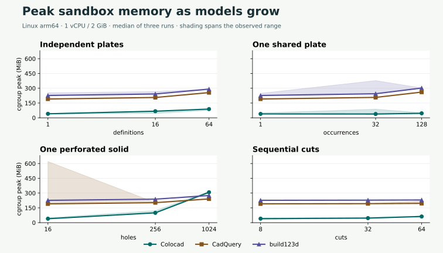
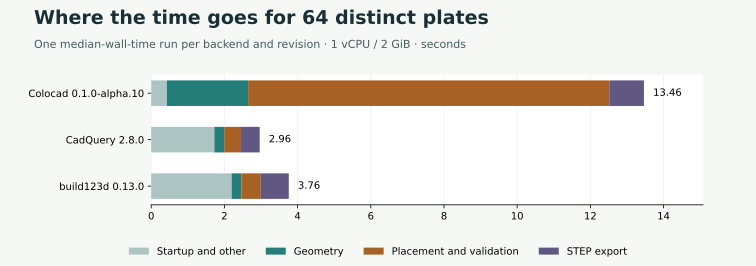
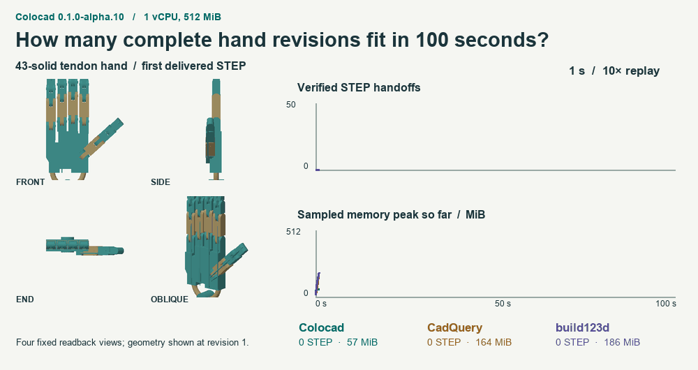
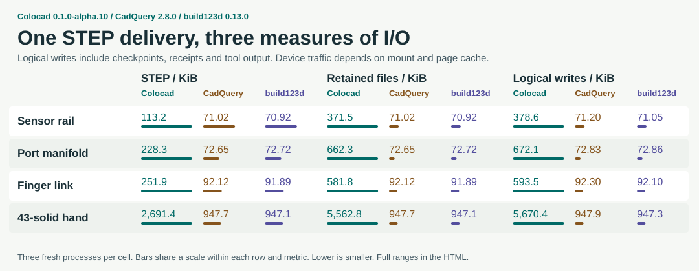

# Colocad alpha.10 performance and geometry

Colocad 0.1.0-alpha.10, CadQuery 2.8.0 and build123d 0.13.0 ran in the same Linux arm64 image. Each job received 1 vCPU. Scaling had a 2 GiB limit, product builds and hand queues had 512 MiB. Swap and network were disabled. The SDK, skill entry point and binaries used in the timed mechanical cases were byte-checked against the public npm install. The cases ran in fresh processes on a shared development VM and filesystem with varying cache state.

[Offline HTML, including all trials, six shape comparisons and the timed replay](benchmarks/alpha10/scorecard.html) · [Raw observations](benchmarks/alpha10/observations.json) · [Checks and matched release trials](benchmarks/alpha10/acceptance.json)

## Time to STEP and peak sandbox memory

Each cell gives medians of three runs in the order **Colocad / CadQuery / build123d**. Time includes startup, construction, backend validation and STEP delivery. Independent OCCT readback ran outside the clock for all 207 files. Memory is the kernel cgroup high-water mark, including charged filesystem pages. The 11 product cases, including edits, gave Colocad the lowest memory in all 11 and shortest median time in 10. For 12 scaling cases these counts were 11 and 6.

| Case | Time (s) | Cgroup peak (MiB) |
|---|---|---|
| part/16 | 0.82 / 2.46 / 2.58 | 40.0 / 190.8 / 226.4 |
| part/256 | 11.19 / 2.42 / 3.12 | 99.7 / 202.8 / 238.5 |
| part/1024 | 54.88 / 6.03 / 5.45 | 308.5 / 240.9 / 275.5 |
| repeated/1 | 0.77 / 2.04 / 2.14 | 39.6 / 191.0 / 226.5 |
| repeated/32 | 0.85 / 2.09 / 3.30 | 38.6 / 207.1 / 244.3 |
| repeated/128 | 0.81 / 2.81 / 4.47 | 45.6 / 261.0 / 302.1 |
| unique/1 | 0.79 / 1.65 / 2.77 | 40.6 / 191.0 / 226.7 |
| unique/16 | 3.24 / 1.87 / 2.80 | 67.0 / 206.2 / 241.9 |
| unique/64 | 13.46 / 2.96 / 3.76 | 88.6 / 256.0 / 291.3 |
| chain/8 | 0.67 / 1.75 / 2.30 | 40.7 / 191.1 / 226.8 |
| chain/32 | 4.40 / 2.30 / 2.78 | 45.9 / 192.7 / 228.4 |
| chain/64 | 14.20 / 3.30 / 3.05 | 62.3 / 195.4 / 230.2 |
| sensor-rail | 0.20 / 1.36 / 1.90 | 53.0 / 197.2 / 232.6 |
| sensor-rail-edit | 0.42 / 1.28 / 1.86 | 47.6 / 196.8 / 232.3 |
| manifold | 0.49 / 1.61 / 2.18 | 53.3 / 197.7 / 232.6 |
| manifold-edit | 0.38 / 1.44 / 2.45 | 58.6 / 196.8 / 256.3 |
| finger | 0.44 / 1.69 / 1.72 | 54.4 / 197.6 / 233.4 |
| links-1 | 0.41 / 1.27 / 1.80 | 51.8 / 197.6 / 233.3 |
| links-4 | 0.41 / 1.49 / 1.84 | 40.0 / 197.7 / 233.3 |
| links-16 | 0.41 / 1.44 / 2.11 | 47.2 / 197.8 / 233.7 |
| links-43 | 0.39 / 1.49 / 2.36 | 41.4 / 198.3 / 234.5 |
| pins-16 | 0.14 / 1.33 / 1.97 | 42.7 / 195.8 / 231.3 |
| hand | 2.05 / 1.92 / 2.43 | 69.9 / 207.9 / 246.2 |

A shared definition grew from 39.6 MiB at one instance to 45.6 MiB at 128. The 16-to-1,024-hole solid grew from 40.0 to 308.5 MiB. Session indexing and geometric working-set growth have different scaling behaviour; three points per family do not establish an asymptotic bound.

One definition placed 128 times took 0.81 / 2.81 / 4.47 s and 45.6 / 261.0 / 302.1 MiB. Here Colocad delivered STEP 3.5× as fast as CadQuery and 5.5× as fast as build123d. For 64 independently dimensioned plates it retained a lower memory peak and took longer. In the median Colocad trial, placement and validation took 9.87 s, including 5.05 s integrating placed volumes. The 1,024-hole solid spent 40.32 s in Level-1 checks.

## 100-second edit queue and build I/O

Each backend processed the same deterministic edit sequence on a 43-solid hand. In one 100 s window per backend, verified deliveries were **42 / 45 / 42**, with sampled running peaks **165.2 / 293.8 / 283.5 MiB**. The GIF plays actual completion times at 10×. For a single cold hand delivery the three medians were 2.05 / 1.92 / 2.43 s. The queue runs one window per backend and measures a different workload.

On the complete hand, logical writes were 5,670 / 948 / 947 KiB. Retained files occupied 5,563 / 948 / 947 KiB. Colocad writes the editable checkpoint and receipt alongside STEP. These counters measure process writes and retained artifacts; physical disk traffic depends on the mount and cache.

[History length vs. active geometry: KK60 retrofit, 4,096 durable queries and 64 independently checked revisions](field-history.md).

## Release comparisons and additional checks

The separate 512 MiB alpha.9/alpha.10 experiment ran three alternating pairs on each of 12 inputs. All 72 exports matched their per-input digest and the 12 distinct STEP models passed OCCT. The median for 64 distinct plates went from 49.13 to 11.60 s. For the 1,024-hole plate it went from 100.40 to 58.23 s. Each long session reopened 10,001 committed entries. Peak memory was 224.1 → 72.0 MiB, with 21,219 → 1,505 files.

One preliminary alpha.10 plate run hit the 120 s SDK deadline while independent readback was eligible for its CPU. Both variants of both overlapping geometry pairs were repeated on an available CPU, and both long sessions were repeated on a separate CPU. The acceptance JSON retains the four excluded geometry observations and identifies the timeout. The 207 primary jobs used other CPUs.

The six small shape controls ran separately on macOS arm64 against build123d 0.11.1, with warm-ups and five alternating repeats. The offline viewer compares same-camera STEP readbacks, median time and maximum process RSS. The Linux cgroup measurements use a different memory accounting boundary.

The independent engineering suite reopened all 16 KK60 revisions and all 16 turbofan revisions. For alpha.10’s hybrid path the 1.6 mm housing yielded a 1.600000 mm probe and three valid mixed STEP solids. The 345,944-triangle Stanford Armadillo with exact probes took 18.10 s including mixed STEP, GLB and offline review. It reached 512 MiB and completed without an OOM kill. The surface probe intersected 3.803 mm³. These are single Colocad builds, with no matched Python hybrid implementation in this suite.

[Extended stress outcomes](benchmarks/alpha10/controls.json) include resource rejections, OOMs, timeouts and jobs skipped by the frozen stopping rule. Sharded output is validated as a collection of files. [Reproduction](../benchmarks/release/README.md) · [Previous candidate](benchmark-bounded-candidate.md).
