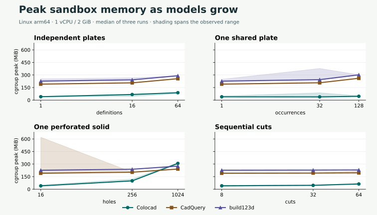
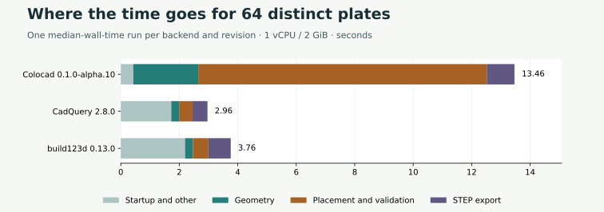
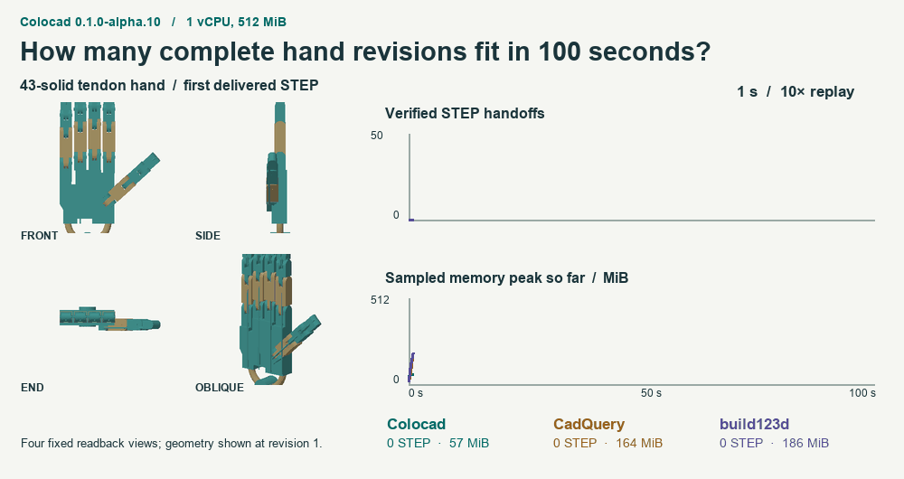
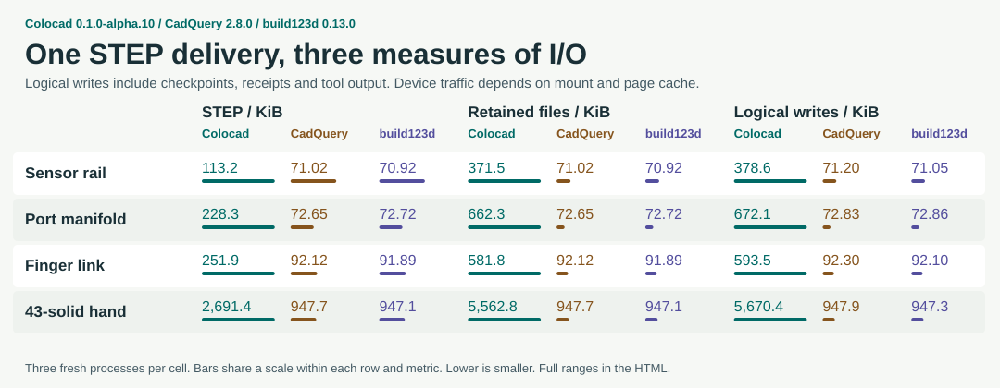

# Colocad alpha.10 性能与几何复测

Colocad 0.1.0-alpha.10、CadQuery 2.8.0 和 build123d 0.13.0 使用同一 Linux arm64 镜像。各任务分配 1 vCPU，规模组限额 2 GiB，产品组和灵巧手队列限额 512 MiB，禁用交换与网络。机械用例执行的 SDK、skill 入口和内核文件逐字节核对了公共 npm 安装包。各进程独立启动，共用开发虚拟机、文件系统及其缓存。

[离线单文件 HTML，含全部用例、六组几何对照和实测回放](benchmarks/alpha10/scorecard.html) · [原始数据](benchmarks/alpha10/observations.json) · [验收和版本配对样本](benchmarks/alpha10/acceptance.json)

## STEP 交付耗时与沙箱内存峰值

每格按 **Colocad / CadQuery / build123d** 顺序列出三次运行的中位数。耗时含启动、建模、后端校验和 STEP 写出。207 份 STEP 均在计时后经过独立 OCCT 回读。内存为内核记录的 cgroup 峰值，含计入沙箱的文件缓存。11 个产品及改参用例中，Colocad 在 11 项内存最低、10 项耗时最短。12 个规模用例中分别为 11 项和 6 项。

| 用例 | 耗时（秒） | 沙箱峰值（MiB） |
|---|---|---|
| part/16 | 0.82 / 2.46 / 2.58 | 40.0 / 190.8 / 226.4 |
| part/256 | 11.19 / 2.42 / 3.12 | 99.7 / 202.8 / 238.5 |
| part/1024 | 54.88 / 6.03 / 5.45 | 308.5 / 240.9 / 275.5 |
| repeated/1 | 0.77 / 2.04 / 2.14 | 39.6 / 191.0 / 226.5 |
| repeated/32 | 0.85 / 2.09 / 3.30 | 38.6 / 207.1 / 244.3 |
| repeated/128 | 0.81 / 2.81 / 4.47 | 45.6 / 261.0 / 302.1 |
| unique/1 | 0.79 / 1.65 / 2.77 | 40.6 / 191.0 / 226.7 |
| unique/16 | 3.24 / 1.87 / 2.80 | 67.0 / 206.2 / 241.9 |
| unique/64 | 13.46 / 2.96 / 3.76 | 88.6 / 256.0 / 291.3 |
| chain/8 | 0.67 / 1.75 / 2.30 | 40.7 / 191.1 / 226.8 |
| chain/32 | 4.40 / 2.30 / 2.78 | 45.9 / 192.7 / 228.4 |
| chain/64 | 14.20 / 3.30 / 3.05 | 62.3 / 195.4 / 230.2 |
| sensor-rail | 0.20 / 1.36 / 1.90 | 53.0 / 197.2 / 232.6 |
| sensor-rail-edit | 0.42 / 1.28 / 1.86 | 47.6 / 196.8 / 232.3 |
| manifold | 0.49 / 1.61 / 2.18 | 53.3 / 197.7 / 232.6 |
| manifold-edit | 0.38 / 1.44 / 2.45 | 58.6 / 196.8 / 256.3 |
| finger | 0.44 / 1.69 / 1.72 | 54.4 / 197.6 / 233.4 |
| links-1 | 0.41 / 1.27 / 1.80 | 51.8 / 197.6 / 233.3 |
| links-4 | 0.41 / 1.49 / 1.84 | 40.0 / 197.7 / 233.3 |
| links-16 | 0.41 / 1.44 / 2.11 | 47.2 / 197.8 / 233.7 |
| links-43 | 0.39 / 1.49 / 2.36 | 41.4 / 198.3 / 234.5 |
| pins-16 | 0.14 / 1.33 / 1.97 | 42.7 / 195.8 / 231.3 |
| hand | 2.05 / 1.92 / 2.43 | 69.9 / 207.9 / 246.2 |

共享一个几何定义时，1 个到 128 个实例的 Colocad 峰值为 39.6 到 45.6 MiB。单板 16 孔到 1,024 孔则从 40.0 增至 308.5 MiB。会话索引和几何工作集有不同的增长规律。每族三个规模点不足以推导渐进复杂度。

相同定义放置 128 次，耗时 0.81 / 2.81 / 4.47 秒、峰值 45.6 / 261.0 / 302.1 MiB。该场景 Colocad 的 STEP 交付速度分别为 CadQuery 的 3.5 倍、build123d 的 5.5 倍。64 种独立尺寸板件的峰值仍低，但耗时较长。Colocad 中位样本的装配与校验耗时 9.87 秒，其中放置后体积积分 5.05 秒。1,024 孔单板的 Level-1 校验用时 40.32 秒。

[区分历史条数和当前几何：KK60 真实改装、4,096 次持久化检查与 64 次逐版 STEP 验收](field-history.zh-CN.md)。

## 100 秒改参队列与构建 I/O

三个后端对同一只 43 实体灵巧手执行同序列改参。每个后端各运行一个 100 秒窗口，完整交付并通过回读的数量为 **42 / 45 / 42**，采样到的累计内存峰值为 **165.2 / 293.8 / 283.5 MiB**。GIF 按实际交付时间作 10 倍速回放。同一只手独立启动一次的耗时中位数为 2.05 / 1.92 / 2.43 秒。队列和单次冷启动分别统计。

完整灵巧手的进程逻辑写入量为 5,670 / 948 / 947 KiB，落盘保留文件为 5,563 / 948 / 947 KiB。Colocad 除 STEP 还写出可编辑检查点和收据。物理设备写入受挂载方式和缓存影响。

## 版本对照与补充验收

单独的 512 MiB 版本对照在 12 个输入上各做三组 alpha.9、alpha.10 交替配对。72 次输出的同输入 STEP 哈希一致，12 个不同模型通过 OCCT。64 种板件耗时 49.13 → 11.60 秒，1,024 孔板耗时 100.40 → 58.23 秒，均取三次中位数。长会话逐条重开 10,001 项提交记录。峰值 224.1 → 72.0 MiB，文件数 21,219 → 1,505。

独立回读曾与两组补充配对共享 CPU，其中一份 alpha.10 孔板触发 120 秒 SDK 超时。两组的两个版本均在空闲核重跑，长会话也将两个版本移至专用核重跑。验收 JSON 保留四条排除的几何观测和超时记录。207 份主对照使用另外的 CPU。

六组基础形状另在 macOS arm64 上与 build123d 0.11.1 对照，预热后各交替重复五次。离线报告提供同机位 STEP 回读图、耗时中位数和进程 RSS 最大值。Linux 表格采用整组 cgroup 的内存计量。

KK60 与涡扇两个工程各自的 16 个 STEP 阶段均重新回读。alpha.10 混合路径中，目标 1.6 mm 的壳壁实测 1.600000 mm，混合 STEP 回读得到三个有效实体。345,944 面的 Stanford Armadillo 与精确探针装配，用 18.10 秒完成含混合 STEP、GLB 和离线 HTML 的交付，达到 512 MiB，无 OOM kill。表面探针交叠 3.803 mm³。这两项各跑一次，仅覆盖 Colocad，未计入三后端输赢。

[扩展压力结果](benchmarks/alpha10/controls.json)保留资源策略拒绝、OOM、超时及按预设边界跳过的任务。分片交付按多个文件验收。[复现步骤](../benchmarks/release/README.md) · [上一次候选版报告](benchmark-bounded-candidate.zh-CN.md)。
