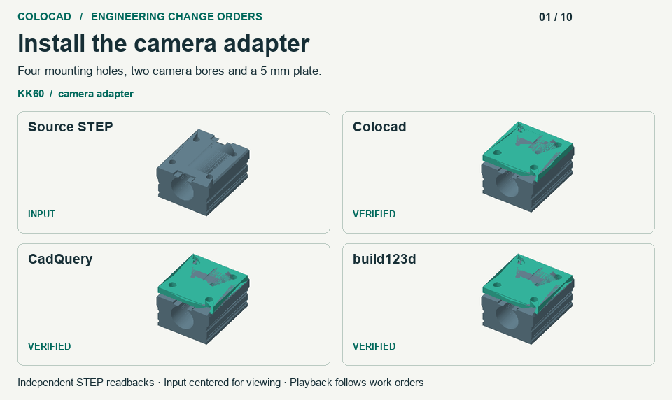

# Engineering edits, memory growth and time to STEP

The November 13, 2026 rerun compared Colocad `0.1.0-alpha.11-rc.1`, CadQuery 2.8.0 and build123d 0.13.0. Colocad had the lowest median peak sandbox memory in 22 of 23 mechanical cases and the shortest median delivery in 16. All three backends delivered seven valid assemblies and rejected three incompatible inputs across ten engineering change orders. [Offline single-file scorecard](benchmarks/alpha11-rc1/scorecard.html) · [中文](benchmark-alpha11-rc1.zh-CN.md)

## Engineering flexibility

The KK60 saddle retrofit required a camera adapter, a resize, a service window, rejection of a three-hole saddle and installation on a translated replacement. A second workflow measured a keyed flange to install a motor, changed the housing, recovered an arbitrarily rotated frame and rejected incorrect bolt pitch and a missing bore. Each implementation measured the same neutral STEP inputs with one installation recipe per family. The GIF uses actual exported geometry for each successful output. The saddle is a catalog reconstruction and the flange inputs are independently authored engineering fixtures.

Independent OCCT checks covered mounting correspondence, hole floors and surrounding material, window, volume, contact and overlap. The outcomes tie on these tasks. Colocad supplies revision-bound queries, native snapshots, editable inputs and receipts through its SDK and CLI. The Python controls supply their own history, measurement and rejection logic. The Colocad blind-hole query on the reimported saddle returned partial coverage, so the retrofit used exact circular edges to find the mount. This is a deterministic workflow comparison. [Measurements and readback evidence](benchmarks/alpha11-rc1/engineering.json)

## 256 saved geometry edits

Each backend kept a persistent session on a fresh native Linux volume and changed plate thickness and camera pitch for 256 distinct revisions. Each had one CPU, 512 MiB of memory, no swap and no network. Common deliverables were editable source, an exact assembly STEP, a mesh preview and an indexed revision. Both Python controls used SQLite FULL, fsync and Linux cache advice on committed STEP and STL files. Colocad also saved native query snapshots, build checkpoints and additional previews. Its preview chord setting was 1 mm. Python STL linear and angular settings were 0.15 mm and 0.15 rad. The common geometry oracle checks the exact STEP.

| Workflow | Cgroup peak | Current memory at edits 128 → 256 | Change over last 128 |
|---|---:|---:|---:|
| Colocad RC | 92.5 MiB | 66.3 → 73.0 MiB | +6.8 MiB |
| CadQuery with persistence adapter | 223.0 MiB | 217.9 → 218.8 MiB | +0.9 MiB |
| build123d with persistence adapter | 271.4 MiB | 260.2 → 267.1 MiB | +6.9 MiB |
| Colocad alpha.10 | 512.0 MiB | 503.5 → 503.2 MiB | At the memory cap |

All four sessions completed 260 accepted revisions with zero OOM kills. The independent verifier reopened all 1,024 edited STEPs, checked 256 mesh hashes per session, and the workflows recovered the measured camera pitch from six historical revisions. Corresponding alpha.10 and RC STEPs were byte-identical. Colocad used about 41% of CadQuery’s peak and 34% of build123d’s peak. The CadQuery adapter showed the smallest late increase. One session per implementation, on a shared VM. The replay aligns by accepted edit count. Current comes from cgroup memory.current after an edit returns and peak comes from memory.peak. [Full traces and per-revision checks](benchmarks/alpha11-rc1/engineering.json)

## Geometry construction and throughput

The 11 product cases and 12 scaling cases each ran on three backends in three fresh processes. All 207 deliveries passed independent STEP readback. Products had a 512 MiB limit and scaling cases 2 GiB. Time covers process startup, backend checks and export. Independent readback runs outside the clock. Executables, SDK and skill entry points used by the checkout-based jobs matched the installed candidate package.

| Workload | Seconds, Colocad / CadQuery / build123d | Peak MiB, same order |
|---|---|---|
| 128 placements of one definition | 0.62 / 2.51 / 3.64 | 46.4 / 260.7 / 302.1 |
| 64 distinct plates | 11.12 / 2.28 / 3.51 | 79.4 / 255.7 / 291.2 |
| One 1,024-hole solid | 53.99 / 4.36 / 4.60 | 307.5 / 240.9 / 275.4 |
| 43-solid tendon hand | 2.17 / 2.03 / 2.79 | 64.1 / 207.8 / 245.1 |

The 100-second hand queues delivered **45 / 51 / 41** verified revisions. Their maximum 25 ms memory samples were **167.1 / 481.0 / 280.9 MiB**. Each backend ran one window. The actuator cover was separately rebuilt and rendered from 16 actual revisions, ending at 81 named occurrences. Six macOS shape controls used build123d 0.11.1 with five alternating repeats. The frozen 18-case regression and six-case held-out splits passed, including expected rejections. [All 23 cases](benchmarks/alpha11-rc1/observations.json) · [Shape readbacks](benchmarks/alpha11-rc1/shapes.json) · [Frozen corpus](benchmarks/alpha11-rc1/geometry-corpus.json) · [Reproduction](https://github.com/Coloopx/colocad/blob/main/benchmarks/readme/candidate/README.md)
