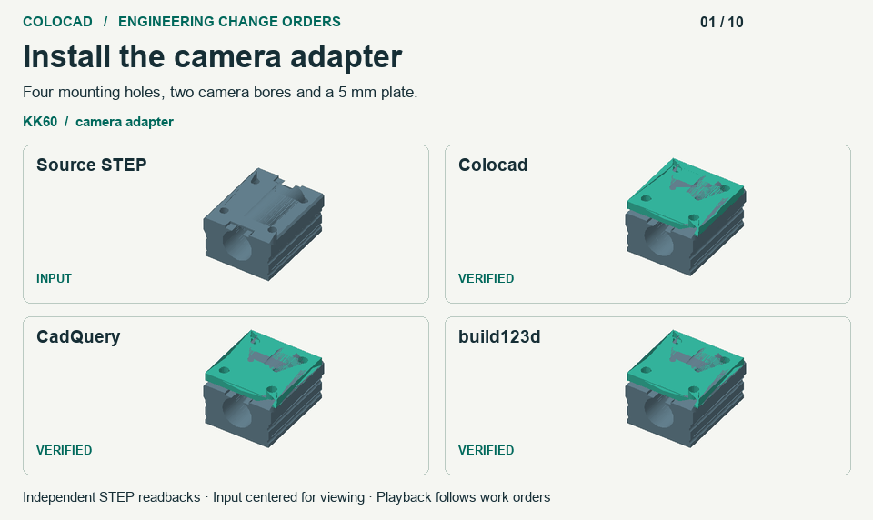

# 连续改图、装配换件和 STEP 交付

2026 年 11 月 13 日复测了 Colocad `0.1.0-alpha.11-rc.1`、CadQuery 2.8.0 和 build123d 0.13.0。候选版在 23 个机械用例中的 22 项取得最低沙箱内存峰值，在 16 项中交付最快。真实改装的十条需求中，三方均交付七个有效装配，并正确拒绝三个不兼容件。[离线单文件 HTML](benchmarks/alpha11-rc1/scorecard.html) · [English](benchmark-alpha11-rc1.md)

## 灵活性如何验收

KK60 相机板覆盖首次安装、按尺寸改参、增加走线窗口、拒绝缺孔滑台以及更换坐标原点后的重新安装。带定位孔的电机法兰覆盖原始壳体、增大壳体、任意轴旋转后的输入、错误孔距及缺孔。各后端从相同中性 STEP 中测量几何；替换件沿用原安装规则。动画中的成功画面来自各后端实际输出，拒绝画面列出输入。KK60 滑台来自产品目录重建，法兰为独立编制的工程夹具。

OCCT 回读验证孔位、板厚、孔底与周围材料、开窗、实体体积、接触和重叠。三套方案在这些任务上功能结果持平。Colocad 将可编辑源文件、原生查询快照、版本索引和回执纳入 SDK/CLI；Python 对照实现自行组织索引、快照回读与拒绝逻辑。本次 Colocad 在重导入滑台上仍通过精确圆边定位安装孔，高层盲孔识别返回 `partial`。这些确定性任务衡量几何和工作流能力，未测量不同推理模型的成功率。[输入、实测判定与逐版回读](benchmarks/alpha11-rc1/engineering.json)

## 256 次真实改图

同一两件装配连续修改板厚和相机孔距，在四个新建的 Linux 原生卷上各执行一次，每个会话限 1 vCPU、512 MiB、无交换、无网络。每一版均保存可编辑配方、精确 STEP、网格预览及索引；Python 控制实现使用 SQLite FULL、fsync，并对已提交的 STEP 和 STL 释放干净文件页。Colocad 另保存原生检查点、查询快照、PNG 等预览。Colocad 使用 1 mm 预览弦差，Python STL 的线性/角度设置为 0.15 mm / 0.15 rad。三方共享精确几何验收，预览产物各有差异。每个工作流保持一份活动装配，历史保存在磁盘上。

| 工作流 | 沙箱峰值 | 第 128 → 256 版当前内存 | 后半段净增 |
|---|---:|---:|---:|
| Colocad RC | 92.5 MiB | 66.3 → 73.0 MiB | +6.8 MiB |
| CadQuery + 持久化适配器 | 223.0 MiB | 217.9 → 218.8 MiB | +0.9 MiB |
| build123d + 持久化适配器 | 271.4 MiB | 260.2 → 267.1 MiB | +6.9 MiB |
| Colocad alpha.10 | 512.0 MiB | 503.5 → 503.2 MiB | 已触及限额 |

四场均完成 260 个成功版本，OOM kill 为 0。1,024 份被修改的 STEP 全部独立回读通过，两个 Colocad 版本的对应 STEP 摘要逐一相同。每场另核对 256 个预览摘要，在六个历史版本回读相机孔距。新版本峰值约为两个 Python 对照的 41% 和 34%，CadQuery 控制实现后半段增量最小。横轴为已完成的改图次数；动画中当前值取 edit 返回后的 `memory.current`，峰值取 `memory.peak`。各次运行共享 VM 和映像缓存。[原始轨迹与逐件验收](benchmarks/alpha11-rc1/engineering.json)

## 更广的几何与速度对照

11 个产品及改参用例 × 3 个后端 × 3 次，另有 12 个规模用例 × 3 × 3，共 207 份 STEP，均由 OCCT 独立回读。产品组限 512 MiB，规模组限 2 GiB。耗时从新建模进程启动计至完成后端校验、写出 STEP；每格为三次中位数。计时之外另做独立验收。普通内核/SDK 构建和 skill 入口的可执行文件与安装的候选 npm 包校验一致。

| 用例 | 耗时，Colocad / CadQuery / build123d（秒） | 峰值，同顺序（MiB） |
|---|---|---|
| 共享几何放置 128 次 | 0.62 / 2.51 / 3.64 | 46.4 / 260.7 / 302.1 |
| 64 个独立尺寸 | 11.12 / 2.28 / 3.51 | 79.4 / 255.7 / 291.2 |
| 1,024 孔单实体 | 53.99 / 4.36 / 4.60 | 307.5 / 240.9 / 275.4 |
| 43 实体绳驱手 | 2.17 / 2.03 / 2.79 | 64.1 / 207.8 / 245.1 |

100 秒灵巧手队列按实际完成时间计数，三个后端分别交付 **45 / 51 / 41** 份通过验收的 STEP，25 ms 采样的累计内存峰值分别为 **167.1 / 481.0 / 280.9 MiB**。每个后端一个窗口，宿主机缓存与排队均可能影响结果。完整模型封面另从 16 个实际版本重新渲染，最终含 81 个实例。六组 macOS 形状对照用了 build123d 0.11.1 和五次交替重复；冻结几何回归与留出集共 24 项通过（含预期拒绝）。[23 项完整读数](benchmarks/alpha11-rc1/observations.json) · [六组形状](benchmarks/alpha11-rc1/shapes.json) · [几何语料](benchmarks/alpha11-rc1/geometry-corpus.json) · [复现方法](https://github.com/Coloopx/colocad/blob/main/benchmarks/readme/candidate/README.md)
