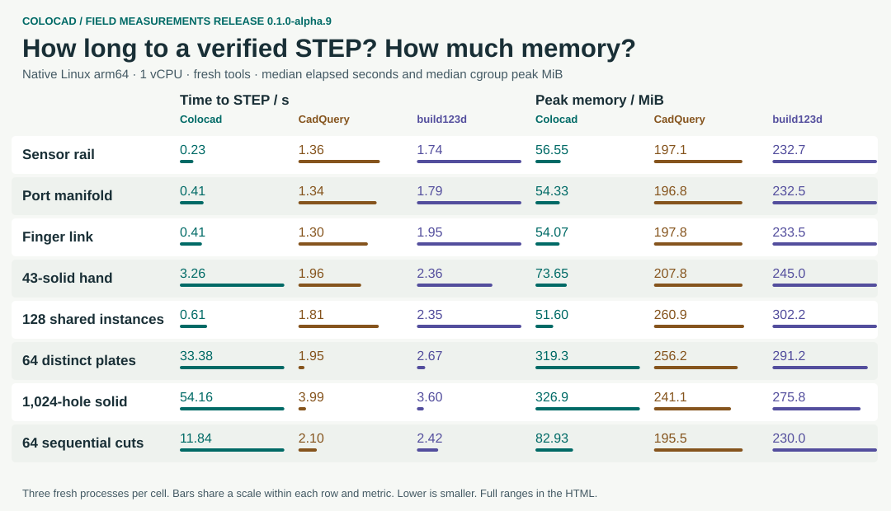
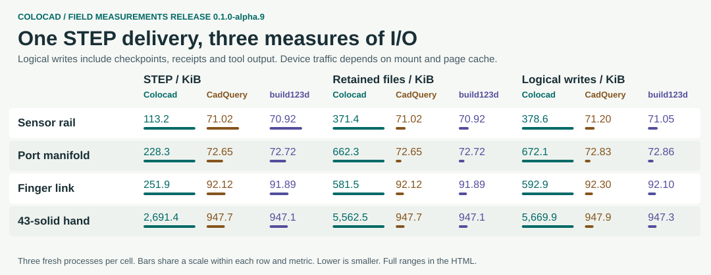

# Alpha.9 benchmark: choose by workload

Colocad is a good fit for short tool calls and assemblies with many **occurrences of the same definition**. Independent definitions, dense perforations and long Boolean chains change the result. Each cell below is **Colocad / CadQuery / build123d**. [Download the standalone HTML](https://github.com/Coloopx/colocad/releases/download/v0.1.0-alpha.9/scorecard.html) · [中文](benchmark-alpha9.zh-CN.md).

| Task | Time to STEP (s) | Peak memory (MiB) |
|---|---:|---:|
| Sensor rail | 0.23 / 1.36 / 1.74 | 56.6 / 197.1 / 232.7 |
| Port manifold | 0.41 / 1.34 / 1.79 | 54.3 / 196.8 / 232.5 |
| Proximal link | 0.41 / 1.30 / 1.95 | 54.1 / 197.8 / 233.5 |
| Complete hand, 43 solids | 3.26 / 1.96 / 2.36 | 73.6 / 207.8 / 245.0 |
| 128 shared instances | 0.61 / 1.81 / 2.35 | 51.6 / 260.9 / 302.2 |
| 64 distinct plates | 33.38 / 1.95 / 2.67 | 319.3 / 256.2 / 291.2 |
| 1,024 holes | 54.16 / 3.99 / 3.60 | 326.9 / 241.1 / 275.8 |
| 64 sequential cuts | 11.84 / 2.10 / 2.42 | 82.9 / 195.5 / 230.0 |

**Reading the results.** Four geometry families × three sizes × three backends × three repetitions produced 108 STEPs. Across those 12 sizes Colocad had the lowest median peak in 10 and the shortest median wall time in 6. The npm tarball includes the complete offline report at `node_modules/@coloopx/colocad/docs/benchmarks/alpha9/scorecard.html`. These equally weighted points do not represent a production workload mix. Eleven additional product/parameter cases × three backends × three repetitions produced 99 STEPs. All 207 were independently reopened. Every common-case solid was checked for validity, placement, bounds, volume and bore geometry; product checks matched solids and material, with two-way material differences on the first repeat. Time includes process startup, construction, backend checks and export, excluding installation, inference, the resident harness, post-run verification and rendering. Native Linux arm64, one vCPU, no network/swap: 2 GiB for the scaling matrix and 512 MiB for product fixtures. Fresh processes on a shared host do not imply cold file caches or dedicated hardware.

**Build I/O.** On the manifold, final STEP sizes were **228.3 / 72.6 / 72.7 KiB**, retained outputs **662.3 / 72.6 / 72.7 KiB**, and logical writes **672.1 / 72.8 / 72.9 KiB**. Colocad persists checkpoints and receipts by default. Even the final STEP differs in size across writers. Linux `/proc/PID/io` counts calls made by the process and its waited-for children, including stdout. It does not measure SSD traffic or fsync latency. Host bind mounts and warm cache make device counters incomplete.

**100 seconds of tendon-hand edits.** From the same ordered parameter queue the backends delivered **32 / 58 / 48** independently reopened 43-solid STEPs. First handoff: **3.00 / 1.84 / 1.85 s**; highest 25 ms sampled cgroup memory: **146.4 / 259.1 / 287.6 MiB**. One window per backend. Colocad used less memory and delivered fewer full hands. The GIF plots peak-so-far; instantaneous samples, including dips, are retained in the JSON.

**Editing and assembly.** All three backends passed the rail change (three slots to two; pitch 19→17 mm) and manifold change (four blind bores to three; diameter 6→7 mm). Each hand queue changes guide diameter and tendon radius. Colocad provides a recorded `head → inspect → edit → inspect` workflow with exact measurements and stale-reference checks. [Runnable CLI example](../skills/colocad/references/modeling-loop.md#inspect-and-edit-from-a-shell). The experiment establishes edit behavior, not a general API flexibility ranking. The earlier [CadQuery audit](cadquery-comparison.md) mapped 150 API entries: 36 analogous within a supported domain, 30 partial, 29 recipes, 29 unsupported and 26 different abstractions. It was neither 150 differential tests nor a build123d coverage study.

**Where writes actually fell.** For 24 recorded inspections of one imported 256-hole STEP, 25 ledger entries referenced 1 input (1,037,809 B), down from 25 copies (25,945,225 B) on the already-indexed internal baseline. Median cgroup peak fell from 110.76 to 82.05 MiB across three runs. Measurement digests matched, with zero rebuilds, STEP exports or tessellations. This is a Colocad ablation, not a Python comparison.

**Next optimization targets.** Measure duplicate STEP encoding and checkpoint traffic on distinct parts, and isolate construction on dense grids. Hold delivery and readback constant. Indexed history and shared query inputs do not make whole-model memory logarithmic. The 2,048-distinct-part baseline completed on CadQuery/build123d at 4 GiB and both hit OOM at 2 GiB; Colocad's monolithic path has feature, instance and 32 MiB STEP limits. Rejection, timeout, OOM and an indexed folder of shards are not successful equivalents of one complete STEP.

[All observations and ranges](benchmarks/alpha9/observations.json) · [Reproduction](../benchmarks/release/README.md) · [Extended stress observations](benchmarks/alpha9/controls.json) · [KK60 readbacks](benchmarks/alpha9/kk60-readback.json) · [Raw traces](https://github.com/Coloopx/colocad/releases/download/v0.1.0-alpha.9/raw-observations.tar.gz). The KK60 cover visualizes 16 actual Colocad stages; there is no comparative KK60 timing.
