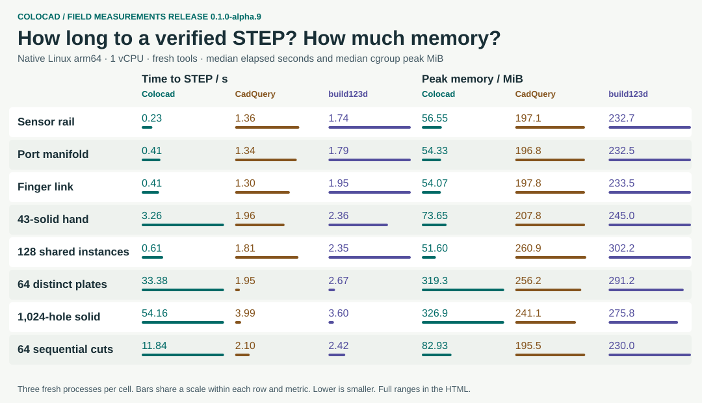
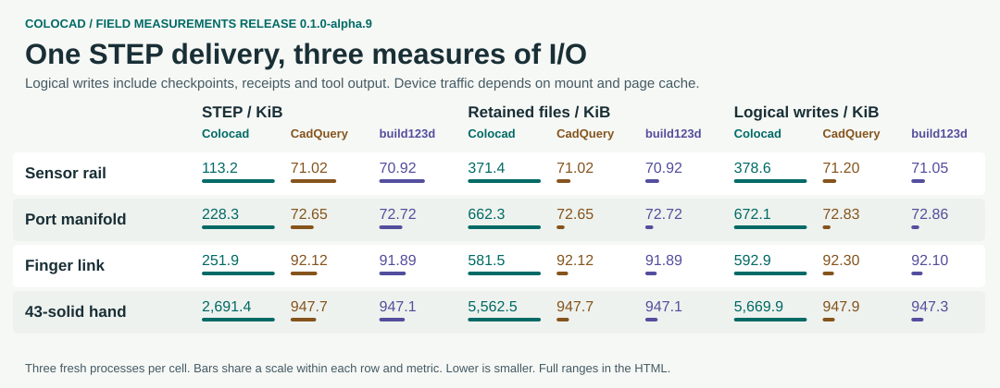

# alpha.9：什么时候该选 Colocad

这轮测试支持两个不同的结论：在新的沙箱进程中，小零件和大量**相同定义**的实例很适合 Colocad；密集孔、长布尔链和大量**独立定义**并不是它的速度强项。以下三项数值始终按 **Colocad / CadQuery / build123d** 排列。[下载单文件交互报告](https://github.com/Coloopx/colocad/releases/download/v0.1.0-alpha.9/scorecard.html) · [English](benchmark-alpha9.md)。

| 任务 | 交付 STEP，秒 | 峰值内存，MiB |
|---|---:|---:|
| 传感器导轨 | 0.23 / 1.36 / 1.74 | 56.6 / 197.1 / 232.7 |
| 歧管 | 0.41 / 1.34 / 1.79 | 54.3 / 196.8 / 232.5 |
| 近端指节 | 0.41 / 1.30 / 1.95 | 54.1 / 197.8 / 233.5 |
| 完整灵巧手，43 个实体 | 3.26 / 1.96 / 2.36 | 73.6 / 207.8 / 245.0 |
| 128 个共享实例 | 0.61 / 1.81 / 2.35 | 51.6 / 260.9 / 302.2 |
| 64 个独立零件 | 33.38 / 1.95 / 2.67 | 319.3 / 256.2 / 291.2 |
| 1,024 孔 | 54.16 / 3.99 / 3.60 | 326.9 / 241.1 / 275.8 |
| 64 次连续切孔 | 11.84 / 2.10 / 2.42 | 82.9 / 195.5 / 230.0 |

**读图。** 主矩阵是 4 类模型 × 3 个规模 × 3 个后端 × 3 次，共 108 份 STEP。每个规模按中位数比较，Colocad 在 10/12 个规模点内存最低，在 6/12 个规模点用时最短。npm 安装后可直接打开 `node_modules/@coloopx/colocad/docs/benchmarks/alpha9/scorecard.html`。每个规模各算一票，这不是实际业务的加权平均。另外 11 个同输入产品/改参案例，各后端三次，共 99 份 STEP。全部 207 份都经过独立的几何回读。耗时从启动 CAD 进程算到校验、导出并退出；主矩阵 2 GiB，产品案例 512 MiB，均为 Linux arm64、1 vCPU、无网络、无 swap。不计安装、渲染、推理、常驻 agent/harness。复测在共享主机运行，容器隔离不等于冷文件缓存或独占主机。

**I/O 应看哪一列？** 歧管最终 STEP 分别为 **228.3 / 72.6 / 72.7 KiB**，全部保留产物为 **662.3 / 72.6 / 72.7 KiB**，进程逻辑写入为 **672.1 / 72.8 / 72.9 KiB**。Colocad 默认保存检查点和回执；即使只数最终 STEP，不同编码器的大小也不同。逻辑写入来自 Linux `/proc/PID/io`，包括已等待的子进程及标准输出，不是 SSD 写入量。文件缓存和共享挂载会使设备计数空缺，不能推出物理盘吞吐更高。

**100 秒灵巧手。** 同一参数队列，均从零建模。三个后端分别交付 **32 / 58 / 48** 个回读有效的 43 实体 STEP；首份交付 **3.00 / 1.84 / 1.85 秒**；25 ms 采样的最高内存 **146.4 / 259.1 / 287.6 MiB**。每个后端只测一个窗口。更低内存没有换来这个产品的更高吞吐。GIF 的内存线为从零时刻起的运行峰值；测量数据保留瞬时值及下降段。

**改参、选择与装配。** 三方都完成并验证了导轨槽数 3→2、节距 19→17 mm；歧管盲孔 4→3、直径 6→7 mm。灵巧手按相同队列改变导孔和腱径。Colocad 的价值在于 `head → inspect → edit → inspect` 把输入、精确测量、改参和过期引用绑定在同一个可回放会话里。[CLI 操作实例](../skills/colocad/references/modeling-loop.md#inspect-and-edit-from-a-shell)。这些是工程任务验收，不是 API 灵活性排名。既有 [CadQuery API 审计](cadquery-comparison.zh-CN.md)的 150 项中，36 项在限定域有对应实现、30 项部分、29 项可组合、29 项没有对应契约、26 项采用不同抽象。它不是 150 个差分测试，也不提供 build123d 全覆盖率。

**能验证的写入优化。** 同一 256 孔外部 STEP 连续记录 24 次精确检查，与已经有索引但尚未共享源文件的内部基线相比，25 条记录对应的独立输入由 25 份（25,945,225 B）减到 1 份（1,037,809 B），三次中位峰值从 110.76 降到 82.05 MiB。结果摘要一致，零次重建、STEP 导出或三角化。这是 Colocad 内部对照，不是与 Python 的比较。

**下一步。** 优先看独立零件 STEP 的重复编码、检查点写入量和密集孔的几何阶段；固定模型、输出契约和回读阈值再做消融。索引历史和对同一输入重复查询的收益不能推广到整个 B-rep 的内存复杂度。2,048 个独立件在 CadQuery/build123d 的 4 GiB 配额下成功，降到 2 GiB 后均 OOM；Colocad 的单文件规模受特征、实例及 32 MiB STEP 等限额约束。拒绝、超时、OOM 以及分块项目都不算一次成功的完整装配 STEP。

[原始观测及范围](benchmarks/alpha9/observations.json) · [复现脚本](../benchmarks/release/README.md) · [扩展压力实验](benchmarks/alpha9/controls.json) · [本版 KK60 回读](benchmarks/alpha9/kk60-readback.json) · [逐次原始采样包](https://github.com/Coloopx/colocad/releases/download/v0.1.0-alpha.9/raw-observations.tar.gz)。KK60 四视图来自 16 个真实阶段；没有在另外两套库上对 KK60 计时。
