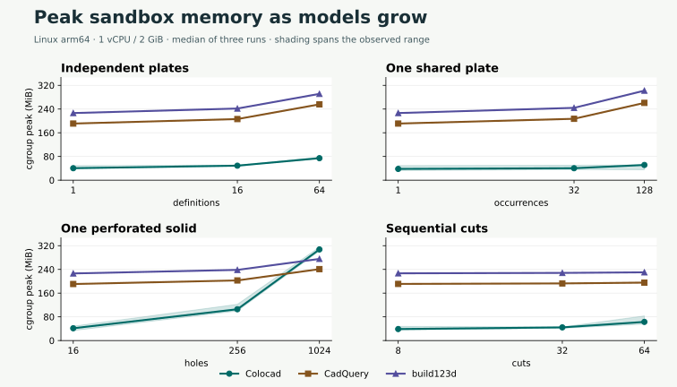
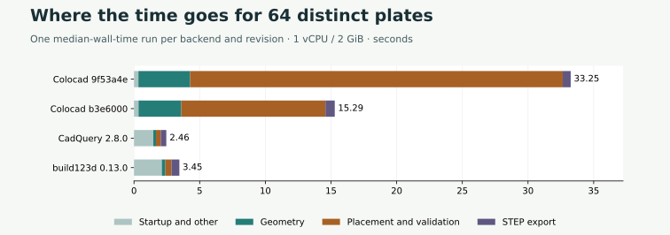
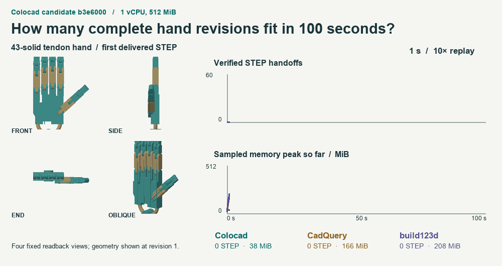
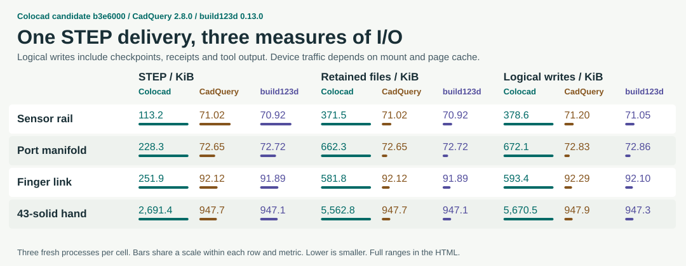

# Three-backend measurements and assembly validation costs

[Single-file HTML](benchmarks/bounded-candidate/scorecard.html) · [Trials](benchmarks/bounded-candidate/observations.json) · [Paired experiments](benchmarks/bounded-candidate/iterations.json) · [Reproduction](../benchmarks/release/README.md)

Source `b3e6000`, CadQuery 2.8.0 and build123d 0.13.0 ran in the same Linux arm64 image. Scaling tests allowed 2 GiB and product and queue tests allowed 512 MiB, each with 1 vCPU and no swap. Cells give medians across three fresh processes in the order Colocad / CadQuery / build123d. Separate CPU sets share the development VM and filesystem.

| Input | Time to STEP, s | Peak cgroup memory, MiB |
|---|---:|---:|
| chain/32 | 4.95 / 1.88 / 2.25 | 44.5 / 192.7 / 228.2 |
| chain/64 | 11.30 / 2.31 / 2.73 | 63.0 / 195.3 / 230.2 |
| chain/8 | 0.79 / 1.79 / 2.20 | 38.8 / 191.1 / 226.8 |
| part/1024 | 58.09 / 4.00 / 4.47 | 307.4 / 241.0 / 275.5 |
| part/16 | 0.60 / 1.56 / 2.39 | 41.5 / 190.8 / 226.4 |
| part/256 | 9.17 / 1.80 / 2.34 | 105.6 / 202.8 / 238.4 |
| repeated/1 | 0.80 / 1.59 / 2.13 | 38.1 / 191.0 / 226.5 |
| repeated/128 | 0.61 / 2.03 / 3.36 | 51.4 / 260.8 / 302.0 |
| repeated/32 | 0.82 / 1.94 / 2.31 | 40.4 / 207.1 / 244.0 |
| unique/1 | 0.84 / 1.51 / 2.03 | 40.5 / 191.0 / 226.5 |
| unique/16 | 3.73 / 1.69 / 2.27 | 49.0 / 206.2 / 241.7 |
| unique/64 | 15.29 / 2.46 / 3.45 | 74.3 / 255.8 / 291.2 |
| finger | 0.41 / 1.56 / 2.06 | 40.2 / 197.7 / 233.2 |
| hand | 2.22 / 2.42 / 2.53 | 69.4 / 207.7 / 244.7 |
| links-1 | 0.50 / 1.64 / 2.00 | 45.7 / 197.7 / 233.2 |
| links-16 | 0.42 / 1.44 / 2.87 | 48.1 / 197.8 / 233.7 |
| links-4 | 0.44 / 1.35 / 1.90 | 45.1 / 197.7 / 233.3 |
| links-43 | 0.46 / 1.59 / 2.10 | 41.4 / 198.2 / 234.5 |
| manifold | 0.46 / 1.46 / 1.80 | 43.7 / 196.9 / 232.6 |
| manifold-edit | 0.37 / 1.36 / 2.32 | 58.7 / 196.8 / 232.4 |
| pins-16 | 0.16 / 1.89 / 1.76 | 44.4 / 196.0 / 231.3 |
| sensor-rail | 0.24 / 1.45 / 2.01 | 51.0 / 196.9 / 232.8 |
| sensor-rail-edit | 0.22 / 1.47 / 1.81 | 51.2 / 196.9 / 232.2 |

The stock width varies across 64 distinct plates, each with 16 bores. At revision `9f53a4e`, Colocad spent 28.37 s in assembly placement and validation. CadQuery extruded a profile with inner wires and checked validity, volume and solid count on the compound. Its construction and validation took 0.16 s and 0.30 s. For build123d these took 0.20 s and 0.36 s. The kernels use different native validation algorithms. The independent STEP checks used identical criteria.

The 32 UV trims on each perforated plate were expensive general curve searches. The change bounds speed and radius on each eligible rational quadratic Bézier span. Ambiguous inputs go through the solver. Each part's precise placed mass integral also checks the original analytic stock-volume oracle. Three alternating 512 MiB pairs reduced wall time from **36.42 s to 10.49 s**. The new Level‑1 and manifold checks took 2.14 s, volume 4.00 s, and bounds and census 1.62 s. All paired STEP digests matched.

The 100 s edit queue delivered 25 / 57 / 48 verified 43-solid hands. Peaks from 25 ms samples were 115.8 / 258.1 / 287.8 MiB. One window per backend.

The full-hand fixture issued 5670 / 948 / 947 KiB of logical writes, including checkpoints, receipts and output. Across 10,000 operations, the session write rerun peaked at 220.33 MiB for alpha.9 and 70.04 MiB for this candidate. All 10,001 receipts were audited after reopening both projects.

Extended stress results belong to the first candidate in this rerun, `9f53a4e`. Their records include resource rejections, OOMs, timeouts and planned boundary stops. The offline report also contains six separately measured macOS STEP shape comparisons.
