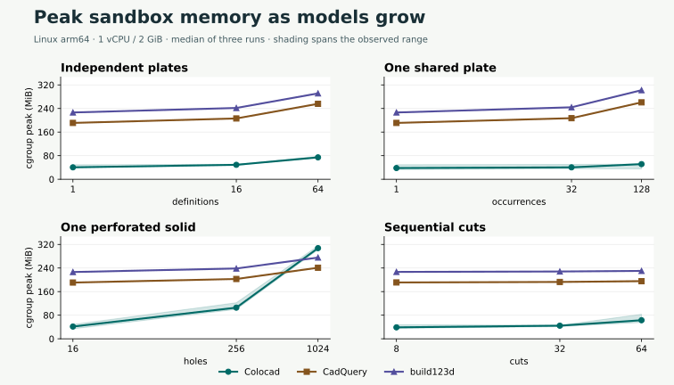
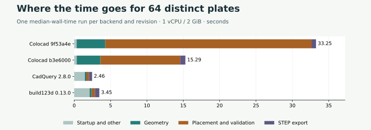
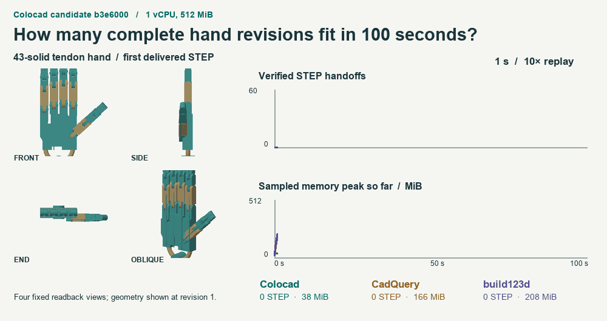
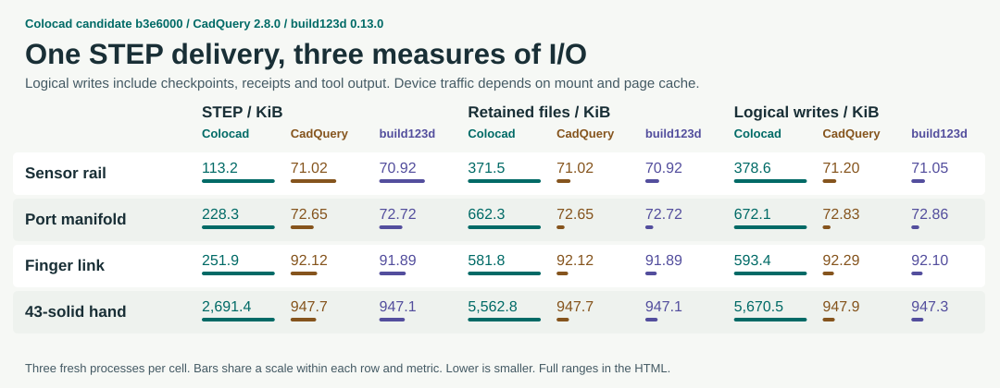

# 三后端复测与 64 件装配耗时分析

[Single-file HTML](benchmarks/bounded-candidate/scorecard.html) · [Trials](benchmarks/bounded-candidate/observations.json) · [Paired experiments](benchmarks/bounded-candidate/iterations.json) · [Reproduction](../benchmarks/release/README.md)

源码 `b3e6000` 与 CadQuery 2.8.0、build123d 0.13.0 在同一 Linux arm64 镜像中运行。主矩阵 2 GiB，产品用例与装配队列 512 MiB，每次限制 1 vCPU，无交换空间。每格为三个独立进程的中位数，顺序为 Colocad / CadQuery / build123d。

| 输入 | STEP 耗时，秒 | cgroup 峰值，MiB |
|---|---:|---:|
| chain/32 | 4.95 / 1.88 / 2.25 | 44.5 / 192.7 / 228.2 |
| chain/64 | 11.30 / 2.31 / 2.73 | 63.0 / 195.3 / 230.2 |
| chain/8 | 0.79 / 1.79 / 2.20 | 38.8 / 191.1 / 226.8 |
| part/1024 | 58.09 / 4.00 / 4.47 | 307.4 / 241.0 / 275.5 |
| part/16 | 0.60 / 1.56 / 2.39 | 41.5 / 190.8 / 226.4 |
| part/256 | 9.17 / 1.80 / 2.34 | 105.6 / 202.8 / 238.4 |
| repeated/1 | 0.80 / 1.59 / 2.13 | 38.1 / 191.0 / 226.5 |
| repeated/128 | 0.61 / 2.03 / 3.36 | 51.4 / 260.8 / 302.0 |
| repeated/32 | 0.82 / 1.94 / 2.31 | 40.4 / 207.1 / 244.0 |
| unique/1 | 0.84 / 1.51 / 2.03 | 40.5 / 191.0 / 226.5 |
| unique/16 | 3.73 / 1.69 / 2.27 | 49.0 / 206.2 / 241.7 |
| unique/64 | 15.29 / 2.46 / 3.45 | 74.3 / 255.8 / 291.2 |
| finger | 0.41 / 1.56 / 2.06 | 40.2 / 197.7 / 233.2 |
| hand | 2.22 / 2.42 / 2.53 | 69.4 / 207.7 / 244.7 |
| links-1 | 0.50 / 1.64 / 2.00 | 45.7 / 197.7 / 233.2 |
| links-16 | 0.42 / 1.44 / 2.87 | 48.1 / 197.8 / 233.7 |
| links-4 | 0.44 / 1.35 / 1.90 | 45.1 / 197.7 / 233.3 |
| links-43 | 0.46 / 1.59 / 2.10 | 41.4 / 198.2 / 234.5 |
| manifold | 0.46 / 1.46 / 1.80 | 43.7 / 196.9 / 232.6 |
| manifold-edit | 0.37 / 1.36 / 2.32 | 58.7 / 196.8 / 232.4 |
| pins-16 | 0.16 / 1.89 / 1.76 | 44.4 / 196.0 / 231.3 |
| sensor-rail | 0.24 / 1.45 / 2.01 | 51.0 / 196.9 / 232.8 |
| sensor-rail-edit | 0.22 / 1.47 / 1.81 | 51.2 / 196.9 / 232.2 |

64 块独立孔板的板宽逐件变化，每块各有 16 个孔。在原复测中 Colocad 的放置与校验中位数为 28.37 秒。CadQuery 用含内环的轮廓一次拉伸，组装后核对有效性、体积和实体数，构造与校验分别为 0.16 与 0.30 秒。build123d 对应为 0.20 与 0.36 秒。三者的原生校验算法不同，最终 STEP 均按同一 OCCT 标准回读。

每件有 32 条孔口 UV 曲线。新版在全部有理二次 Bézier 跨段上建立速度和曲率半径下界，临界输入仍调用通用求解器。最终装配的高精度体积积分也核对了 64 次原解析体积公式。与前一候选版 `9f53a4e` 在 512 MiB 下交替配对三次，整次建模从 **36.42 秒降到 10.49 秒**。新版 Level‑1 与流形检查 2.14 秒，体积 4.00 秒，包围盒及实体计数 1.62 秒。每次交付的 STEP 摘要相同。

100 秒灵巧手队列交付 25 / 57 / 48 个经回读的 43 实体装配，25 ms 采样峰值为 115.8 / 258.1 / 287.8 MiB。每个后端一次窗口。

完整手的逻辑写入为 5670 / 948 / 947 KiB，包含检查点、收据和输出。1 万次操作的会话重测中，alpha.9 与当前版的沙箱峰值分别为 220.33、70.04 MiB，均逐条回读了 10,001 个记录。

扩展压力测试使用同次复测中的第一版候选内核 `9f53a4e`，包含边界拒绝、OOM、超时及按规则停止的用例。单文件报告还包含六组 macOS STEP 渲染对照及各自的内存口径。
