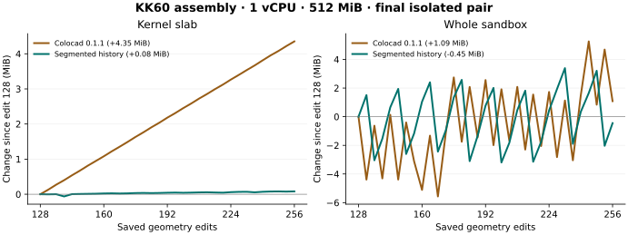

# Fixing memory growth across saved geometry revisions

Colocad 0.1.1 retained 5,719 files and 783 directories in the KK60 session. The new layout retained 42 files and seven directories for the same 260 accepted revisions. The current head stays available for modeling. Older receipts, source, exact solids and previews are indexed members of append-only segments. [Storage API and compatibility](indexed-sessions.md#segmented-geometry-history).

## Final source versus the public package

This isolated pair used the exact SDK and Linux catalog from commit `e98f3b4` and the published 0.1.1 tarball on CPU 0, in baseline-first order. Both used the same released geometry executable. Each trial used its own native volume and a fresh Linux arm64 cgroup with 1 vCPU, 512 MiB, zero swap and no network. It built four setup deliveries, recorded a rejected mount, then saved 256 distinct camera adapters fitted to an imported KK60 carriage. [Final pair and per-edit-interval memory samples](benchmarks/revision-memory-attribution/segmented-final-pair.json).

| | 0.1.1 | Segmented |
|---|---:|---:|
| Files / directories after the final commit | 5,719 / 783 | 42 / 7 |
| Kernel slab, edit 256 minus edit 128 | +4.35 MiB | +0.08 MiB |
| Whole cgroup, edit 256 minus edit 128 | +1.09 MiB | -0.45 MiB |
| Whole cgroup peak | 91.3 MiB | 82.5 MiB |
| End-to-end edit p50 / p95 | 602 / 631 ms | 611 / 641 ms |
| Time inside all 256 edit calls | 154.69 s | 157.28 s |

The file count includes the session descriptor, SQLite catalog, lock and segment files. Each p95 is the nearest-rank percentile of 256 calls timed around the full awaited SDK edit, including durable commit and cleanup. The memory deltas subtract edit 128 from edit 256 in the same session. The peak comes from Linux `memory.peak` and includes unsampled work between edits.

## Five development pairs

Pairs 1–4 ran simultaneously on four pinned CPU lanes, alternating backend order within each pair. Pair 5 ran alone on CPU 0, candidate first. Each cell below is the median of five per-run values. These runs used the same segmented format and verified geometry. The final source additionally syncs the artifacts parent directory and checks file types and paths. The final isolated pair above repeats the experiment after those changes. The mesh and STEP tolerances were identical throughout. The development catalog SHA-256 began with `662e7820eeb8`. The final Linux arm64 catalog SHA-256 began with `81f868acfeaa`. [Five pairs, including every trial and sampled memory counters](benchmarks/revision-memory-attribution/segmented-five-pairs.json).

| | 0.1.1 | Segmented |
|---|---:|---:|
| Files / directories after the final commit | 5,719 / 783 | 42 / 7 |
| Kernel slab, edit 256 minus edit 128 | +4.36 MiB | +0.12 MiB |
| Whole cgroup, edit 256 minus edit 128 | +6.38 MiB | +0.29 MiB |
| Whole cgroup peak | 76.4 MiB | 73.3 MiB |
| End-to-end edit p50 / p95 | 635 / 710 ms | 667 / 727 ms |
| Time inside all 256 edit calls | 165.47 s | 173.80 s |

The paired median change in edit p95 was **+4.55%**, with individual changes of +1.01%, +8.55%, +1.99%, +9.37% and +4.55%. Isolated and parallel trials have separate page-cache conditions. The development candidate's late whole-cgroup deltas ranged from −12.04 to +11.50 MiB while the late slab delta stayed below 0.16 MiB in every trial. The file and anonymous memory counters explain why total memory can still fluctuate after the archive layout is fixed.

## Acceptance and scope

Across the six pairs, the independent OCCT verifier accepted **3,072 distinct-edit STEP deliveries** (256 configurations repeated in each of 12 sessions). It checked the two solids, dimensions, volume, mounting holes, camera bores, service window, contact and interference. Each session reopened in a fresh process, checked 4,676 receipt-listed artifact hashes and ran six exact historical queries without rebuilding geometry. All 12 sessions recorded zero OOM kills. The SDK suite passed 93 tests, the integration suite passed six, and all five storage regressions also passed in the Linux x64 guest. The tests include a real SIGKILL during append, a failed archive and retry, file corruption, relocation and a concurrent reader.

The fix applies to displaced successful geometry revisions. The SDK's loose-path default preserves existing programs, while new CLI recordings and the recorded Pi integrations select segmented storage. Existing sessions keep their layout. Stored model bytes and the number of segments still grow with history. This 256-edit workload measures Linux resident memory over a finite interval. Full-history viewer export materializes meshes in memory. [Run the benchmark](../benchmarks/revision-attribution/README.md#exercise-the-actual-segmented-sdk).
