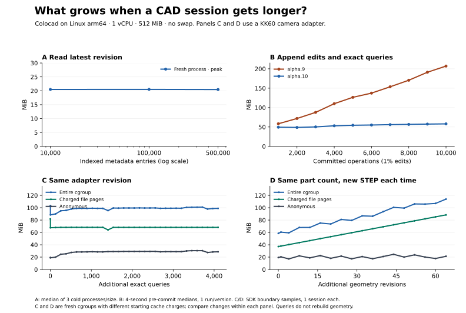

# What still grows after persisting the index?

**Indexed lookups are nearly flat across the tested history sizes. Repeated geometry edits are not.** In a KK60 camera-adapter retrofit, recording 4,096 checks of the same geometry stayed near 99 MiB after warm-up. Keeping the same two parts but delivering 64 distinct revisions increased current sandbox memory from 58.5 to 114.0 MiB.

[中文](field-history.zh-CN.md) · [Measurements and independent geometry checks](benchmarks/alpha10/field-history.json) · [Work orders, implementations and reproduction](../benchmarks/field-task/README.md) · [Original mixed-write cgroup traces](benchmarks/alpha10/write-traces.tar.gz)

| Variable | Memory in MiB | Interpretation |
|---|---|---|
| Open an indexed session and read its latest geometric revision at 10k / 100k / 500k entries | Median peaks **20.49 / 20.51 / 20.46** | Three new processes per size; synthetic metadata. A head lookup does not load the entire history. |
| Append to a session: 99% exact queries, 1% box-height edits; operation 1,000 → 10,000 | Current memory: alpha.9 **58.3 → 207.1**; alpha.10 **49.4 → 58.0** | Both versions already have SQLite. Endpoint growth per 1,000 operations fell from **16.5 to 0.96 MiB** in these runs. Neither is an asymptotic bound. |
| Keep the accepted KK60 adapter revision fixed and append an exact camera-hole inspection | At 512 / 1,024 / 2,048 / 4,096 queries: **98.0 / 99.2 / 99.5 / 99.0** | Each receipt was persisted. Zero geometry builds per query; no new high-water mark after initial modeling (115.4 MiB). |
| Change adapter thickness and hole pitch; deliver a new STEP, snapshot and preview each time | After 0 / 16 / 32 / 64 edits: **58.5 / 75.2 / 86.8 / 114.0**; running peak **70.7 → 126.4** | Charged file pages **37.2 → 88.4**; anonymous **19.3 → 21.3**; kernel **1.8 → 4.0**. All 64 different STEPs passed independent readback. |

For the historical mixed-write runs, the table uses 4-second medians just before each commit milestone, derived from the original 20 ms traces. The full-run peaks, including the final page audit, were 224.1 and 72.0 MiB. Each writing series is one session. The two KK60 runs use separate fresh cgroups with different starting cache charges; compare changes *within* each. Linux arm64, 1 vCPU, 512 MiB, no swap; no resident inference agent.

## Index, artifacts and active bodies

The [catalog](../crates/session-catalog/src/main.rs) indexes sequence and accepted revisions; its SQLite page-cache target is about 2 MiB **per connection**, and results can be paged. [Inspection receipts](../src/session-payload.mjs) share identical requests and use compressed segments. [Geometry edits](../src/session.mjs) persist sources, exact STEP, checkpoints, previews and receipts. Saving bytes to disk does not remove them from cgroup file accounting. Explicit full-history reads and the single-file viewer export can still collect entire histories.

At 64 edits the project retained **238.17 MiB**, including just **0.10 MiB** of SQLite. About **51.2 MiB** of the **55.5 MiB** increase was in the cgroup's file counter. File charge is neither a per-file breakdown nor bytes written. In a separate run, after the producer exited, Linux cache advice on 1,403 files from closed historical revisions left that counter unchanged at **37.27 MiB**; all 68 STEP hashes still reopened. This did not establish an effective cache fix or identify which file types caused the live increase.

For a larger **current** B-rep, 16 / 256 / 1,024 holes in one solid measured **40.0 / 99.7 / 308.5 MiB**. Holes add topology to the same body. [Early release of assembly parts](../crates/agent-cad/src/assembly.rs) is conditional: snapshots, preview, mates and cross-part checks can require live bodies. The [single-file STEP writer](../crates/agent-cad/src/step_assembly.rs) still collects definition text and constructs an output string. An index on historical entries does not bound any of these working sets.

## Engineering flexibility: retrofit a KK60 saddle

All three tools received the same neutral STEP from stage six of the [catalog-backed KK60 reconstruction](../examples/hiwin-kk60/README.md), not an OEM STEP. Camera-adapter dimensions are a new test brief. Each implementation measured the mounting circles, then (1) installed a two-hole camera adapter, (2) changed length 44 → 54 mm, gauge 5 → 7 mm and pitch 16 → 22 mm, (3) added an 8 × 4 mm through-window, (4) rejected a saddle missing a mounting hole and (5) accepted a replacement translated by +7 mm X and +11 mm Z without a hand-written placement.

**Colocad, CadQuery and build123d each delivered four accepted assemblies and rejected the incompatible part.** Independent OCCT checks covered all 12 STEPs: two valid solids, mounting and camera circles/axes, blind-hole floor and surrounding stock, window, plate bounds/volume, contact and zero intersection volume. All 64 edited Colocad STEPs passed the same checks. Python exporters did not implement Colocad's persistent session/preview contract; single workflow timings are not a performance ranking. This is a scripted, agent-authored engineering task, not a blind agent study or a general flexibility ranking. [Previously measured live Pi tasks](../specs/experiments/0005/README.md) are separate.

On the reimported saddle, Colocad's high-level blind-hole query returned partial coverage and **zero recognized holes**. Exact edge queries identified the four upper mounting circles (three on the invalid input); independent material checks confirmed the floors. The fallback is useful for this interface, but is not evidence of general blind-hole recognition.

The next regression gate should compare 32 / 64 / 128 / 256 geometry edits under both the deployment sandbox mount and Docker Desktop bind mounts. Isolate closure and persistence of STEP, snapshots, checkpoints and previews; record file/anonymous/kernel charges as well as peak and disk bytes. Require recovery, reopening old revisions and independent geometry checks. Keep single large solids and assemblies as separate workloads.
