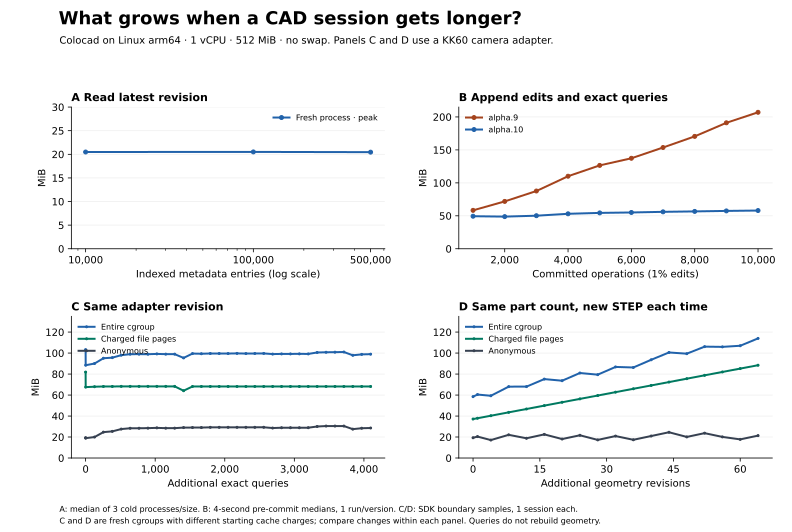

# 索引持久化以后，哪些内存还在涨？

Linux 开发候选版已完成 ext4 和 virtiofs 上的 256 版连续改图验收。 [对照结果](revision-cache.zh-CN.md)

**alpha.10 解决了按历史读取最新版本时整本账本驻留的问题，没有解决每次改图都保存精确几何时的沙箱内存增长。** 在 HIWIN KK60 滑台相机转接板上，固定几何追加 4,096 条检查，整组内存在预热后约 99 MiB；保持同一零件数、每次真正改图并保存 STEP，64 次改图使整组当前内存从 58.5 增至 114.0 MiB。两条曲线都是同一公开版本的实际行为。

[English](field-history.md) · [数值、计数器、几何回读和输入摘要](benchmarks/alpha10/field-history.json) · [运行方法与三套后端实现](../benchmarks/field-task/README.md) · [混合写入的原始 20 ms 内存轨迹](benchmarks/alpha10/write-traces.tar.gz)

| 只改变什么 | 实测内存（MiB） | 可以下什么结论 |
|---|---|---|
| 历史 1 万 / 10 万 / 50 万条，各起新进程读取最新几何版本 | 峰值中位数 **20.49 / 20.51 / 20.46** | 在这个范围内，索引读取基本持平。每规模三次，历史为合成元数据。 |
| 从第 1,000 到第 10,000 次操作，99% 查询、1% 改一个盒子的高度 | 写入期间当前内存 alpha.9 **58.3 → 207.1**；alpha.10 **49.4 → 58.0** | 两版都有 SQLite 索引。整组平均每千次操作增量从 **16.5 降到 0.96 MiB**；这是区间端点差，不是复杂度。 |
| 转接板装配不变，同一次精确圆边检查持续写入 | 第 512 / 1,024 / 2,048 / 4,096 次：**98.0 / 99.2 / 99.5 / 99.0** | 每条检查都持久化，查询没有重建几何。整个查询段未超过此前建模的 115.4 MiB 峰值。 |
| 同一两件装配，连续改板厚和相机孔距；每次保存新 STEP、快照和预览 | 第 0 / 16 / 32 / 64 次后：**58.5 / 75.2 / 86.8 / 114.0**；累计峰值 **70.7 → 126.4** | 文件页 **37.2 → 88.4**，匿名内存 **19.3 → 21.3**，内核内存 **1.8 → 4.0**。64 版全部独立回读。这条写入路径确实仍有近线性增长。 |

第二行从原始 20 ms 轨迹重新统计，取每个千次检查点之前 4 秒的中位数，避开最后的分页审计。以前报道的 **224.1 / 72.0 MiB** 是跑完整个流程的内核峰值，不能用两个这样的单点推断斜率。后两行来自不同的全新 cgroup，初始文件缓存计费不同，应在各自运行内比较变化。均为 Linux arm64、1 vCPU、512 MiB、无交换；不含常驻推理 agent。每条写入轨迹是一次会话，不外推为无限规模上界。

## 为什么磁盘索引没把整个沙箱变成有界内存

[会话目录](../crates/session-catalog/src/main.rs)只保存版本和指针；读取最新版本走索引，分页有条数/字节限制。SQLite 每个连接的页缓存目标约 2 MiB，不是整个沙箱的内存限额。[查询回执](../src/session-payload.mjs)复用相同请求、分段压缩写入；[几何版本](../src/session.mjs)还要保存输入、精确 STEP、快照、预览和回执。磁盘上保存了文件并不意味着 Linux 不会把文件页计入 cgroup。显式读取完整历史的 `session.read()` 和单文件查看器导出也不是分页 head 查询。

64 次改图后，项目文件占 **238.17 MiB**，其中 SQLite 文件只有 **0.10 MiB**。实测净增的 55.5 MiB 中约 **51.2 MiB** 落在 cgroup 的 `file` 计数。这个计数不能定位某个文件，也不等于磁盘写入量。另起同任务，在建模进程退出后，仅对旧版本 1,403 个文件做 Linux 缓存释放提示：`file` 提示前后均为 **37.27 MiB**，68 个 STEP 仍可按摘要回读。因此“只在结束时调用一次 fadvise”没有显示收益；不能据此排除写入期间的影响，也不能把增长全归给 STEP 或 SQLite。

如果增大的是**当前模型**而非历史，情况又不同：同一个实体从 16 / 256 增至 1,024 孔，峰值 **40.0 / 99.7 / 308.5 MiB**。每个孔都会增加当前 B-rep 的拓扑，内核要同时处理当前实体。装配虽可提早释放部分独立几何，但[提前释放路径](../crates/agent-cad/src/assembly.rs)对查询快照、预览、配合和跨件检查有限制；[单文件 STEP 写出](../crates/agent-cad/src/step_assembly.rs)仍会拼接定义和最终字符串。历史索引不会消除这些开销。

## 真实任务和灵活性

输入是[有目录依据的 KK60 滑台](../examples/hiwin-kk60/README.md)第六阶段的中性 STEP，不是厂商原始 STEP。任务是给滑台设计一块相机转接板；板件规格和更改单由实验设定。三种后端读取同样的 STEP，以实际安装孔位置放置转接板，没有针对替换件写死坐标。

1. 安装：保持原有四个安装孔，设计双孔相机接口。
2. 改参：板长 44 → 54 mm、板厚 5 → 7 mm，相机孔距 16 → 22 mm；旧安装接口须保持不动。
3. 改结构：通过板厚新增 8 × 4 mm 走线窗口。这一步需要增加设计特征，不能只改旧参数。
4. 换件：遇到只剩三个安装孔的输入必须拒绝且不交付；换上坐标原点偏移 X+7、Z+11 mm 的兼容输入，自动重测、重新放置。

**Colocad、CadQuery、build123d 均完成四个正例，并拒绝一个错件。** 独立 OCCT 回读全部 12 份 STEP：每份含两个有效实体；检查安装孔的孔口/孔底、孔轴位置、相机孔、走线窗口、材料、体积、接触和零体积重叠。另对 Colocad 的 64 个新版本逐件重复这些检查。它证明三个工具都能完成这组改装，不能据此判定哪一个普遍更灵活。Python 脚本没有实现同款持久化账本和预览，所以不按这组耗时给工具排名。

一个实际缺口：对这份重新导入的 STEP，Colocad 的高层 `holes(blind)` 返回 `partial`，0 个已识别盲孔。精确圆边查询仍找到四个顶面安装圆（错件只有三个），足以放置，独立检查器再验证底部几何。这个替代步骤不能证明通用盲孔识别已经支持所有 STEP。本次是可重复的 SDK/CLI 任务，不是三组模型盲测；[先前有推理轨迹的 Pi 实验](../specs/experiments/0005/README.md)另列，不能把这 64 次自动回归写成 64 次独立 agent 设计。

## 下一道验收门

固定这块转接板及几何标准，把预热后的 **32 / 64 / 128 / 256 个真实版本**做成配对试验；分开运行只查、只改、查询加改图，并在实际部署的 Linux 沙箱挂载与 Docker Desktop bind mount 上分别测。候选实现按版本记录 STEP、查询快照、检查点和预览的写入/关闭时刻，在耐久提交后逐类做隔离试验。验收看后半段的当前文件页、匿名内存、内核峰值和磁盘字节，同时要求旧版本可重开、断点恢复、每份 STEP 几何和必要快照不丢失。单块大实体和大装配另测；不把索引读取的平坦曲线作为这些任务的验收。
