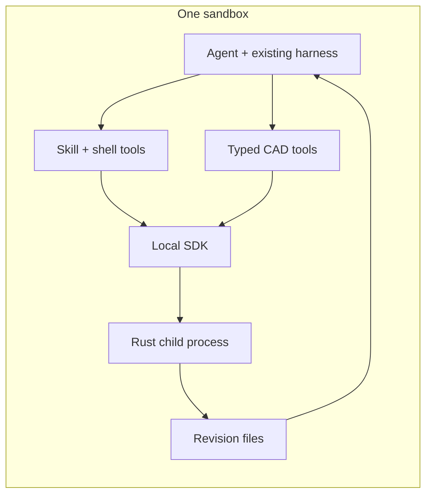

# Integrate with an existing harness

Keep the agent, harness, SDK and native CAD process in the **same sandbox**. Install colocad in the sandbox image or project dependency layer. Bind it to the harness's existing tool execution and artifact storage.

| Harness | Recommended first route | Optional route |
| --- | --- | --- |
| Codex | Project skill + existing shell/image tools | Host-provided tool bridge |
| Claude Code | Project skill + existing Bash/Read tools | Host-provided MCP adapter |
| Pi coding agent | Project skill or explicit `--skill` | Local extension registering CAD tools |
| Pi agent core / custom TypeScript harness | `createCadTools` through a thin adapter | Existing shell tool + loaded skill instructions |

An MCP transport is optional integration code, not a shipped colocad server. A skill supplies workflow guidance; it does not grant filesystem access, install Node, or register typed tools by itself.

## Session lifecycle

1. Allocate a session output root from trusted harness state. Load the pinned package and skill once; record package and native versions.
2. Parse the task into dimensions, datum, constraints and explicit assumptions. Pick a kernel model or a feature tree deliberately.
3. Preflight the source, then build a geometry revision. Return failures with their feature ID so the agent can correct the relevant feature.
4. Inspect the result: geometry counts/bounds/volume, requested views and any internal regions. Persist the accepted source and receipt before moving to the next edit.
5. Return artifact references through the harness's existing attachment system. Upload or copy the source, STEP, receipt and useful previews before the sandbox is destroyed.

With typed tools, allocate one `CadClient` for each sequential modeling session. Do not share its mutable revision/cache state across unrelated concurrent sessions. Schedule independent jobs with separate clients and output roots, and cap concurrency according to actual sandbox memory. The Pi sample deliberately serializes modeling calls.

With shell tools, use argument arrays in a process API rather than interpolating model text into shell commands. Store JSON in a file. Agent-controlled dimensions belong in model input; executable paths, output roots and credentials belong to harness configuration. Keep normal harness permissions in force.

For exact queries, enable `queryable` when needed (datum/interface declarations enable it automatically). Register `cad_query` only when native capabilities advertise it. Raw `createCadTools` takes `{artifact_directory, request}`; session-bound tools take `{request}` and bind the accepted artifact. The host owns `queryRoots`; the agent chooses a target/space/tolerance within that boundary. Preserve `query_revision_id` in compact build/edit feedback and re-query after edits. Stale refs, partial coverage and ambiguity remain visible. [Query/edit walkthrough](../best-practices.md#query-declare-intent-assemble-then-challenge-the-edit).

## Results and failures

A useful tool result includes the artifact directory, revision, relevant measurements, coverage/ambiguity, counts/bounds/volume, validation and timings. Keep detailed feature/query diagnostics in the full receipt and attach a PNG for visual inspection. A path in text is not itself an image input to a remote vision model. The [Pi adapter](../../examples/integrations/pi-tools.mjs) shows text/image content and full `details` together.

`cad_validate` success is only preflight. A nonzero child exit, a failed receipt or an explicit degraded feature must remain visible. Do not turn a failed build into a success containing an empty output path. Do not retry the same invalid geometry indefinitely; change the failing feature or report the unresolved constraint.

The `on_fail` record policy is an explicit degraded-model choice, not a general recovery default. Its object includes `kind: "record"`, a reason, omitted details and affected requirements. Check recorded degradations before accepting a revision; the Pi adapter includes these in model-visible text. Preserve the original exact model when using a simplified display/envelope representation.

## Resource and storage policy

Start with the default 30-second call budget and one active native operation. Increase the budget for a measured workload; do not infer a universal 512 MiB allowance from one benchmark. Account for agent runtime, Node, native descendants, previews and file cache in a real sandbox measurement.

For multiple camera angles, use the same client or `observeArtifact`. For repeated parts, reuse a part definition and place occurrences. Keep cache/source revisions while referenced; artifact cleanup is a host policy and must not delete a live observation's source STEP.

Use [Pi](pi.md), [Claude Code](claude-code.md) or [Codex](codex.md) for concrete setup. [Best practices](../best-practices.md) covers modeling and performance choices.
