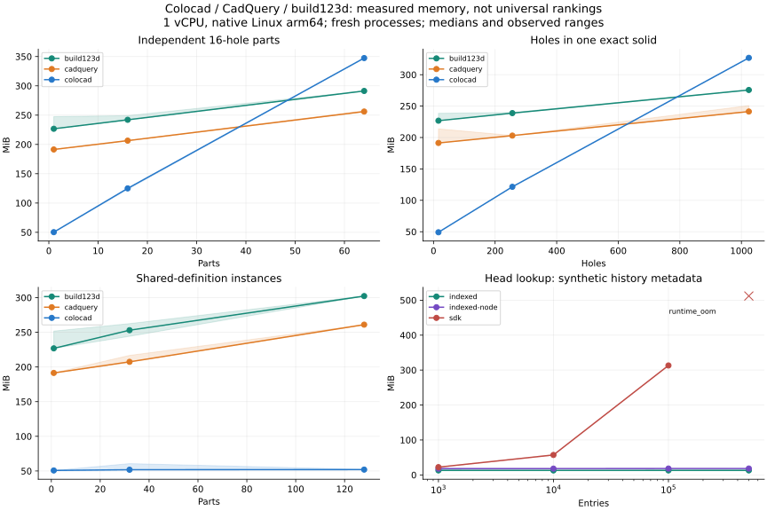
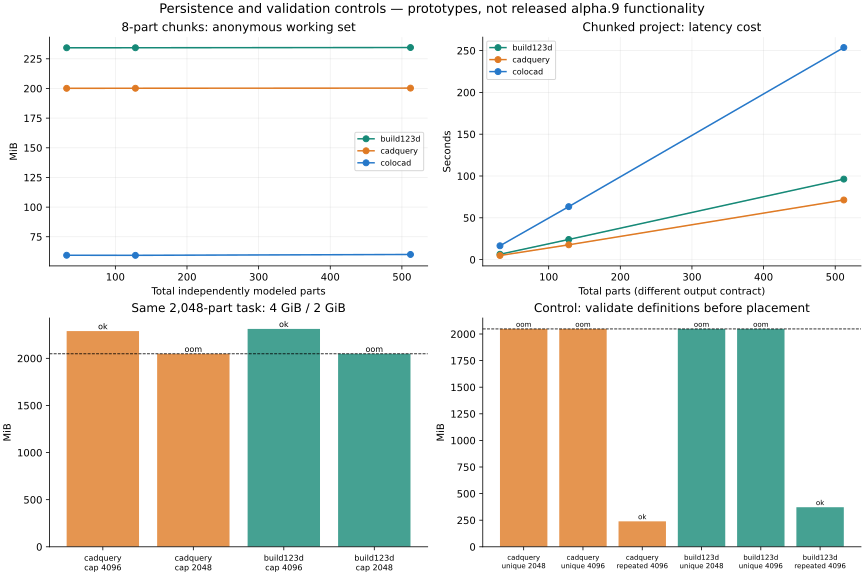
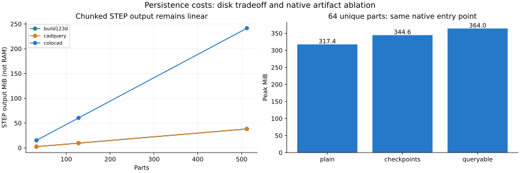

# CAD memory limits and persistence study

2026-11-11 · Colocad alpha.8/native 0.5.1 · [完整中文报告](memory-persistence-report.zh-CN.md).

[Single-file HTML](evidence/memory-2026-11-11/memory-study.html) · [JSON](evidence/memory-2026-11-11/memory-study.json) · [CSV](evidence/memory-2026-11-11/memory-study.csv) · [Raw evidence](evidence/memory-2026-11-11/raw-evidence.tar.gz) · [Reproduction](../benchmarks/memory/README.md)

Tracking: [issue #1](https://github.com/Coloopx/colocad/issues/1) · [alpha.9 milestone](https://github.com/Coloopx/colocad/milestone/1).

## Findings

**The 2 GiB failures are reproducible, and Colocad is not uniformly lower-memory.** Working-set management, whole-assembly validation, STEP export and history indexing are separate problems. Indexed and chunked prototypes demonstrate bounded working sets for the tested contracts; they are not shipped alpha.9 functionality or proof of O(log N) total exact-CAD memory.

The common range (three repetitions, median peak/elapsed time):

| Workload / 负载 | Colocad | CadQuery | build123d |
| --- | --- | --- | --- |
| 1 solid, 1,024 holes | 326.8 MiB / 57.61 s | 241.3 MiB / 4.01 s | 275.7 MiB / 4.05 s |
| 64 distinct 16-hole parts | 347.4 MiB / 33.46 s | 256.1 MiB / 3.05 s | 291.3 MiB / 3.06 s |
| 128 shared-definition instances | 52.0 MiB / 0.67 s | 261.0 MiB / 1.85 s | 302.2 MiB / 2.68 s |
| 64 sequential cuts | 82.3 MiB / 10.83 s | 195.9 MiB / 2.11 s | 230.2 MiB / 2.46 s |

Shared definitions are currently a Colocad strength. Distinct parts and the large perforated solid exceed the Python backends here. Native validation accounts for roughly 85% of heavy-case time, but that bucket combines several checks and measurements. Historical hand/rail speedups remain scoped to their original workloads.

## Experimental boundary

Native Linux arm64, 1 vCPU, no network/swap, fresh processes and warmed host image pages. CadQuery 2.8.0 uses OCP 7.9.3.1.1; build123d 0.13.0 uses OCP-novtk 8.0.1.1.0. Separate environments, NumPy 2.5.4. Differences cannot all be attributed to language or the kernel. cgroup kernel peak includes the supervisor, descendants and charged file pages; anon/file/kernel/RSS are sampled at 20 ms. Installation, inference, resident agent/harness, viewer and independent verification are excluded. See [cgroup accounting](https://docs.kernel.org/admin-guide/cgroup-v2.html).

108 common-range runs were fixed and ordered before execution. Three-run bands are observed ranges, not confidence intervals. This is a shared host; metadata-fixture preparation briefly overlapped the main campaign outside the CAD container. Times are descriptive, unsuitable for narrow speed-regression thresholds. No timed CAD campaigns ran concurrently. Extreme/control arms mostly run once; 128-part chunked projects run three times, 512 parts once.

Bulk holes use a direct perforated-profile extrusion on the Python backends; serial Booleans are a separate family. Distinct parts differ in width and cannot be legitimately geometry-deduplicated. All successful CAD paths check analytic volume and deliver exact STEP. This is a controlled plate/assembly stress corpus, not an industrial-model population success rate.

There are 200 scheduled observations, 194 executed and six unrun after predefined failure boundaries: 173 successes (including metadata lookups), ten cgroup OOMs, three V8 heap OOMs, four policy rejections and four timeouts. **36 representative STEP deliveries** passed separate OCCT readback, every-solid validity/bounds/placement, count, analytic volume and every bore's axis/radius/center. All 15 chunk catalogs passed complete hash/range/integrity checks.

The verifier runs separately at 4 GiB and validates individual STEP-read solids to avoid the whole-compound temporary allocation under investigation. OCCT is an independent kernel for SolidCore output, but CadQuery readback is same-family OCCT plus analytic checks. Chunk geometry readback samples the first/middle/last chunk of each largest backend case; every other chunk retains build checks and digest verification. [Readback](evidence/memory-2026-11-11/verification.json), [catalog checks](evidence/memory-2026-11-11/catalog-verification.json), [environment](evidence/memory-2026-11-11/environment.json).

## The failure has more than one cause

Both Python baselines hit cgroup OOM with 4,096 unique parts and 4,096 repeated instances. Single solids with 16,384 holes and 1,024 serial cuts time out at 120 s; those are not completed memory measurements. The same 2,048-part task at different caps:

| Backend | Cap MiB | Outcome | Peak MiB | Last completed phase |
| --- | --- | --- | --- | --- |
| cadquery | 4096 | ok | 2289.2 | exported |
| cadquery | 2048 | oom | 2048.0 | validated |
| build123d | 4096 | ok | 2312.2 | exported |
| build123d | 2048 | oom | 2048.0 | validated |

Fine-grained events prove that the 2,048-part failures happen during STEP export, after validity, mass and solid-count checks. The 4 GiB completion measures actual demand above 2 GiB. Earlier 4,096-part coarse logs only locate failure to the verification group.

A control validates definitions before known rigid placement, keeps aggregate mass/count checks and exports the full assembly STEP:

| Backend | Family | N | Outcome | Peak MiB | Last completed phase |
| --- | --- | --- | --- | --- | --- |
| cadquery | unique | 2048 | oom | 2048.0 | validated |
| cadquery | unique | 4096 | oom | 2048.0 | validated |
| cadquery | repeated | 4096 | ok | 239.3 | exported |
| build123d | unique | 2048 | oom | 2048.0 | validated |
| build123d | unique | 4096 | oom | 2048.0 | validated |
| build123d | repeated | 4096 | ok | 372.0 | exported |

Repeated instances now complete and independently reopen, identifying whole-compound validity overhead for this fixture. Distinct definitions still OOM in STEP export. Compositional checks cannot be blindly substituted for arbitrary interacting Booleans or inter-part collision requirements.

Colocad rejects the extreme inputs at policy limits: 128 features/instances, 1,024 cutters, and a separate 32 MiB STEP budget. Each unique fixture part has two features. Refusal is not a successful low-memory large-model build.

## Persistence controls

Same Node 22.23.3 and SDK import, full JSON head lookup versus indexed SQLite lookup:

| Entries / 条目 | SDK JSON peak MiB | Indexed Node peak MiB | SDK outcome |
| --- | --- | --- | --- |
| 1000 | 22.27 | 18.02 | ok |
| 10000 | 57.12 | 18.07 | ok |
| 100000 | 313.23 | 18.27 | ok |
| 500000 | 512.00 | 18.33 | runtime_oom |

The 500k SDK failures are V8 heap aborts, not kernel OOM kills. These are synthetic metadata records seeded from one real accepted entry, not 500k CAD edits or a write-throughput result. The auxiliary Python/SQLite control stays near 13 MiB; the main indexing comparison uses the same Node runtime. The configured 2 MiB page cache is not a whole-process limit. [SQLite cache configuration](https://www.sqlite.org/pragma.html#pragma_cache_size) and [index planning](https://www.sqlite.org/queryplanner.html) support the design rationale.

Eight-part chunks, local process completion, hash/fsync/catalog commit and advisory release of completed file pages:

| Backend | Parts | Peak MiB | Anon MiB | Seconds | STEP output MiB |
| --- | --- | --- | --- | --- | --- |
| colocad | 32 | 93.92 | 59.41 | 16.57 | 15.09 |
| colocad | 128 | 94.67 | 59.34 | 63.37 | 60.37 |
| colocad | 512 | 97.71 | 60.07 | 253.66 | 241.48 |
| cadquery | 32 | 219.50 | 200.12 | 4.94 | 2.38 |
| cadquery | 128 | 207.34 | 200.18 | 17.74 | 9.54 |
| cadquery | 512 | 208.32 | 200.30 | 71.33 | 38.15 |
| build123d | 32 | 242.64 | 234.31 | 6.43 | 2.38 |
| build123d | 128 | 242.78 | 234.33 | 24.11 | 9.54 |
| build123d | 512 | 243.98 | 234.52 | 96.30 | 38.15 |

Anonymous working sets plateau from 32 to 512 parts for all three backends. This is a strategy, not a language-exclusive property. Output is a complete **indexed chunked project**, not a single merged assembly STEP. Latency and disk remain linear; Colocad's larger STEP output in this fixture is a separate export concern. Cross-chunk mates/collisions, arbitrary surfaces, whole-job resumption and product migration remain unaccepted.

The same direct native invocation, 64 parts (single-run ablation):

| Native mode | Peak MiB | Anon MiB | Seconds |
| --- | --- | --- | --- |
| plain | 317.43 | 266.20 | 30.86 |
| checkpoints | 344.57 | 280.31 | 31.32 |
| queryable | 364.04 | 282.83 | 31.15 |

Checkpoint/query buffers explain only part of the peak. Local 12 MiB checkpoint and 64 MiB query-geometry caps do not bound all decoded topology, neutral exchange, output strings and runtime memory.

## Complexity and next-version scope

Colocad consumes intermediate bodies at last use but retains final definitions/exchange/output state; distinct geometry remains O(sum G). Instance metadata is O(N). Its JSON ledger has O(H) head-read/append work and O(H²) cumulative append IO. CadQuery's parent chain can retain growing versions (worst case O(sum G_revision), mitigated by topology sharing); build123d without user-retained versions does not automatically imply that same history cost. Both have size-dependent active geometry and verifier/exporter temporaries. These are source-based complexity arguments, not universal measured exponents. [Colocad executor](../crates/agent-cad/src/executor.rs), [session](../src/session.mjs), [CadQuery Workplane](https://cadquery.readthedocs.io/en/latest/workplane.html), [build123d assemblies](https://build123d.readthedocs.io/en/latest/assemblies.html), [OCCT analyzer](https://github.com/Open-Cascade-SAS/OCCT/blob/V7_9_3/src/BRepCheck/BRepCheck_Analyzer.hxx).

Target: runtime + agent/harness + active geometry frontier + operation temporaries + bounded index/IO caches + charged file cache. Disk remains proportional to total geometry, instances and history. O(log N/H) index lookup with a bounded cache is achievable; O(log N) total memory for arbitrary fully resident exact geometry/global operations is not. A procedural pattern can compress its description without removing the expanded topology/output lower bound.

[SDD 0006](../specs/0006-bounded-memory-persistence.md) and [ROADMAP](../ROADMAP.md) scope alpha.9: Rust catalog/SDK migration; byte-budgeted geometry and artifact sinks; streamed single-STEP export; lazy viewer; native multi-architecture and full-harness acceptance. CAD 512 MiB and entire sandbox 2 GiB are separately proposed gates. The existing published alpha.8 runtime is unchanged and alpha.9 is not released. Real appends, kill/recovery, stable refs, cross-platform catalogs, real products and held-out geometry remain required. Postprocessing diagnostics (native output path and host read-only WAL handling) are retained; immutable offline catalog verification does not substitute for future live-reader platform tests.

This is a directed benchmark/diagnosis/prototype iteration. It does not accept the whole G4/RSI automation program, and preserves failed controls rather than hiding them or changing output/verification requirements.
