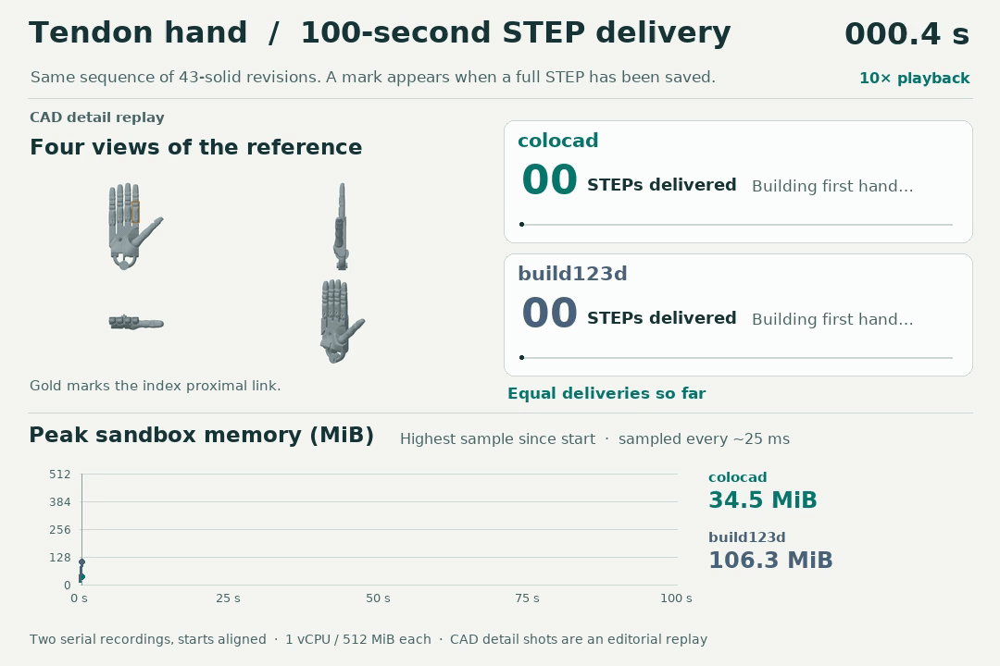
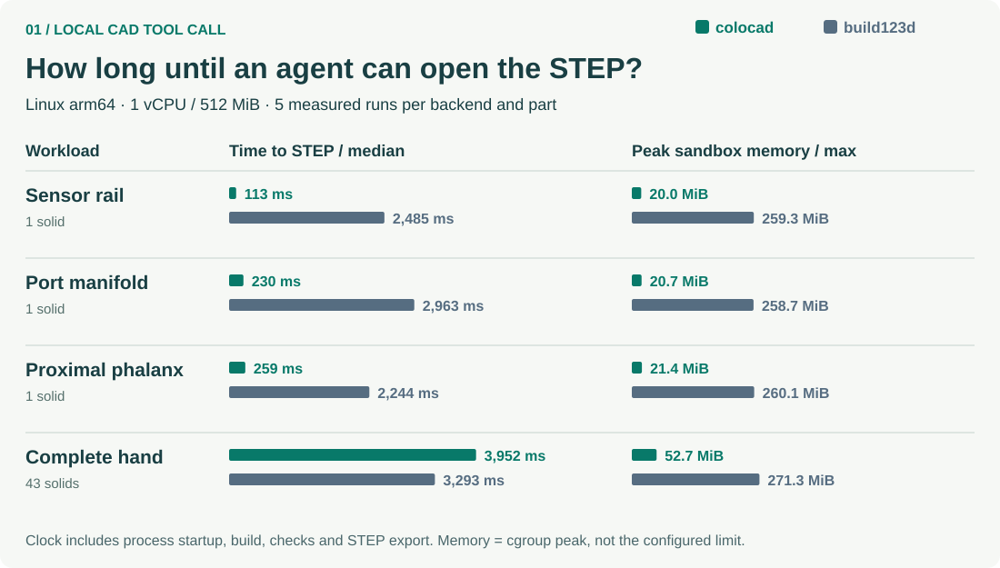
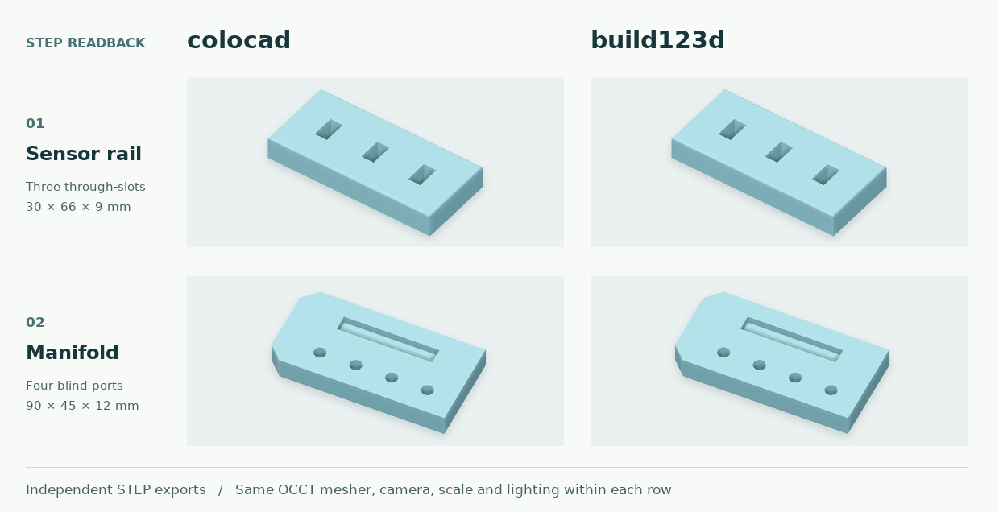

# Performance evidence and reproduction

**Current comparison:** [Alpha.9 versus CadQuery and build123d](benchmark-alpha9.md) · [Offline scorecard](benchmarks/alpha9/scorecard.html). The studies below use earlier kernels and dependency pins.

These measurements apply to the stated workloads and historical binaries. They are not a claim of universal superiority or a fresh benchmark of every release.

The [2026-11-11 memory and persistence study](memory-persistence-report.md) compares alpha.8 with CadQuery and build123d at larger scales, reproduces 2 GiB OOM, and measures indexed/chunked prototypes. Colocad's advantage depends on the workload: shared instances fare well; distinct parts and a large perforated solid expose current scaling limits. See the [alpha.9 bounded-memory specification](../specs/0006-bounded-memory-persistence.md) for the planned response.

## How many tendon hands can an agent deliver in 100 seconds?

**colocad delivered 44 complete revisions to build123d’s 33 (+33.3%), with 57.1% lower peak sampled sandbox memory.** Both tools rebuilt and assembled the same 43-solid hand at each revision. Each tick marks a complete STEP handed off to storage.

The GIF shows the **highest memory sampled so far** for each tool on the same 0–512 MiB scale. For actual usage between builds, see the [instantaneous-memory replay (MP4)](https://github.com/Coloopx/colocad/raw/refs/heads/main/showcase/tendon-hand/window/hand-window-en.mp4) or the [timestamped samples](../showcase/tendon-hand/evidence/window-optimized.json).

| Same revision queue, 1 vCPU / 512 MiB | Optimized colocad | build123d |
|---|---:|---:|
| Complete hands delivered in 100 s | **44** | 33 |
| First STEP | **2.223 s** | 3.010 s |
| Median job time on the same first 33 inputs | **2.234 s** | 2.855 s |
| Highest sampled cgroup memory over the 100 s window | **130.9 MiB** | 304.9 MiB |

One measured window per backend, with a new CAD process for each revision. The original run used the alpha.2 SDK and the optimized Linux arm64 kernel now bundled in alpha.3. Memory samples taken about every 25 ms include subprocesses, tmpfs and charged file cache. Every counted STEP reopened successfully. [Measurement method](../showcase/tendon-hand/window/README.md) · [Detailed build and single-call replay](../showcase/tendon-hand/assembly-performance.md)

The static scorecard below uses the **published alpha.2 binary**. With fresh tool processes the sensor rail and manifold reached STEP 22.0× and 12.9× faster than build123d, using 7.7% and 8.0% of its peak memory.

See the static comparison across four workloads

| Deliverable | Time to STEP: colocad / build123d | Speedup¹ | Peak memory: colocad / build123d | Share of build123d peak |
| :--- | ---: | ---: | ---: | ---: |
| Sensor rail | 113 / 2,485 ms | **22.0×** | 20.0 / 259.3 MiB | **7.7%** |
| Port manifold | 230 / 2,963 ms | **12.9×** | 20.7 / 258.7 MiB | **8.0%** |
| Tendon-hand proximal link | 259 / 2,244 ms | **8.6×** | 21.4 / 260.1 MiB | **8.2%** |
| Complete 43-solid hand | 3,952 / 3,293 ms | **0.83×** | 52.7 / 271.3 MiB | **19.4%** |

¹ build123d time divided by colocad time from unrounded observations. Same Linux arm64 image, 1 vCPU, 512 MiB. Five fresh processes and cgroups per part and backend after warm-up. Time is the median wall clock including startup, imports, modeling, backend checks and STEP export. Memory is the maximum measured cgroup peak; charged pages, temporary outputs and tool descendants count. Installation, container startup, previews, inference and a resident agent are excluded.

[Rail/manifold samples](../docs/benchmarks/runs.json) · [Finger/hand samples](../showcase/tendon-hand/evidence/scope.json) · [Four-view hand study and CAD downloads](../showcase/tendon-hand/README.md) · [Offline scorecard](https://github.com/Coloopx/colocad/raw/refs/heads/main/docs/benchmarks/time-to-step.html)

**Historical alpha.2 result.** in a separate 100-second sweep of complete hand revisions, colocad delivered 24 STEPs to build123d’s 30. Every counted file reopened as a valid 43-solid assembly. [Timestamped outputs and paired geometry checks](../showcase/tendon-hand/evidence/window.json)

## What the two STEP writers produced

Each backend modeled the part from the same parameters. The images use the exported STEPs, the same mesher and camera. OCCT reopened each file as **one valid solid**. Both rail exports had 22 faces and 56 edges; both manifold exports had 27 faces and 54 edges. The two directional boolean differences measured **0 mm³** in both cases (boolean tolerance: 0.000001 mm). [Geometry checks](../docs/benchmarks/step-checks.json)

On the manifold, build123d’s modeling phase alone was **43.8 ms** to colocad’s **53.7 ms**, while build123d import alone took **2.45 s**. The table measures a fresh tool call, not the speed of an isolated boolean operation. [Stage timings and reproduction](../benchmarks/readme/README.md)

### When the agent only changes the camera

The first preview saves a display mesh. For a second view of unchanged geometry, the kernel SDK can load that mesh instead of rebuilding the solid or triangulating it again. Here are five-run medians for the same **top view**, comparing two paths inside colocad:

| Part | Rebuild part + render | Render from saved mesh | Speedup |
| :--- | ---: | ---: | ---: |
| Sensor rail | 108.8 ms | 19.4 ms | **5.6×** |
| Port manifold | 223.8 ms | 13.3 ms | **16.8×** |

The PNG, GLB and STL from both paths matched byte for byte on every pair. This test starts with the SDK already loaded and includes native process startup and display output. A geometry edit needs a new revision. [Preview measurements and hashes](../docs/benchmarks/preview-runs.json)

