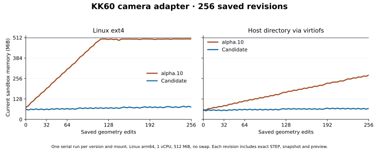

# Saving 256 geometry revisions under a 512 MiB limit

The Linux candidate `0.1.0-alpha.11-rc.1` reduced peak sandbox memory on the KK60 camera adapter from **512.0 to 94.9 MiB** on ext4 and **288.3 to 84.8 MiB** on a host directory mounted through virtiofs. Each project kept 260 accepted revisions and occupied about 905 MiB on disk.

| Filesystem | Current at 128, alpha.10 → candidate | Current at 256, alpha.10 → candidate | Candidate growth from 128 to 256 | End-to-end wall time, alpha.10 → candidate |
|---|---:|---:|---:|---:|
| Linux ext4 | 500.7 → 69.3 MiB | 503.6 → 77.1 MiB | 7.8 MiB | 162.4 → 161.7 s |
| Host directory over Colima virtiofs | 169.0 → 63.8 MiB | 277.4 → 68.7 MiB | 4.9 MiB | 161.0 → 162.9 s |

The four runs used the same Linux arm64 image, single CPU, 512 MiB cgroup and zero swap. They ran serially, once per configuration. Shared VM cache charges can differ at startup. Current samples come from `memory.current` after edit returns. Peaks come from `memory.peak`. Times include container start, setup and rejection, 256 edits and paged reopen. Independent verification ran outside the timed job. The ext4 baseline completed after reaching the 512 MiB limit.

A separate run of the installed candidate on the local Abelien runner image reached **125.2 MiB** peak. Current memory went from **98.8 to 106.8 MiB** over the last 128 edits, with **zero OOM kills**. The measured processes were the SDK, native catalog and geometry kernel. A repeat on ext4 in the original benchmark image reached **94.5 MiB** peak, also with zero OOM kills.

The Rust catalog finds the preceding accepted revision using its existing index. After a successful durable geometry commit it issues Linux `POSIX_FADV_DONTNEED` for clean pages of that revision’s input, receipt, checkpoints, meshes and exports. It also releases pages of the newly written STEP, STL and GLB exchange files. The next edit can reuse the current checkpoints and query snapshots. Failed edits and inspections preserve the accepted revision. [Implementation](https://github.com/Coloopx/colocad/blob/main/crates/session-catalog/src/revision_cache.rs)

On virtiofs the candidate's charged file pages went from **35.05 to 35.06 MiB** over the last 128 edits. Kernel memory grew from **5.41 to 8.77 MiB**. On ext4 the file charge went from **41.88 to 44.28 MiB**. Each revision still creates filesystem metadata. These measurements establish a budget for the measured range. The asymptotic bound on total sandbox memory remains open, and larger active B-reps have a separate working set.

Independent OCCT readback checked every one of the 256 distinct STEPs for solid validity, volume, mounting and camera holes, blind-hole floors, service window, contact and overlap. Every edited STEP in each trial matched its verified digest. Each project reopened 260 accepted revisions, checked 4,416 saved artifact digests and measured the original hole pitch from six historical exact snapshots. The package also handles a zombie writer PID left behind after interrupted migration in a Linux container. [Work orders](field-history.md) · [Measurements and readbacks](benchmarks/revision-cache/results.json)

The registered gate requires peak ≤256 MiB and ≤16 MiB additional current memory between edits 128 and 256. The initial implementation released just the displaced revision and missed the latter on ext4 at **25.5 MiB**. The two final filesystem trials passed both thresholds. Read both metrics together because cgroup reclaim can flatten a baseline already at its limit. [Thresholds and reproduction](https://github.com/Coloopx/colocad/blob/main/benchmarks/field-task/README.md) · [中文](revision-cache.zh-CN.md)
