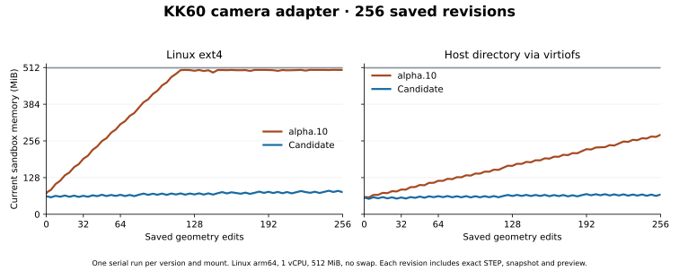

# 连续保存 256 个几何版本的内存

Colocad 的 Linux 候选版 `0.1.0-alpha.11-rc.1` 在 KK60 转接板连续改图任务中降低了整组沙箱内存。Linux ext4 上峰值从 **512.0 降到 94.9 MiB**，宿主机共享目录上从 **288.3 降到 84.8 MiB**。项目仍然保留 260 份几何版本，占用约 905 MiB 磁盘。

| 文件系统 | 第 128 版当前内存，alpha.10 → 候选 | 第 256 版当前内存，alpha.10 → 候选 | 候选版后 128 次净增 | 256 版整场耗时，alpha.10 → 候选 |
|---|---:|---:|---:|---:|
| Linux ext4 | 500.7 → 69.3 MiB | 503.6 → 77.1 MiB | 7.8 MiB | 162.4 → 161.7 秒 |
| Colima 的 virtiofs 宿主机共享目录 | 169.0 → 63.8 MiB | 277.4 → 68.7 MiB | 4.9 MiB | 161.0 → 162.9 秒 |

两类挂载均采用同一 Linux arm64 镜像、同一个 CPU 核、512 MiB 内存、无交换。正式配对串行执行，每格一个完整会话；各次共享系统缓存的起点可能不同。表中内存取每个 edit 返回后的 `memory.current`，峰值另读 `memory.peak`。耗时包含沙箱启动、四个前置成功版本、拒绝错件、256 次改图和分页重开，独立回读另行执行。alpha.10 在 ext4 上触及内存限额后仍交付了全部版本。

在本机 Abelien runner 镜像中运行同一候选安装包，单独重复 256 次改图，测得峰值 **125.2 MiB**，第 128 → 256 版当前内存 **98.8 → 106.8 MiB**，OOM kill 为 **0**。这次计量覆盖 SDK、原生目录工具和几何内核。另在原基准镜像独立重跑 ext4，峰值 **94.5 MiB**，OOM kill 为 **0**。

**修复发生在提交几何版本时。** SQLite 记录被替换的上一版。新版本完成文件同步并成功提交后，Rust 会话目录工具对旧版输入、回执、几何检查点、网格和导出文件的干净页发出 `POSIX_FADV_DONTNEED`。当前版本已写完的 STEP、STL、GLB 也可以释放文件页。下次改图或查询会读取的当前检查点和快照保持可用。每次提交只处理一个被替换的版本。失败或单纯查询不会替换当前几何。[实现](https://github.com/Coloopx/colocad/blob/main/crates/session-catalog/src/revision_cache.rs)

共享目录下，候选版在第 128、256 版的文件页分别是 **35.05、35.06 MiB**，同期内核内存从 **5.41 增至 8.77 MiB**。ext4 上的文件页为 **41.88、44.28 MiB**。每次新增版本仍会增加文件和文件系统元数据，持久化索引自身也占磁盘。这个实验验证了 256 版范围内的实际内存预算，尚未建立总内存随历史长度增长的渐进上界。单个大实体的内核工作集由几何复杂度决定，本次运行使用同一几何内核二进制。

**几何和可恢复性验收**使用同一 KK60 滑台和相机板，固定两个实体、孔数和特征数，每版改变板厚和相机孔距。独立 OCCT 对 256 份不同 STEP 逐一验证了实体有效性、体积、安装孔和相机孔、盲孔底、走线窗口、接触和重叠。四场正式配对的每一版均匹配对应 STEP 的 SHA-256；每场重开了 260 个成功版本、校验 4,416 个产物摘要，并在六个历史快照中重新量出了当时的孔距。另修复了 Linux 容器中僵尸进程 PID 造成的旧项目恢复误报 `SESSION_BUSY`。[实验任务](field-history.zh-CN.md) · [逐版证据](benchmarks/revision-cache/results.json)

验收前设定的资源线为峰值 ≤256 MiB，后 128 次当前内存净增 ≤16 MiB。只在换版后释放旧文件页的首轮方案在 ext4 上净增 **25.5 MiB**，未过线；最终方案的两类挂载均通过。报告和证据保留该首轮结果。两项内存指标应同时读，已经贴着 512 MiB 限额的曲线也可能平坦。[验收标准与复现](https://github.com/Coloopx/colocad/blob/main/benchmarks/field-task/README.md) · [English](revision-cache.md)
