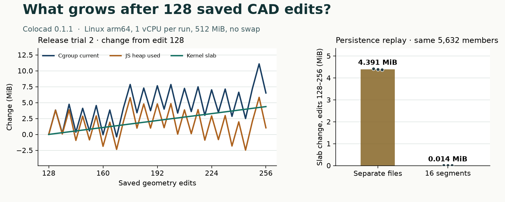

# Colocad 0.1.1 连续改图的内存增长从哪里来

**优先改历史几何的物理存储布局。** KK60 连续改图时，每版为源文件、回执、精确几何、检查点、查询快照及预览留下 22 个文件。正式版三轮在第 128～256 版的 Linux slab 增量都在 **4.35～4.39 MiB**。只重放同一批产物的持久化，散文件复现了 **+4.39 MiB**，改为每 16 版一个分段文件后降到 **+0.014 MiB**。第二个优化点是 SDK 对含内嵌 STEP 的模型反复解码、编码和哈希，主要影响短时波动及分配量。

## 先核对原图

从 0.1.1 正式版封存的三轮原始记录提取同一会话第 256 版减第 128 版的差值。每轮都是 1 vCPU、512 MiB、零交换，在独立 Linux 原生卷上持久化真实几何。下表单位均为 MiB。slab 是 kernel 的一部分，JS 堆反映在进程匿名内存中，不能把各列直接加总。[正式版实验](benchmark-stable.zh-CN.md) · [逐点数据](benchmarks/revision-memory-attribution/evidence.json)

| 正式版轮次 | cgroup 当前内存 | 匿名页 | 文件页 | 内核内存 | 其中 slab | JS 已用堆 |
|---|---:|---:|---:|---:|---:|---:|
| 1 | +9.09 | +3.70 | +0.86 | +4.52 | +4.39 | +3.94 |
| 2 | +6.51 | +1.55 | +0.55 | +4.42 | +4.37 | +1.04 |
| 3 | −3.57 | −7.63 | +0.22 | +4.04 | +4.35 | −8.22 |

原图的 **+6.5 MiB** 是三个配对差值的中位数。第 3 轮的 cgroup 总量虽下降，slab 依旧在增长。按每四次提交的相邻采样计算，三轮中 JS 已用堆变化与 cgroup 当前内存变化的 Pearson 相关系数分别为 **0.998、0.999、约 1.000**。这里衡量图中可见的锯齿；两次采样之间的瞬时分配由 `memory.peak` 另计。

当前 catalog 已经使用 SQLite 的已接受版本索引。260 个已接受版本的数据库文件实测 **356 KiB**。每次提交只对被替换版本的已同步文件以及新导出的 STEP、STL、GLB 提示释放干净数据页。每个历史路径依然存在。slab 计数本身无法区分 inode、dentry 和其他内核对象，因此又做了下面的布局干预。[索引与提交](../crates/session-catalog/src/main.rs) · [旧版页面释放](../crates/session-catalog/src/revision_cache.rs)

## 用相同字节验证存储根因

从正式版第 1 轮截取 256 个编辑版本，共 **5,632 个成员、933,962,407 字节**。按照真实顺序逐版写入，两个写入器读取同一条顺序输入，都保留成员原名、长度、哈希和版本索引。散文件沿用原来的文件和目录层次，另一组将相邻 16 版追加在一个文件中。两组均逐成员 fsync、逐版同步索引并对已同步的数据页做同样的回收提示。每种布局各跑三轮，每轮创建新卷、轮换先后，在独立进程按索引重读全部成员并对照原始 SHA-256。这个实验只计持久化，几何构建和回读不在写入计时内。

| 每种布局三轮中位数 | 散文件 | 16 个分段文件 |
|---|---:|---:|
| 最终文件数，含实验索引 | 5,633 | 17 |
| 新建子目录数 | 770 | 0 |
| 后 128 版 slab 净增 | **4.391 MiB** | **0.014 MiB** |
| 后 128 版 cgroup 当前内存净增 | 5.957 MiB | 0.113 MiB |
| 后 128 版文件页净增 | 1.277 MiB | 0.035 MiB |
| 256 版写入时间 | 6.74 s | 11.67 s |

散文件实验中的 slab 增长几乎全部计入 `slab_reclaimable`。布局变更同时减少了文件和目录，实验支持“众多持久路径导致文件系统元数据缓存增长”，没有将 4.39 MiB 拆算到某一种内核对象。Linux 将可在压力下回收的 slab 单列，其中包括 inode 与 dentry 缓存。[内核 cgroup v2 指标定义](https://docs.kernel.org/admin-guide/cgroup-v2.html#memory-interface-files)。原图记录的是完整建模进程，**0.113 MiB 是存储重放值**。两种布局都没有压缩或者删除成员。

**同步策略对速度有实际影响。** 另做三对分段写入实验，只将段数据的 fsync 从“每个成员一次”改成“每版一次，在索引发布前完成”。逐成员分别为 **7.28 / 4.57 / 4.66 s**，逐版分别为 **2.17 / 2.00 / 7.91 s**。中位数 **4.66 → 2.17 s**，第三对出现反转。应在正常建模入口同时验收提交延迟和掉电恢复。

**旧版读取也做了原型验证。** 使用每版 8 字节的偏移表定位索引记录，按第 192、1、256、64、128、32 版的顺序取回成员，每次只物化指定版本的 3.45～3.51 MiB。六次均通过独立 OCCT 的实体、安装孔、窗口、体积、接触及干涉校验。正式版 SDK 从旧快照查询到的孔距依次为 25.5、16、28.75、19、22.25、17.5 mm，几何重建次数均为零。原型覆盖私有归档与单读者。生产 SDK 的路径兼容、读者租约和崩溃恢复仍需实现与验收。

## JS 堆为什么会上下跳动

额外完整跑了四个 256 版会话。两个 CPU 各跑自然 GC 和采样前强制 GC，顺序相反，所有进程使用相同的 Node 参数。**1,024 份编辑 STEP 独立回读通过**，四轮均通过全部产物哈希和六个历史快照查询，OOM 均为零。

- 自然 GC 时，后 128 版各采样点的已用堆最大值与最小值分别相差 **8.30、8.21 MiB**。采样前强制 GC 时变为 **0.08、0.09 MiB**。四轮的 slab 仍增加 **4.39～4.47 MiB**。这解释了锯齿，也说明强制 GC 不解决持久路径成本。
- 两条 CPU 通道共享宿主机。这四轮的文件页净变化范围是 **+0.11～+28.51 MiB**，明显大于正式版三轮的 **+0.22～+0.86 MiB**。诊断轮保留了这些读数，独立列出；它们不能用于重估首页的 91.3 MiB 峰值，也不能用 GC 干预结果来预测整个沙箱会释放多少内存。
- 对相同构件的 64 次真实参数编辑做 V8 分配采样，包含已经回收的对象。采样估计累计分配 **148.2 MiB**。按最近的包代码栈归属，`sourceFrom` 约 **37.2 MiB**，输入哈希、源 JSON 编码、预览缓存键、原生调用输入编码四条路径各约 **18.8～19.1 MiB**。五处合计约 **76%**。一个典型版本的源 JSON 就有 309,835 字节，其中同一份内嵌 STEP 占 301,728 字节。这些是采样估计的累计分配量；它们不会同时常驻内存。SDK 预览 Map 的上限已是 16 条。[源模型读取及持久化](../src/session.mjs) · [预览缓存键](../kernel/src/preview-cache.ts) · [原生调用输入](../kernel/src/client.ts)

## 旧几何的数据页还驻留吗

另外单独跑了一次完整 256 版会话，测量之后仍按同一标准独立回读。第 128～256 版 slab 增加 **4.35 MiB**，文件页增加 **0.14 MiB**，JS 已用堆下降 **6.55 MiB**，总量下降 **1.43 MiB**。在任何历史回读前，逐一用 Linux `mincore` 检查被替换的 **5,694 个文件**，当时可见的驻留数据页为 **0**。对这些文件再次执行干净页释放提示，驻留数据页仍为 0。当前 head 的 22 个文件合计驻留 2.33 MiB，SQLite 文件驻留约 0.34 MiB。该观测支持保留现有旧版页面释放逻辑；无法从一次观察定位另四轮共享宿主时每个活跃文件页的归属。历史文件即使没有驻留数据页，路径所产生的内核元数据仍可能占用内存。

## 下一版的实施顺序

1. **先改历史几何的写入单位。** 活动版本及仍被读者持有的版本维持正常读取；历史成员按提交追加到有大小上限的段。用现有 SQLite 索引保存 revision、成员名、段、偏移、长度与 SHA-256，支持定点读取。首个原型以 16 版分段，生产切段还要限制字节。优先直接写入段或复用已有数据，逐版验证“先生成散文件再后台搬运”能否得到同样收益。读索引、导出 STEP、历史快照查询都要走同一套解析逻辑。需要真实路径的现有调用方，通过有界的按需物化入口和生命周期管理取得工件。保持旧 session 可读。
2. **把一次几何提交做成一个耐久边界。** 先写完该版成员并同步段，创建新段时同步父目录，再用事务原子发布索引和 head。恢复时辨别无索引的尾部、截断和校验失败，避免误删其他写者和读者可达的数据。给并发读、旧版正在查询、ENOSPC、各持久化边界进程被杀等情形做故障注入。每个已确认版本必须能重新打开。
3. **降低每次改参的 JS 分配量。** 先在 SDK 内复用一次提交已经校验的源字节，供哈希、持久化与原生输入消费。对不可变外部 STEP 使用内容地址引用，独立导出源文件时物化完整输入。预览键继续覆盖全部影响几何和网格的参数，同名资产换内容、缓存失效、损坏源和过期快照均需回归。先用同一 V8 探针验证分配是否下降，再看耗时与总峰值。全局强制 GC 仅用作诊断。

**建议立项门槛。** 在相同公共基线和原验收器上至少跑五对串行、交替顺序的完整会话，分别报告全程峰值、提交后当前值、slab、文件页、堆以及每次提交 p50/p95。目标为第 128～256 版 slab 增量中位数 **≤1 MiB**、当前内存配对增量中位数 **≤3 MiB**、峰值和提交 p95 相对同机基线回退 **≤5%**。这三项均为拟定门槛。扩展到 512、1,024 版时，保留原来前 256 版和验收公差，后续继续生成互不相同、孔距仍处于实体内的合法尺寸。分别验收普通保存、撤回、替换件、任意旧版重开和多读者的峰值。全部 STEP、收据、快照、网格和断电恢复验收通过后，再更新主页结论。当前数据仅能量化测试区间，无法证明总沙箱内存具有对数复杂度。[实验脚本与复现方法](../benchmarks/revision-attribution/README.md)

## 分段写入修复与最终复测

修复已接入 CLI 的建模提交和 SDK 的 `storage: 'segmented'`，每次成功改图后将被替换版本的全部成员分段存储。最终源码和 npm 0.1.1 在同一 CPU 上串行复测。第 128～256 次改图的 slab 净增从 **+4.35 MiB** 变为 **+0.08 MiB**，整个沙箱净增从 **+1.09 MiB** 变为 **-0.45 MiB**。保存后文件数从 **5,719** 降至 **42**，完整提交 p95 从 **631 ms** 变为 **641 ms**。该轮两边各 256 份 STEP 均通过相同的独立 OCCT 验收。前五对开发版对照及其与最终源码的差别另列。这里修复的是成功几何版本持续占用文件系统元数据的问题。[实测曲线、各轮数值和验收边界](benchmark-segmented-sessions.md) · [SDK 与 CLI 的历史版本取回用法](indexed-sessions.zh-CN.md)。
