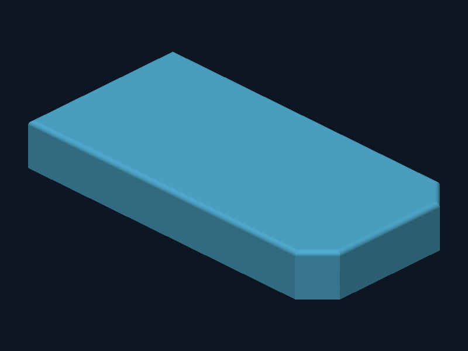
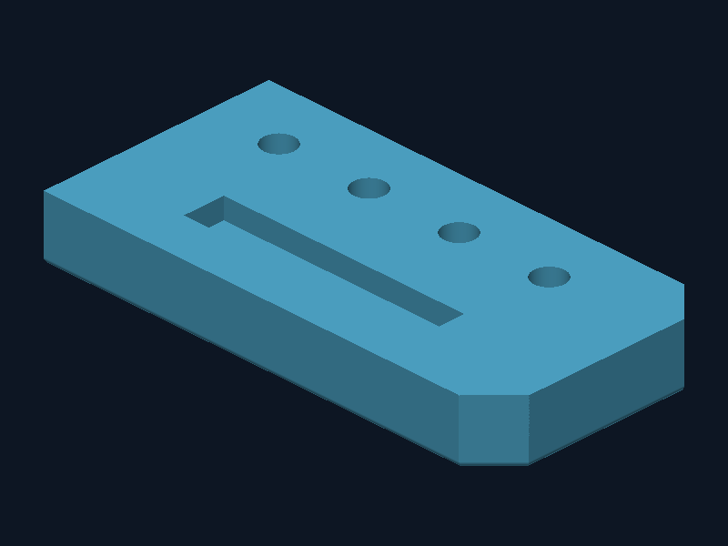

# Release validation

## UV trim validation metric

Native execution enables SolidCore's `uv_trim_checks_on_surface` check. A UV parameter difference is not a millimetre distance: an unchanged physical hole can have arbitrarily small trim coordinates after a surface is reparameterized. The check evaluates eligible UV-trim curvature and internal control-point spacing using the supporting surface's first fundamental form. The same execution kernel is used by single-body, early assembly-part and cached-body validation. The enabled fix is listed in `kernel.upstream_fixes` in capabilities and build receipts.

The metric map is exact for an affinely parameterized planar patch. For a non-affine planar patch or a regular nonplanar surface it uses a local metric at the trim midpoint, with the existing surface-domain-centre fallback; it is not a global arc-length certificate. If a metric is unavailable, the original trim check or its error is retained. Three-dimensional curve checks, distance-gap tolerances, loop/topology checks and the Level-1/manifold gates are unchanged. This does not introduce a relative gap allowance, repair source geometry, or establish manufacturing accuracy.

`crates/agent-cad/tests/uv_trim_metric.rs` generates a nominal 20 × 20 × 6 mm block with a radius-1 mm through bore. Only the planar end faces and their UV trims are affinely reparameterized to `[0, 1e-5]²`; 3D edge curves, vertices and stored tolerances are retained. Before the fix, both public part and assembly builds reject its STEP with `SmBSplineCurve` test 15 (coincident control points). The regression checks successful build and STEP readback, a real 0.01 mm endpoint-gap rejection, wrong outer-loop rejection, singular-metric fallback, unchanged faulty 3D-curve checks, and sphere poles/cylinder seams. Additional regressions exercise two independently released terminal definitions, real terminal import and translated-result checkpoint cache hits, conservative intermediate fallback, and a genuinely collapsed UV span rejected by test 15 with a regular metric. The checked-in `uv-rescaled-plate.step` fixture also exercises the public JavaScript SDK and official readback template.

Eligible terminal-assembly validation reuses the existing conservative rational-quadratic certificate on the actual metric-mapped curve. It independently bounds that curve's speed and curvature radius using its unchanged mapped tolerance; the raw UV certificate is not a physical-curvature certificate. Failed sizing or bounds, unsupported curves, cancellation and stricter status/zero-speed-end policies retain the original solver. The hash-locked extension and Docker application are described in [the downstream patch notes](../third_party/patches/README.md). Regression controls include skewed and rescaled planes, an ordinary UV circle flattened into a physically sharp ellipse, alternating surface metrics, cancellation and a multi-span kink.

The public performance driver uses `native build --out NEW_DIRECTORY` with no checkpoint, query or preview flags. It verifies actual output files, literal geometry, STEP digests and one source parse with cache hits. It interleaves one warmup and three measured fresh-process runs per binary on the 32-part public reproduction and an ordinary ten-part control. Supply explicit release executables for metric off, metric on before optimization and metric on after optimization:

```sh
UV_METRIC_OFF_BINARY=/absolute/path/to/off/agent-cad \
UV_METRIC_BEFORE_BINARY=/absolute/path/to/before/agent-cad \
UV_METRIC_AFTER_BINARY=/absolute/path/to/after/agent-cad \
UV_METRIC_PERF_OUT=/absolute/path/to/new-results \
node test/validation/uv-metric-performance.mjs
```

The driver preserves process arguments, raw stdout, receipts and STEP hashes before geometry assertions. A benchmark using an instrumented executable must separately record that instrumentation and use an uninstrumented production executable for correctness tests. Timing results from different hosts are not directly comparable.

Windows/WSL2 review validation against upstream 0.1.1 (`4124bcb`): all 181 Rust tests across 33 executables, the five UV/vendor-chain SDK tests and SDK/consumer type checks pass. The full serial SDK run is **92 passed / 1 failed**: the streaming migration's `SESSION_BUSY` at `session-catalog.test.mjs:155` also fails on the archived, unchanged 0.1.1 session sources with the byte-identical catalog executable. It is retained rather than reported as an all-green suite. Warm default-release compilation and the complete native runtime each pass at 2 CPUs / 3 GiB / swap 0; this is not a cold-compile memory claim.

Independent read-only `replicad-opencascadejs@1.2.1` checks all four saved UV source/export files: valid one-solid geometry, literal 20 × 20 × 6 mm bounds, equal source/output measured volume within 1e-6 mm³ and all 16 material probes. Its pinned WASM SHA-256 is `a9335919fa64bfeaee3e241d3139ad134022682429c6688e20d8ca12093d33d9`. The material probes use exact solid/point distance and `InnerSolution`; the reduced WASM does not expose `BRepClass3d_SolidClassifier`. The nominal-volume audit keeps the published Python audit's 0.001 mm³ criterion. An additional 1e-8-relative nominal-volume check fails on the **source itself**: default OCCT integration reports 2381.1506875064147 mm³ versus ideal 2381.150444078461 mm³, identically for the exports; adaptive GK integration also misses that additional target. These stricter diagnostic failures are retained, and are not claimed repaired by the UV optimization. Native tolerances and rejection policies are unchanged.

Review performance control on Windows/WSL Linux x64 (2 CPUs / 3 GiB / swap 0): three distinct, uninstrumented default-release executables use the exact frozen #3/#6/#12/#14 integration (`bd5a552`). Every variant's complete dependency tree was matched to a fresh pinned archive plus its locked patches, including file modes and symlink targets. All 24 fresh-process builds passed; the table uses three measured samples after one warmup, interleaved between variants, with no checkpoint/query/preview flags and no other owned test lanes running.

| Public model / median milliseconds | Metric off | Metric on, before optimization | Metric on, optimized |
|---|---:|---:|---:|
| 32 drilled blocks: wall | 510.220 | 993.546 | 516.165 |
| 32 drilled blocks: Level-1/manifold | 109.827 | 593.187 | 114.189 |
| Ordinary ten-part assembly: wall | 158.280 | 291.117 | 152.085 |
| Ordinary ten-part assembly: Level-1/manifold | 28.866 | 168.740 | 28.436 |

The 32-block geometry stage remains 138.439 / 141.161 / 141.083 ms respectively, with one parse and 31 hits in every run. The ordinary control combines five public drilled blocks and five cylinders; it is not the private StackChan or Watcher workload. Independent pinned OCCT accepts all six representative output STEPs with literal solid counts, volume and world bounds. All three variants also produce byte-identical STEP files within each model. This is a same-host resource control, not a cross-platform speed guarantee or global material-equivalence certificate.

The off/before/after executable SHA-256 values are `9df112faac198aa93fa8135d0719056655ba50a3d3836339f63193a6677a3fa4`, `2325089431d61e9e5c397662a76afa49caed4764a7a650bee9c3db2308fc4f6e` and `a3a246472502dfd8cfd13fbc21e69f8ae4e7d7af51ed3dba13b704116ef04af9`. The separately tested latest-main production executable is `c91ac69ba62e511caddcb029566d7ad5e2b47b89abb43f1831d3abe859b920a6`; the benchmark is bound to its original four-PR comparison source rather than presented as another full-suite run.

Run the native and SDK regressions against a freshly built executable:

```sh
npm run build:kernel
cargo test --locked -p agent-cad --test uv_trim_metric
node --test test/uv-trim-metric.test.mjs
# Requires OCP (cadquery-ocp); use a new output directory.
python test/validation/uv-trim-metric.py --native kernel/native/darwin-arm64/agent-cad --output out/uv-independent
```

Choose the matching Linux/macOS native path for your host. The independent audit verifies STEP validity, one solid, equal source/output volume and inside/outside probes; its volume/probe checks are audit tolerances, not changes to the native validation policy.

[Alpha.9 release evidence](evidence/release-alpha.9.json) · [new comparative measurements](benchmark-alpha9.md). The version-specific runs below are historical.

The same public build API compiled the two different feature trees in `examples/`. The manifold has one solid with 27 faces and 54 edges. OCCT read its STEP as a valid solid with volume 45,490.923866 mm³. Reducing the blind-port count from four to three restored 226.194671 mm³, matching π × 3² × 8. The rail has rectangular through-slots patterned along Y. Removing one slot restored 405 mm³. The validation script also probes points within and outside the blind ends, the pocket, and the fillet.



The native Windows author compiled against SOLIDWORKS 2024 interop 32.1.0. Runtime creation, feature edit, force rebuild and reopen in the vendor application remain unverified.

The Linux file-format experiment started with a synthesized envelope containing no part geometry or feature tree. On an empty source the pinned Rust encoder refuses synthesis without retained signature tokens. Providing a minimal envelope allowed a cube to round-trip as one solid with six faces. For the actual manifold, its exported STEP contains 54 explicit trim ranges. Of these, 32 are lines delimited by their vertices, 8 are closed full circles and 14 are clamped full-domain NURBS. Checking that the endpoints and natural domains agree permits equivalent vertex-delimited geometry. The experimental re-read then recovered one solid, 27 faces, 54 edges and zero neutral validation findings. This result contains a geometry partition only. Editable fillet selection ownership and native feature-pattern seed references still need to be serialized and independently proven. The CLI intentionally does not release these experimental bytes as an editable part.

The packaged npm archive was installed offline and invoked through the sandbox-local Pi bash tool in an Abelien Linux arm64 runner limited to 1 vCPU and 512 MiB. In the [scoped 0.1.0-alpha.2 run](evidence/scoped-runner.json) the manifold build with preview took 272 ms, the rail 84 ms and the pattern-count edit 181 ms. These are single tool-call wall times. The full cgroup peak includes the offline npm install, cache and files staged on tmpfs. See the JSON receipts in [evidence](evidence/).

We also tested the first two manifold operations with a freshly generated, matching B-rep and a sketch graph compiled directly from the same job. The independent decode of the experimental bytes recovered seven sketch entities across two sketches, one extrusion and one cut. The native operation-class and driving-scalar counts were both zero. Adding the rim fillet to the full graph produced a native encoder refusal at the edge-selection group. The records are in [native-prefix.json](evidence/native-prefix.json) and [native-full-refusal.txt](evidence/native-full-refusal.txt). These are file-format diagnostics, with no claim of successful rebuild in SOLIDWORKS.

The fillet selector separately found all six intended edges in the B-rep recovered for the state immediately preceding the fillet. Both adjacent faces and both endpoints are recorded for each edge. Mapping those input-state identities to persistent SOLIDWORKS operands remains open. In a second diagnostic without the fillet, file readback recovered the linear pattern (four instances along X at 18 mm pitch) and its link to the port-cut seed. Its native operation-class and driving-scalar counts were still zero. See [input-state edges](evidence/historical-selection.json) and [pattern diagnostic](evidence/native-pattern.json).



## npm release 0.1.0-alpha.3

The [archive checks and independent STEP measurements](evidence/release-alpha.3.json) cover macOS arm64, Linux arm64 and Linux x64. Both Linux installations ran offline with 1 vCPU and 512 MiB. The x64 check used an emulated x64 environment and exercised the x64 Node executable and native kernel. Each installation used the packaged CLI to build a manifold and the bundled skill to build a six-hole plate, a sleeve pair and a complete 43-solid hand. OCCT reopened all twelve STEP files. The hand report counted 21 measured instances and 22 translated reuses on each platform.

For a release, stage the three tested executables and their manifests under `kernel/native/<platform>/`. Record the corresponding SHA-256 values and npm version in `kernel/release.json`. The `prepack` check rejects missing executables and hashes that differ from the recorded build. Run `npm pack`, install that tarball in an empty consumer project on each platform, and run `node /path/to/checkout/test/validation/packed.mjs` from that project. Provide the hand model JSON as an optional argument to exercise all 43 occurrences. Publish that tested tarball directly.
