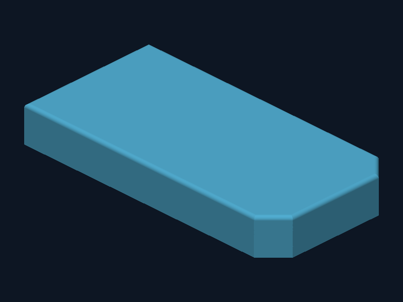
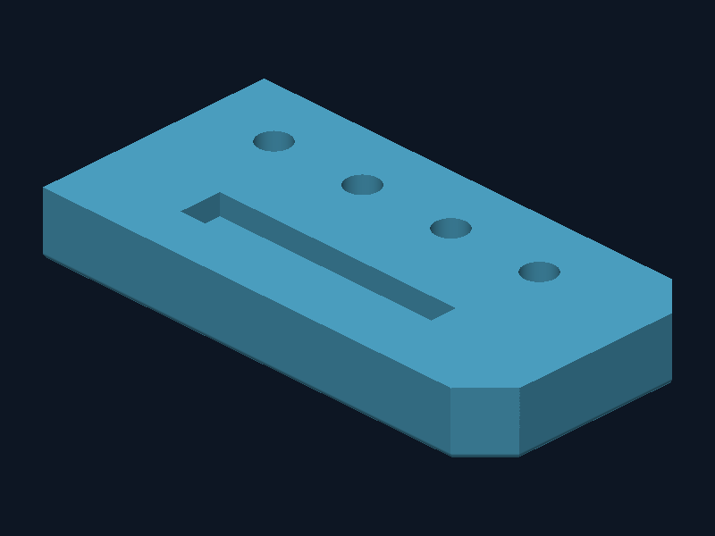

# Release validation

The same public build API compiled the two different feature trees in `examples/`. The manifold has one solid with 27 faces and 54 edges. OCCT read its STEP as a valid solid with volume 45,490.923866 mm³. Reducing the blind-port count from four to three restored 226.194671 mm³, matching π × 3² × 8. The rail has rectangular through-slots patterned along Y. Removing one slot restored 405 mm³. The validation script also probes points within and outside the blind ends, the pocket, and the fillet.

The native Windows author compiled against SOLIDWORKS 2024 interop 32.1.0. Runtime creation, feature edit, force rebuild and reopen in the vendor application remain unverified.

The Linux file-format experiment started with a synthesized envelope containing no part geometry or feature tree. On an empty source the pinned Rust encoder refuses synthesis without retained signature tokens. Providing a minimal envelope allowed a cube to round-trip as one solid with six faces. For the actual manifold, its exported STEP contains 54 explicit trim ranges. Of these, 32 are lines delimited by their vertices, 8 are closed full circles and 14 are clamped full-domain NURBS. Checking that the endpoints and natural domains agree permits equivalent vertex-delimited geometry. The experimental re-read then recovered one solid, 27 faces, 54 edges and zero neutral validation findings. This result contains a geometry partition only. Editable fillet selection ownership and native feature-pattern seed references still need to be serialized and independently proven. The CLI intentionally does not release these experimental bytes as an editable part.

The packaged npm archive was installed offline and invoked through the sandbox-local Pi bash tool in an Abelien Linux arm64 runner limited to 1 vCPU and 512 MiB. In the [scoped 0.1.0-alpha.2 run](evidence/scoped-runner.json) the manifold build with preview took 272 ms, the rail 84 ms and the pattern-count edit 181 ms. These are single tool-call wall times. The full cgroup peak includes the offline npm install, cache and files staged on tmpfs. See the JSON receipts in [evidence](evidence/).

We also tested the first two manifold operations with a freshly generated, matching B-rep and a sketch graph compiled directly from the same job. The independent decode of the experimental bytes recovered seven sketch entities across two sketches, one extrusion and one cut. The native operation-class and driving-scalar counts were both zero. Adding the rim fillet to the full graph produced a native encoder refusal at the edge-selection group. The records are in [native-prefix.json](evidence/native-prefix.json) and [native-full-refusal.txt](evidence/native-full-refusal.txt). These are file-format diagnostics, with no claim of successful rebuild in SOLIDWORKS.

The fillet selector separately found all six intended edges in the B-rep recovered for the state immediately preceding the fillet. Both adjacent faces and both endpoints are recorded for each edge. Mapping those input-state identities to persistent SOLIDWORKS operands remains open. In a second diagnostic without the fillet, file readback recovered the linear pattern (four instances along X at 18 mm pitch) and its link to the port-cut seed. Its native operation-class and driving-scalar counts were still zero. See [input-state edges](evidence/historical-selection.json) and [pattern diagnostic](evidence/native-pattern.json).

