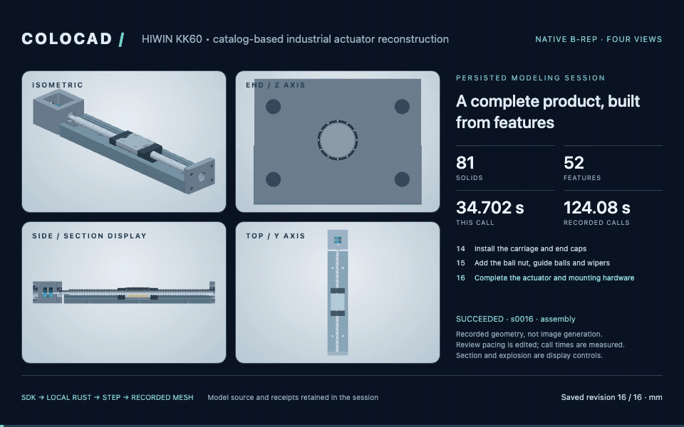

# HIWIN KK60: a whole industrial actuator reconstructed from its catalog

This example models one complete configuration of a real product: **HIWIN KK60 standard, 5 mm screw lead, 300 mm rail, one normal A block, open, without a motor or switches**. It contains 52 native geometric features, 81 named occurrences and 16 recorded construction/assembly milestones. The product is a catalog-based reconstruction, not an OEM manufacturing model.



[MP4](../../showcase/hiwin-kk60/modeling.mp4) · [Editable generated model](../../showcase/hiwin-kk60/model.json) · [Independent verification](../../showcase/hiwin-kk60/verification.json) · [Source dimensions and assumptions](sources.json)

## Build, view and export through the CLI

From a source checkout with `npm ci` (precompiled native executables must be installed or `npm run build:kernel` run):

```sh
node examples/hiwin-kk60/run.mjs ./out/hiwin-kk60
node bin/colocad.mjs view ./out/hiwin-kk60/session
node bin/colocad.mjs replay ./out/hiwin-kk60/session ./out/hiwin-kk60/review.html

# Optional movie tools; CAD and HTML export do not require these.
npx playwright install chromium
# Install FFmpeg on the host, then:
node bin/colocad.mjs render ./out/hiwin-kk60/session ./out/hiwin-kk60/modeling.mp4 \
  --width 1280 --height 800 --fps 15 --seconds-per-step 1.25
node bin/colocad.mjs render ./out/hiwin-kk60/session ./out/hiwin-kk60/modeling.gif \
  --width 960 --height 600 --fps 10 --seconds-per-step 0.75
```

With the npm alpha.4 package, the generator is included under `node_modules/@coloopx/colocad/examples/hiwin-kk60/run.mjs`; the CLI is `npx colocad`. The generator requires a new output directory. It writes the actual per-stage sources/receipts/artifacts to `session/`, plus final `model.json` and `hiwin-kk60.step`. `replay` produces one self-contained HTML file, embedding meshes, source, receipts and final STEP. The interactive viewer supports four viewpoints, cutaway, explosion, part selection and the feature journal. Movie export is optional and runs locally; Chromium/FFmpeg have a separate resource cost from geometry builds.

The film shows the real intermediate B-reps: rail stock → guide grooves → six counterbores; saddle → nut seat → mounting pattern; stepped shaft → helical cuts; bearing plate and motor support → assembly. It does not interpolate or simulate machining. The final explode/reassemble segment changes displayed placements only. Recorded call times remain visible; the 26-second review is **not** a 26-second build or a build123d comparison.

## How the drawing became CAD in this example

The assistant downloaded the [manufacturer's catalog](https://hiwin.com/wp-content/uploads/2026/08/HIWIN-Ballscrew-Driven-Stages-Catalog-1.pdf), read the dimension table with `pdftotext`, rendered PDF page 25 with `pdftoppm`, and inspected enlarged drawing sections. The initial screw-axis interpretation was corrected from 15 to **23 mm** after inspecting SECTION A-A. The catalog was not passed to an automatic colocad image-to-CAD endpoint; no such endpoint is claimed.

The assistant then wrote [model.mjs](model.mjs): explicit cross-sections, feature dependencies, cutters and placements. That generator emits the same JSON schema accepted by a harness. `ModelingSession.build` executes each revision in the local Rust kernel. Rendering consumes the resulting saved meshes. This is an observed agent/tool workflow, not evidence that a trained image-to-CAD model reconstructed an arbitrary drawing autonomously.

The product's catalog interfaces are the acceptance target: rail length/width, carriage height, hole positions/depths, screw axis, total length and travel. [`sources.json`](sources.json) separates specified numbers, datum interpretations and approximated internals. The one exposed run-time parameter is `travel` (−105…105 mm); its screw rotation is linked at 72 degrees/mm. Other dimensions are explicit source constants or feature values; changing those requires rebuilding and rechecking interfaces. This is not a general KK-series configurator.

## Geometric details and verification

The screw's 56-turn groove is actual B-rep subtraction: four cubic lofted circular cutters per turn, repeated at 5 mm pitch. It is an approximation to a helical groove, not the proprietary gothic-arch race. The rail, carriage and motor support have real bores, counterbores, tracks, pockets and datum slots. Bolts include hex sockets. Repeated rolling elements share geometry definitions.

Run the independent verifier with a development Python environment containing `cadquery-ocp`:

```sh
python examples/hiwin-kk60/verify.py ./out/hiwin-kk60/session ./out/hiwin-kk60/verification.json
```

It reopens every successful STEP in OCCT, checks all solids, counts and volumes, probes the rail counterbores, carriage mounting holes and screw groove/crest, and measures selected rail/carriage overlap at −105/0/+105 mm travel. Tests in `test/kk60.test.mjs` also rebuild both carriage travel endpoints. The recorded result passed all 16 revisions and 64 material probes. Maximum relative volume disagreement was 0.002608%; the three selected rail/carriage overlap volumes were all zero. These checks do not certify every internal fit.

Unpublished rolling-element arrangement, bearing sizes, coupling details and nut recirculation are not recovered OEM specifications. The nut is an envelope with a screw bore; recirculation is omitted. Threaded holes are nominal bores; tolerance fits, load rating, fatigue, contact/preload and complete all-pairs interference are not certified. These limits are part of the delivered model, not hidden assumptions.

The first full assembly exposed a real library defect: internally generated STEP definitions above 100,000 records were rejected by the assembly writer. Alpha.4 separates the bounded internal export budget (1,000,000 records per definition) from the unchanged external import budget (100,000). A regression test and the full screw assembly cover this fix. The failed original attempt was retained separately during development; it is not counted as a successful build.

A complete build with a 640 × 480 preview also passed in a network-disabled Linux arm64 container limited to 1 vCPU and 512 MiB. Native reported total time was 24.192 seconds (one run). Peak memory was not sampled, and no build123d run was performed for this product. [Run evidence](../../showcase/hiwin-kk60/evidence.json).
