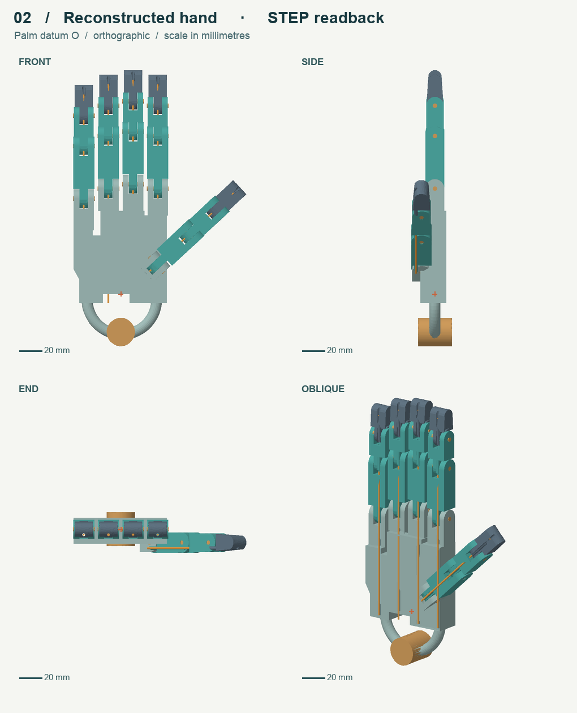

# A tendon-driven hand from one finger to a complete assembly

The 100-second modeling and assembly replay compares the optimized kernel with build123d and keeps sampled memory visible throughout. The two arms delivered **44 and 33** complete revisions. [Watch the 10-second race](window/hand-window-en.mp4) · [Timing and memory details](window/README.md)

[Watch the hand animation](replay/tendon-hand-en.mp4) · [Open the offline player and download the measured STEPs](https://github.com/Coloopx/colocad/raw/refs/heads/main/showcase/tendon-hand/replay/hand-replay.html)

The optimized source kernel delivers the full assembly in **2.24 seconds**, compared with **3.93 seconds** for the earlier published kernel and **3.34 seconds** for build123d in the same five-run test. The original measurements below describe the published alpha.2 binary. [Cause, change and independent readback](assembly-performance.md)

[Four reference views](reference/four-views.png) · [Four reconstructed STEP views](static/readback.png) · [Download CAD sources and paired exports](hand-study.zip) · [Raw latency and memory](evidence/scope.json) · [100-second delivery log](evidence/window.json)

This is a simplified reconstruction of the right Shadow Hand E3M5 using four scaled views. The [source and license](reference/NOTICE.md) identify the independent upstream model. The CAD builder reads no upstream CAD, meshes or joint transforms. It defines the wrist, palm sockets, four three-link fingers, angled thumb, pins and five illustrative straight neutral tendon paths. The hidden routes are assumptions: the result is neither the vendor's mechanism nor a tested prosthesis. No grasp, contact, fatigue, or manufacturability validation was performed.



**What held up against the images?** Projecting the STEP without refitting each camera gave silhouette IoU of 91.1% front, 83.0% side, 74.3% end and 91.1% oblique. The end view is the weakest match. The model has 43 solids. At z = 23 mm, OCCT measured the edited finger guide as Ø2.900 and Ø3.300 mm; the change removed 86.727 mm³ per proximal link. The Rust preview reused 20 unique mesh definitions across 43 occurrences. [STEP and mesh evidence](evidence/geometry.json)

## Try it with your agent

1. Install Node 22+ and the **project-local** SDK: `npm install @coloopx/colocad@0.1.0-alpha.2`.
2. In Codex request: `$skill-installer install https://github.com/Coloopx/colocad/tree/main/skills/colocad`. The [skill](../../skills/colocad/SKILL.md) guides the agent; it does not contain a CAD engine.
3. In the next turn, give the agent [four-views.png](reference/four-views.png) with: *“Use $colocad to reconstruct the wrist and five fingers as a named assembly. Give me an editable model, a STEP, and four projected views at the reference cameras. Mark the internal features you had to assume.”*

To replay the published editable model instead of asking an agent to reconstruct it again, use a copy of this repository in a fresh project that has the SDK installed. From the **consumer project**:

```sh
node /path/to/colocad/showcase/tendon-hand/model.mjs ./hand-models
node "${CODEX_HOME:-$HOME/.codex}/skills/colocad/scripts/assembly.mjs" ./hand-models/drive.json ./hand-build --preview
```

The helper prints the artifact directory containing `model.step`, `report.json` and the preview files. Every output directory must be new. For SDK-only integration, pass the same JSON object to `new CadClient({outputRoot: './outputs'}).build(model)` from `@coloopx/colocad/kernel`. Parameter changes belong in the JSON or [source model](model.mjs), not in the displayed mesh.

## Two different measurements

**First STEP and memory.** One warm-up then five new processes **and cgroups** per backend and workload, alternating order. Both use the same offline Linux arm64 image, 1 vCPU, 512 MiB, no swap, warm host caches and the same model JSON. Time is the median from launching the tool to it exiting with the STEP written; memory is the largest measured cgroup v2 `memory.peak`, including charged file pages, tmpfs outputs, the wrapper and descendants. It excludes a resident agent. Both writer implementations build features, place instances and run their own checks; they do not perform identical internal checks. The colocad arm uses the published npm package and the skill's SDK wrapper. The build123d 0.11.1 arm constructs the same geometry natively from the same features. No preview, LLM inference, container startup or install is timed.

| Work unit | colocad / build123d time | colocad / build123d peak | colocad share of peak |
|---|---:|---:|---:|
| Index proximal link, including both hinge bores and the tendon bore | 259 / 2,244 ms | 21.4 / 260.1 MiB | 8.2% |
| All 43 hand solids | 3,952 / 3,293 ms | 52.7 / 271.3 MiB | 19.4% |

Both paired STEPs were reopened in OCCT. They agree on solid count, per-occurrence bounds and integrated volume. Both directions of the finger boolean difference yielded 0 mm³. [Checks and file hashes](evidence/scope-checks.json)

**100 seconds of revisions.** In a separate experiment each tool got one serial 100-second window. Each revision built the *whole* hand from a fresh process, with a new guide or cord diameter from the same predeclared queue. Each writer handed its STEP to the same persistent store. The whole container stayed up, with an independent warm-up. No templates, previews, cached incremental builds or time extrapolation. This differs from a fresh cgroup for each observation in the table above.

- colocad delivered **24** revisions; build123d delivered **30**. For the first 24 matched inputs the job medians were **3.946 s / 3.058 s**. The deadline-crossing jobs were excluded.
- Every counted revision was reopened. Where the other lane had not reached a revision in time, it was replayed outside the clock only for comparison. Across 30 pairs, each contained 43 valid solids; maximum per-solid relative volume difference was below 7e-9, and maximum bounds difference below 1.1e-7 mm. The first pair also had zero measured difference volume in both boolean directions for all 20 unique definitions.
- In the matched colocad runs, the geometry phase took a median **0.318 s**; the assembly finishing phase labeled `validation` took **3.497 s**. That phase includes placement, per-instance validation, measurement and collecting STEP definitions. These are profiling leads, not a claim that all the time is spent in one check.

## Reproduce

```sh
# In the source checkout. The public alternative base is documented in benchmarks/readme/.
npm pack @coloopx/colocad@0.1.0-alpha.2
python3 showcase/tendon-hand/bench/scope.py abelien/runner:dev ./coloopx-colocad-0.1.0-alpha.2.tgz ./fresh-run
sh showcase/tendon-hand/bench/run.sh abelien/runner:dev "$PWD/coloopx-colocad-0.1.0-alpha.2.tgz" "$PWD/window-run"
```

For the public [Dockerfile](../../benchmarks/readme/Dockerfile.public), pass the resulting image name and `--python /usr/local/bin/python3` to scope.py, or `BASELINE_PYTHON=/usr/local/bin/python3` to run.sh. For independent readback use a build123d/OCP Python environment: `bench/check-scope.py fresh-run checks.json` and `bench/verify.py window-run path/to/drive.json path/to/consumer results.json`. For the latter the consumer project must have colocad installed; missing counterparts are rebuilt untimed.

The [CAD builder](model.mjs), [build123d implementation](bench/baseline.py), [four-camera preparation](tools/reference.py) and [neutral rendering](tools/projection.py) are separate. To regenerate the reference, supply the pinned upstream `shadow_hand/` directory to reference.py in a Python environment with MuJoCo, NumPy and Pillow. Reference artwork is distributed with its original [Apache license](reference/LICENSE).
